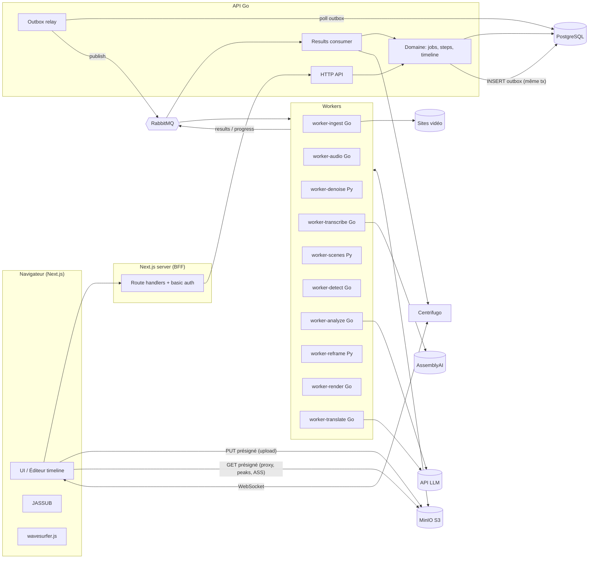
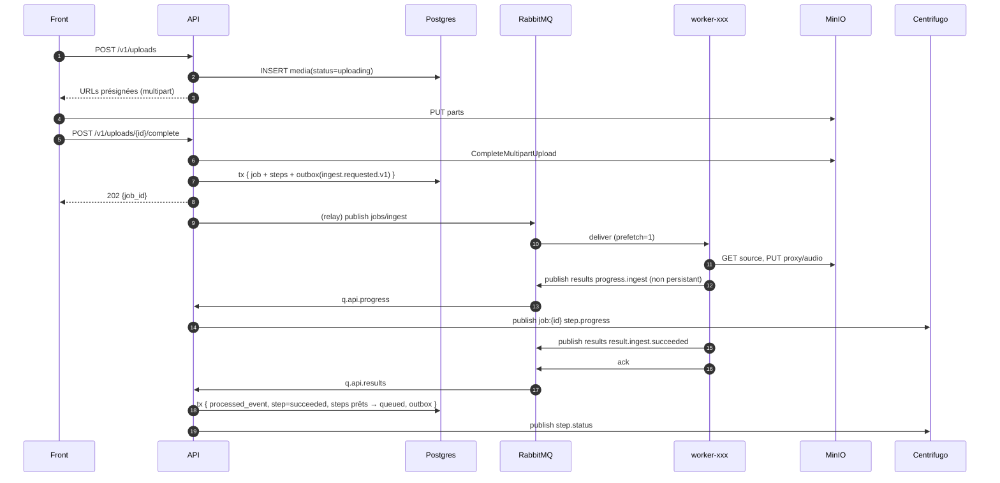
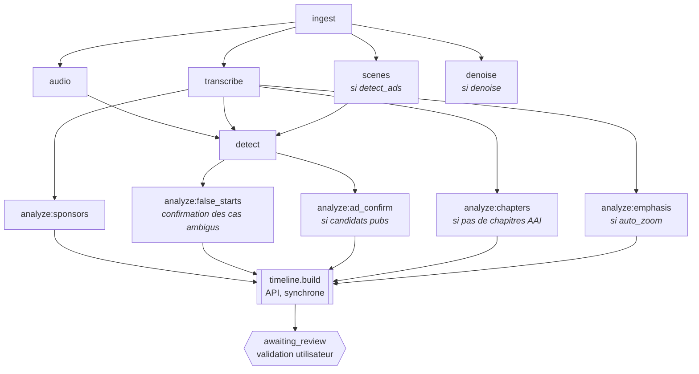
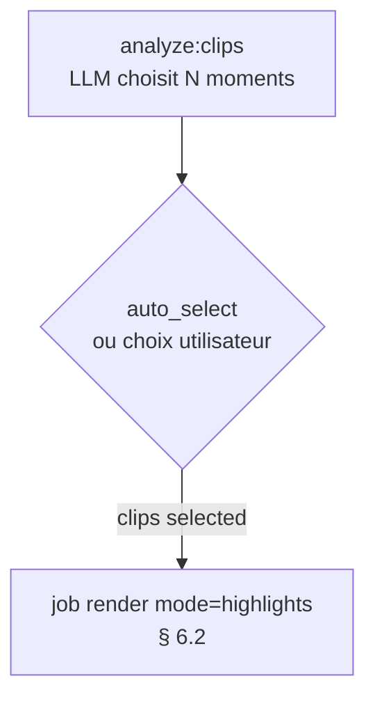
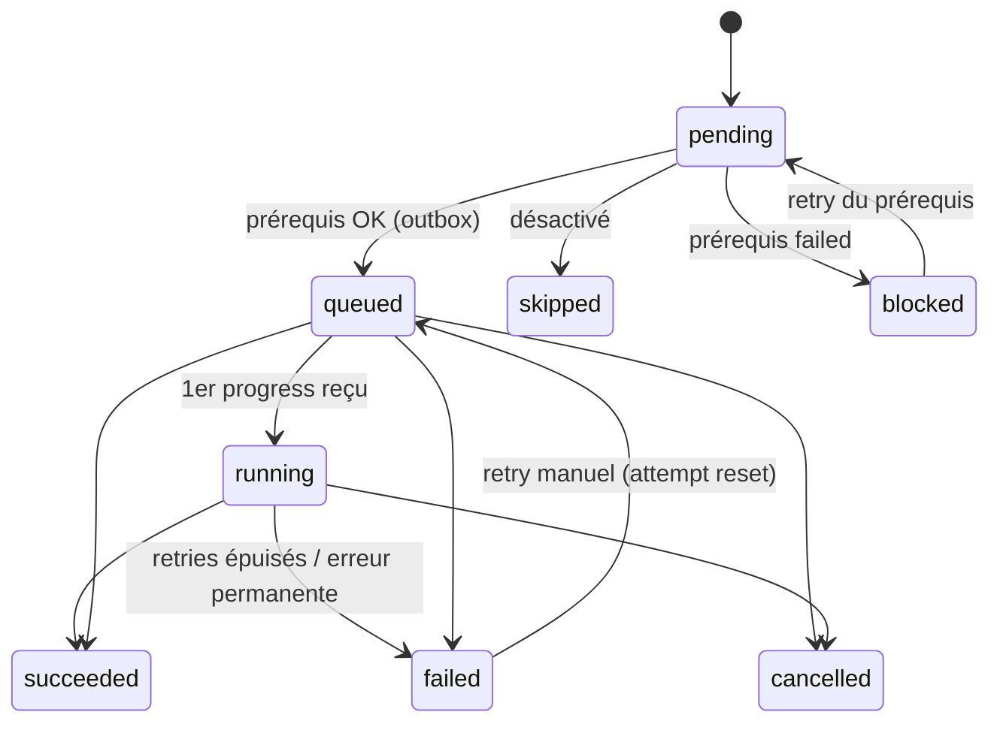
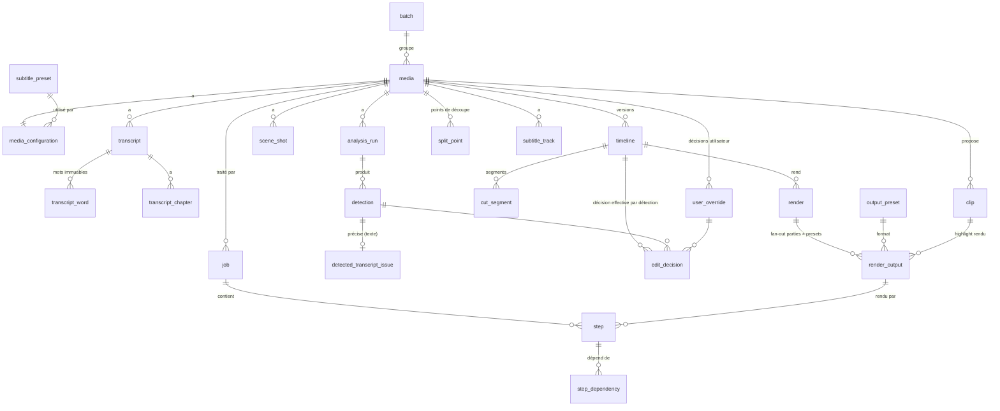

# Montage vidéo automatique — Spécification d'architecture

> Coupes intelligentes, sous-titres animés, timeline validée par l'utilisateur. En sortie : **des fichiers vidéo prêts à publier** (vidéo complète, vidéo découpée en plusieurs parties, ou highlights), jamais un projet de logiciel de montage.

| | |
|---|---|
| **Auteur** | Clément (avec Roo) |
| **Statut** | Spécification de référence, à implémenter étape par étape (§ 27) |
| **Stack** | API Go · workers Go/Python · RabbitMQ · PostgreSQL · MinIO (S3) · Centrifugo · Next.js (App Router) |
| **Usage** | Personnel, mono-utilisateur |
| **Date** | Novembre 2026 |

Conventions du document :

- **« à vérifier »** marque un point sur une API ou un outil tiers que je n'ai pas pu confirmer. Vérifie-le dans la doc officielle avant de coder dessus.
- Tous les temps sont des **entiers en millisecondes** (`*_ms`), sauf dans les commandes ffmpeg, qui prennent des secondes décimales.
- Deux repères temporels ne doivent jamais être mélangés :
  - **SourceTime** : position dans le fichier source ;
  - **OutputTime** : position dans la vidéo montée.
- Les noms de code (tables, champs, queues, routing keys) sont en anglais. La prose est en français.

---

## Table des matières

1. [Vision et périmètre](#1-vision-et-périmètre)
2. [Liste des fonctionnalités](#2-liste-des-fonctionnalités)
3. [Outils retenus et écartés](#3-outils-retenus-et-écartés)
4. [Architecture globale](#4-architecture-globale)
5. [Services et workers](#5-services-et-workers)
6. [Pipeline : DAG, fan-in, fan-out et ordonnancement](#6-pipeline--dag-fan-in-fan-out-et-ordonnancement)
7. [Topologie RabbitMQ](#7-topologie-rabbitmq)
8. [Contrats de messages (JSON versionnés)](#8-contrats-de-messages-json-versionnés)
9. [Modèle de données et DDL PostgreSQL](#9-modèle-de-données-et-ddl-postgresql)
10. [Stockage MinIO : buckets et nommage des clés](#10-stockage-minio--buckets-et-nommage-des-clés)
11. [API REST](#11-api-rest)
12. [Centrifugo : temps réel](#12-centrifugo--temps-réel)
13. [Transcription AssemblyAI](#13-transcription-assemblyai)
14. [Algorithmes de détection](#14-algorithmes-de-détection)
15. [Construction de la timeline](#15-construction-de-la-timeline)
16. [Précision des coupes](#16-précision-des-coupes)
17. [Pipeline de rendu ffmpeg](#17-pipeline-de-rendu-ffmpeg)
18. [Sous-titres animés (ASS, libass, JASSUB)](#18-sous-titres-animés-ass--libass--jassub)
19. [Highlights : sélection, recadrage, rendu](#19-highlights--sélection-recadrage-rendu)
20. [Fonctionnalités audio et vidéo additionnelles](#20-fonctionnalités-audio-et-vidéo-additionnelles)
21. [Sorties : modes de rendu et formats](#21-sorties--modes-de-rendu-et-formats)
22. [Front Next.js](#22-front-nextjs)
23. [Monorepo, docker-compose et configuration](#23-monorepo-docker-compose-et-configuration)
24. [Observabilité](#24-observabilité)
25. [Erreurs, retries et idempotence](#25-erreurs-retries-et-idempotence)
26. [Tests et sécurité](#26-tests-et-sécurité)
27. [Ordre de construction (jalons et critères d'acceptation)](#27-ordre-de-construction)
28. [Risques et questions ouvertes](#28-risques-et-questions-ouvertes)

---

## 1. Vision et périmètre

### 1.1 Vision

Je dépose une vidéo (upload ou lien), et l'outil :

1. détecte tout ce qui est à retirer : blancs, « euh », mots répétés, faux départs, passages sponsorisés et pubs ;
2. me présente une **timeline** où je valide ou refuse chaque coupe d'un clic, avec un aperçu instantané sans rendu ;
3. rend **en une seule passe ffmpeg** une vidéo propre, avec son normalisé, sous-titres animés (mot prononcé en couleur, effet « pop ») et zooms automatiques ;
4. propose des **highlights** : moments choisis par LLM, en 9:16 recadré sur le locuteur ou au ratio d'origine, avec bandeau d'accroche, titre, hashtags et miniature ;
5. livre **directement des fichiers média** selon trois modes au choix :
   - **vidéo complète** montée ;
   - **vidéo découpée** en plusieurs fichiers (par chapitres, par durée, par points de découpe posés sur la timeline, ou par scènes) ;
   - **highlights** (un fichier par moment, ou une compilation).

   Les formats se choisissent **à chaque rendu dans un catalogue**, sans aucun format coché par défaut : paysage (original, 720p, 1080p, 4K), vertical 9:16 (fond flouté « TikTok », suivi du locuteur, crop centré, bandes noires), carré, 4:5, et des variantes de conteneur (MP4 H.264 comme codec de base, WebM, MOV HEVC, GIF, audio seul). On peut créer ses propres formats. Les fichiers de sous-titres SRT/VTT/ASS peuvent être joints en plus des sous-titres incrustés. Tout se télécharge un par un ou en ZIP.

Il n'y a **aucun export vers un logiciel de montage** (FCPXML, EDL, OTIO…) : le produit fini, c'est le fichier vidéo.

### 1.2 Principes directeurs

| Principe | Conséquence |
|---|---|
| **La timeline est la source de vérité** | Le rendu, l'aperçu, les sous-titres et toutes les sorties (complète, parties, highlights) dérivent de la même timeline versionnée. |
| **Non destructif** | La source n'est jamais modifiée. Les mots de la transcription (`transcript_word`) ne sont jamais mutés. Les analyses vivent dans des tables séparées. |
| **Un seul rendu par fichier** | Pour chaque fichier de sortie, coupes, fondus, recadrage, zoom, sous-titres et loudnorm s'appliquent dans un seul graphe ffmpeg (plus une passe de mesure audio). |
| **Le livrable est un fichier média** | Les sorties sont des vidéos (ou GIF, ou audio) prêtes à publier, plus d'éventuels fichiers de sous-titres. Pas de projet pour un logiciel de montage. |
| **L'API possède l'état** | Seule l'API Go écrit en base. Les workers sont stateless, sans accès DB, et communiquent uniquement par RabbitMQ et MinIO. |
| **Jamais de vidéo dans le broker** | Les messages portent des références (`s3://…`), jamais de binaire. |
| **At-least-once partout** | Chaque handler est idempotent, avec une déduplication `(event_id, handler)` et des sorties à clés déterministes. |
| **Décisions stables** | Une décision utilisateur s'accroche à une **détection** (clé stable plus plage SourceTime), jamais à un `segment_index`. |
| **Tout dès le départ, testable pièce par pièce** | Le produit complet est spécifié ici, mais l'ordre de construction (§ 27) rend chaque pièce testable seule. |

### 1.3 Périmètre

**Dans le périmètre :**

- un seul utilisateur, avec une clé API statique et une basic auth sur le front ;
- des vidéos parlées (talking head, podcast filmé, tuto, vlog), des enregistrements TV pour la détection de pubs, et des vidéos longues pour les sponsors ;
- les langues prioritaires : le français, puis l'anglais ;
- un déploiement local ou home lab via docker-compose.

**Hors périmètre :**

- le multi-utilisateur, la facturation et Clerk (le schéma reste compatible avec un ajout ultérieur, voir § 28) ;
- le montage multi-pistes libre et l'export vers un logiciel de montage (Premiere, Final Cut, Resolve…) : l'éditeur se limite à la validation des coupes, des points de découpe et des highlights, et la sortie est toujours un fichier média rendu ;
- la publication automatique sur les réseaux sociaux.

**Usage légal de l'ingestion par lien :** réserve-la aux vidéos dont tu as les droits (tes propres contenus, ou des contenus sous licence le permettant).

### 1.4 Glossaire

| Terme | Définition |
|---|---|
| **Media** | Une vidéo source ingérée. |
| **Job** | Une exécution d'un pipeline sur un media (traitement complet, rendu, suggestion de highlights…). |
| **Step** | Une tâche unitaire d'un job, exécutée par un worker. Elle a des dépendances. |
| **Detection** | Une plage SourceTime candidate à la coupe (silence, filler…), avec un type, une confiance et une `stable_key`. |
| **Override** | Une décision explicite de l'utilisateur sur une détection, ou une coupe manuelle. |
| **Timeline** | Une liste ordonnée de segments `keep`/`cut` couvrant toute la source. Elle est versionnée. |
| **Clip (highlight)** | Un extrait court (15 à 90 s) choisi par le LLM ou à la main, rendu en 9:16 ou au ratio d'origine. |
| **Render** | Une demande de rendu : un **mode** (`full`, `split`, `highlights`) et un ou plusieurs **presets de sortie**. |
| **Partie (part)** | Une plage OutputTime à produire : la vidéo entière (`full`), une partie (`split`) ou un highlight. |
| **Preset de sortie (format)** | Une entrée du catalogue : conteneur, codecs, résolution, ratio, cadrage (crop, suivi, flou, bandes), qualité, sous-titres incrustés ou joints. Exemples : `landscape-1080p`, `vertical-blur`, `gif-480`. Aucun n'est sélectionné par défaut. |
| **Render output** | Un fichier produit, soit une partie rendue avec un preset (plus ses fichiers annexes : miniature, SRT…). Un render produit N parties × M presets fichiers. |
| **Point de découpe** | Une position posée sur la timeline (SourceTime) où la vidéo doit être scindée en mode `split`. |

---

## 2. Liste des fonctionnalités

Tout est dans le produit. La colonne **Jalon** renvoie à l'ordre de construction du § 27.

| Groupe | Fonctionnalité | Worker / composant | Jalon |
|---|---|---|---|
| **Ingestion** | Upload direct vers MinIO (multipart présigné, reprise possible) | API + front | M1 |
| | Ingestion par lien (yt-dlp) | worker-ingest | M1 |
| | Normalisation : proxy H.264 CFR à GOP court pour l'aperçu, extraction audio | worker-ingest | M1 |
| | Traitement par lot (plusieurs liens ou fichiers, même configuration) | API (`batch`) | M12 |
| **Analyse audio** | Waveform (pics JSON), enveloppe d'énergie RMS (10 ms) | worker-audio | M2 |
| | silencedetect, mesure loudnorm | worker-audio | M2 |
| | Débruitage (DeepFilterNet) | worker-denoise | M10 |
| **Transcription** | AssemblyAI : mots horodatés, diarisation, disfluences (à vérifier pour le FR), chapitres (à vérifier pour le FR) | worker-transcribe | M3 |
| **Détection** | Silences (audio et trous entre mots) | worker-detect | M4 |
| | Mots de remplissage (« euh », « hum »…, lexique FR/EN, niveaux dur/doux) | worker-detect | M4 |
| | Mots et groupes répétés (« je je », « on va on va ») | worker-detect | M4 |
| | Faux départs (phrase abandonnée puis reprise) | worker-detect (+ confirmation LLM) | M4 |
| | Sponsors (LLM sur le texte) | worker-analyze | M8 |
| | Pubs TV (PySceneDetect + blackdetect + silencedetect, score) | worker-scenes + worker-detect | M9 |
| | Chapitres (AssemblyAI, sinon LLM) | worker-transcribe / worker-analyze | M8 |
| **Édition** | Timeline versionnée, SourceTime ↔ OutputTime | API (domaine `timeline`) | M5 |
| | Validation de chaque coupe (garder ou couper), coupes manuelles | API + front | M6 |
| | Montage par le texte (barrer des mots = couper) | front + API | M6 |
| | Aperçu sans rendu (lecture qui saute les coupes) | front | M6 |
| | Écoute d'une coupe avec 1 s de contexte | front | M6 |
| | Calage des coupes sur l'énergie minimale, plus fondus de 10 à 20 ms | API (timeline) + worker-render | M5 / M7 |
| | Normalisation loudnorm (−14 LUFS par défaut) | worker-render | M7 |
| | Auto-zoom sur les mots forts (LLM ou heuristique) | worker-analyze + worker-render | M11 |
| **Sous-titres** | ASS animés : mot actif en couleur, « pop » d'échelle, presets de style | worker-render (génération ASS) | M7 |
| | Aperçu exact dans le navigateur (JASSUB) | front | M7 |
| | Traduction des sous-titres (LLM) | worker-translate | M12 |
| **Highlights** | Sélection des moments par LLM (score, titre, accroche) | worker-analyze | M8 |
| | Recadrage 9:16 avec suivi du locuteur (MediaPipe + diarisation) | worker-reframe | M10 |
| | Mise en page « split screen » pour deux locuteurs | worker-reframe + worker-render | M10 |
| | Bandeau d'accroche, sous-titres et re-rendu par highlight | worker-render | M8 |
| | Compilation « best of » (highlights concaténés dans un seul fichier) | worker-render | M8 |
| | Titres, descriptions, hashtags | worker-analyze | M8 |
| | Miniature (frame choisie + texte) | worker-render | M11 |
| **Sorties (fichiers)** | Mode `full` : la vidéo complète montée | worker-render | M7 |
| | Mode `split` : plusieurs vidéos, **par durée cible ou par nombre de parties** (configurable, avec tolérance), ou par chapitres, points de découpe manuels ou scènes ; bornes toujours calées sur une fin de phrase, une pause ou un point calme | API (planificateur de parties) + worker-render | M11 |
| | Mode `highlights` : un fichier par moment (9:16 ou ratio d'origine), ou une compilation | worker-render | M8 |
| | Catalogue de formats, **aucun coché par défaut** (au moins un à choisir par rendu) : paysage original/720p/1080p/4K, vertical 9:16 fond flouté (« TikTok blur »), suivi du locuteur, crop centré, bandes noires, carré et 4:5 (crop ou flou), WebM VP9, MOV HEVC, GIF ≤ 15 s, M4A audio seul | worker-render (`pkg/output`) | M7 / M10 / M11 |
| | Formats personnalisés (dupliquer un format ou partir de zéro : conteneur, codecs, résolution, ratio, cadrage, flou, qualité) | API + front | M11 |
| | Plusieurs presets en un seul rendu (par exemple MP4 1080p + vertical + GIF) | API (fan-out) + worker-render | M11 |
| | Fichiers annexes en option : SRT/VTT/ASS par partie et par langue, miniature JPG, métadonnées JSON (titre, description, hashtags) | worker-render | M7 / M11 |
| | Téléchargement fichier par fichier (URL présignée) ou ZIP de toutes les sorties d'un rendu | API | M7 / M11 |
| **Temps réel** | Progression par step (« transcription 60 % ») via Centrifugo | API + workers | M2 |
| **Optionnel (GPU)** | Upscale (Real-ESRGAN), doublage (TTS) | worker-upscale, worker-dub | M13 |

---

## 3. Outils retenus et écartés

### 3.1 Retenus

| Outil | Rôle | Où |
|---|---|---|
| **FFmpeg / ffprobe** | Le cœur : probe, proxy, extraction audio, silencedetect, blackdetect, loudnorm, coupes, crop, zoom, sous-titres (libass), encodage | ingest, audio, scenes, render |
| **yt-dlp** | Ingestion par lien, isolée dans worker-ingest | ingest |
| **AssemblyAI** | Transcription mot à mot, diarisation, disfluences, chapitres | transcribe |
| **API LLM** (fournisseur interchangeable) | Sponsors, faux départs ambigus, chapitres de secours, clips, titres/hashtags, mots forts, traduction | analyze, translate |
| **PySceneDetect** | Détection des coupes de plan, servant de signal de densité pour les pubs | scenes |
| **MediaPipe** | Détection et landmarks de visage pour le recadrage | reframe |
| **OpenCV** | Lecture des frames, calculs de crop et de flux | reframe |
| **libass** | Rendu des sous-titres ASS (via le filtre `ass` de ffmpeg) | render |
| **JASSUB** | libass en WebAssembly, pour un aperçu identique au rendu | front |
| **DeepFilterNet** | Débruitage de la voix | denoise |
| **wavesurfer.js** | Waveform et régions dans l'éditeur | front |
| **YOLO** (optionnel) | Sujet non humain (gameplay, objets). Licence AGPL. | reframe |

### 3.2 Écartés

| Raison | Outils | Explication |
|---|---|---|
| Remplacés par AssemblyAI | WhisperX, Whisper, whisper.cpp, stable-ts, pyannote.audio | AssemblyAI fournit déjà les timestamps mot à mot et la diarisation. Les garder reviendrait à maintenir un second moteur de transcription. |
| Doublons de FFmpeg | MoviePy, PyAV, Editly, auto-editor, pysubs2 | Ils enveloppent FFmpeg. Les silences se calculent à partir des timestamps et de silencedetect, et l'ASS est du texte simple à générer en Go. |
| Applications graphiques | OBS, LosslessCut, OpenCut, Kdenlive, Shotcut | Elles sont faites pour un humain devant un écran, pas comme briques headless. Elles restent utiles pour contrôler un rendu à la main. |
| Monolithe redondant | Anil-matcha/AI-Youtube-Shorts-Generator | Il couvre transcribe, analyze, reframe et render en un bloc. On s'en inspire (prompt, logique de crop), sans dépendance. |
| Lourds ou hors cœur | SAM 2, RIFE, Demucs | Gain nul pour du contenu parlé en 1080p. Demucs est archivé. |
| Pas de projet de montage | FCPXML, EDL CMX3600, OTIO | Le livrable est un fichier vidéo rendu, pas un projet à rouvrir dans Final Cut, Premiere ou Resolve. |
| En réserve | Remotion | Animations plus riches qu'ASS, mais il ajoute Node, un rendu plus lent et une licence à vérifier. Plan B si ASS devient limitant. |
| En réserve | Norfair, Supervision | Suivi multi-objets et lissage, seulement si le recadrage saute entre deux visages. |

---

## 4. Architecture globale

### 4.1 Vue d'ensemble



### 4.2 Processus côté API

Il y a un seul binaire Go, `api`, avec trois rôles activables par flag ou variable d'environnement. Le même code de domaine sert partout, et chaque rôle se scale indépendamment.

| Rôle | Commande | Responsabilité |
|---|---|---|
| `http` | `api serve` | API REST, presign, auth, rebuild synchrone de la timeline |
| `relay` | `api relay` | Lit l'outbox (`FOR UPDATE SKIP LOCKED`) et publie dans RabbitMQ avec publisher confirms |
| `consumer` | `api consume` | Consomme `q.api.results` et `q.api.progress`, met à jour l'agrégat, ordonnance les steps suivants (via l'outbox) et pousse vers Centrifugo |

En local, `api all` lance les trois dans le même process. C'est la reprise du schéma Uptime : outbox, relais, consumer de résultats.

### 4.3 Flux nominal (séquence)



---

## 5. Services et workers

### 5.1 Tableau des services

| Service | Langage | Queue consommée | Entrée (schéma) | Sortie (schéma résultat) | GPU | Durée typique (vidéo de 30 min) |
|---|---|---|---|---|---|---|
| `api` | Go | `q.api.results`, `q.api.progress` | `step.result.v1`, `step.progress.v1` | Outbox vers `jobs` | non | ms |
| `worker-ingest` | Go (+ yt-dlp, ffmpeg) | `q.ingest` | `ingest.requested.v1` | `ingest.completed.v1` | non | 1 à 10 min |
| `worker-audio` | Go (+ ffmpeg) | `q.audio` | `audio.requested.v1` | `audio.completed.v1` | non | 30 à 90 s |
| `worker-denoise` | Python (DeepFilterNet) | `q.denoise` | `denoise.requested.v1` | `denoise.completed.v1` | optionnel (CPU possible, plus lent) | 1 à 5 min |
| `worker-transcribe` | Go (client HTTP) | `q.transcribe` | `transcribe.requested.v1` | `transcribe.completed.v1` | non | 1 à 5 min (côté AssemblyAI) |
| `worker-scenes` | Python (PySceneDetect + ffmpeg) | `q.scenes` | `scenes.requested.v1` | `scenes.completed.v1` | non | 2 à 10 min |
| `worker-detect` | Go | `q.detect` | `detect.requested.v1` | `detect.completed.v1` | non | secondes |
| `worker-analyze` | Go (client LLM) | `q.analyze` | `analyze.requested.v1` (task : `sponsors`, `chapters`, `false_starts`, `clips`, `metadata`, `emphasis`, `ad_confirm`) | `analyze.completed.v1` | non | 10 s à 2 min |
| `worker-reframe` | Python (MediaPipe, OpenCV) | `q.reframe` | `reframe.requested.v1` | `reframe.completed.v1` | optionnel | 20 s à 2 min par partie (highlight ou partie recadrée) |
| `worker-render` | Go (+ ffmpeg/libass) | `q.render` | `render.requested.v1` (un message = **une partie × un preset de sortie**) | `render.completed.v1` (le fichier, plus miniature et sous-titres annexes) | optionnel (NVENC) | quelques secondes (highlight) à 20 min (vidéo complète) |
| `worker-translate` | Go (client LLM) | `q.translate` | `translate.requested.v1` | `translate.completed.v1` | non | 30 s à 2 min |
| `worker-upscale` *(opt.)* | Python (Real-ESRGAN) | `q.upscale` | `upscale.requested.v1` | `upscale.completed.v1` | **oui** | long |
| `worker-dub` *(opt.)* | Python (TTS) | `q.dub` | `dub.requested.v1` | `dub.completed.v1` | **oui** | long |

### 5.2 Contrat commun d'un worker

Chaque worker, quel que soit son langage, suit la même boucle :

```text
loop:
  msg = consume(q.<name>, prefetch=1, manual ack)
  env = validate(msg.body, envelope.v1 + <schema>)      # invalide → DLQ direct (poison)
  ctx = trace.extract(msg.headers) ; log.with(job_id, step_id, event_id, attempt)
  publish progress.<name> {step_id, pct: 0}
  try:
     out = handle(env.payload)        # idempotent : clés de sortie déterministes
     publish results "result.<name>.succeeded" {step_id, output: out}  (publisher confirm)
     ack(msg)
  except Retryable as e and attempt < max:
     publish retry exchange (TTL tier selon attempt, header x-attempt+1)  (confirm)
     ack(msg)
  except (Permanent | Retryable épuisé) as e:
     publish results "result.<name>.failed" {step_id, error}
     publish dlx "dlq.<name>" (copie du message, avec l'erreur en header)
     ack(msg)
```

Règles :

1. Le résultat est **toujours publié avant l'ack**, avec publisher confirms. Si le process meurt entre les deux, le message est relivré, puis retraité de façon idempotente et dédupliqué côté API.
2. Les workers n'écrivent que sous des **préfixes déterministes** :
   - `work/{media_id}/{step_kind}/{idempotency_key}/…` pour les fichiers intermédiaires ;
   - `derived/…` pour les sorties finales.

   Ré-exécuter un step écrase donc les mêmes objets.
3. Les workers sont **sans état** : pas de DB, et le disque n'est qu'un cache temporaire (`/tmp/work/{step_id}`), purgé en fin de step.
4. Chaque worker écoute aussi l'exchange `control` (fanout) pour annuler un step (§ 25.5).
5. Chaque worker expose :
   - `/healthz` (liveness) ;
   - `/readyz` (connexion AMQP et S3 OK) ;
   - `/metrics` (Prometheus) sur `:9100`.

### 5.3 SDK partagé

Le SDK partagé évite de réécrire la plomberie dans chaque worker.

- `pkg/workerkit` (Go) et `workerkit-py` (Python) fournissent :
  - la connexion AMQP avec reconnexion et publisher confirms ;
  - la validation JSON Schema à partir du dossier `contracts/` ;
  - la classification des erreurs et la publication retry/DLQ ;
  - la progression throttlée (au plus 1 message par seconde et par step) ;
  - les helpers S3 (download/upload streamés, presign) ;
  - la propagation OTel (`traceparent` dans les headers AMQP) ;
  - un wrapper `ffmpeg` qui parse `-progress pipe:1` pour calculer le pourcentage ;
  - le graceful shutdown : le worker termine le message en cours si possible, sinon le nacke avec requeue.

---

## 6. Pipeline : DAG, fan-in, fan-out et ordonnancement

### 6.1 Job `process` (traitement complet d'un media)



- **Fan-in :** `detect` attend `audio`, `transcribe` et `scenes` (si scenes est actif). Un step désactivé par la configuration est créé avec le statut `skipped`, ce qui compte comme satisfait.
- **`timeline.build`** n'est pas un worker. C'est un step *interne*, exécuté par l'API dans la même transaction que la réception du dernier prérequis. Il produit `timeline v1` et passe le media en `awaiting_review`.
- **`denoise`** ne bloque pas la revue : son résultat (`audio_denoised_key`) n'est requis que par le rendu.

### 6.2 Job `render` : du mode de sortie aux fichiers (fan-out)

Un rendu se demande avec un **mode** et une liste de **presets de sortie** (§ 21). L'API transforme cette demande en **parties** (plages OutputTime), puis crée un step de rendu par couple **partie × preset**.

```mermaid
flowchart TD
  RQ[POST /v1/media/{id}/renders<br/>mode + presets + options] --> PLAN[[render.plan<br/>API, synchrone]]
  PLAN -->|full| P1[1 partie : toute la timeline]
  PLAN -->|split| PN[N parties : chapitres / durée / points manuels / scènes]
  PLAN -->|highlights| PH[N parties : clips sélectionnés<br/>+ option compilation]
  P1 --> FO{fan-out<br/>parties × presets}
  PN --> FO
  PH --> FO
  FO --> RF1[reframe partie k<br/><i>si ratio cible ≠ source et fit=reframe</i>]
  FO --> MD1[analyze:metadata partie k<br/><i>si titres demandés</i>]
  RF1 --> R1[render partie k × preset A]
  RF1 --> R2[render partie k × preset B]
  MD1 --> R1
  MD1 --> R2
  DEN[denoise terminé si activé] -.prérequis.-> R1
  DEN -.prérequis.-> R2
  R1 --> FIN[job finished<br/>succeeded / partial / failed]
  R2 --> FIN
  FIN --> ZIP[ZIP de toutes les sorties<br/>à la demande, streamé par l'API]
```

- **`render.plan`** est un step *interne* (API, synchrone) qui calcule les parties (§ 21.2). Le résultat est visible avant tout rendu grâce à `POST …/renders/plan` (aperçu du découpage dans l'éditeur).
- **Fan-out :** dans **une seule transaction**, l'API crée la ligne `render`, une ligne `render_output` par partie × preset (statut `pending`), les steps correspondants avec leurs dépendances, et l'outbox des steps prêts.
- **Mutualisation :** un `reframe` est calculé **une fois par partie et par ratio**, seulement pour les formats dont le cadrage vaut `reframe`, puis partagé par tous ces formats. Par exemple, `vertical-track` et un format personnalisé « vertical-track en WebM » utilisent la même trajectoire. Les formats `*-blur`, `*-center` et `*-bars` n'ont pas besoin de reframe.
- **Mesure loudnorm :** elle est faite **à l'intérieur** de chaque step de rendu (passe 1 audio seule, puis passe 2), ce qui évite un step de plus par fichier.
- **Débruitage en cours :** si le step `denoise` du job `process` n'est pas terminé, chaque step de rendu en dépend (une dépendance peut traverser les jobs, puisque `step_dependency` relie deux steps quelconques).
- **Fan-in final :** le job est terminé quand tous ses steps sont dans un état terminal. Son statut final se calcule comme suit :

  | Condition | Statut du job |
  |---|---|
  | Tous les steps en `succeeded` ou `skipped` | `succeeded` |
  | Au moins un fichier réussi et au moins un en échec | `partial` |
  | Aucun fichier réussi | `failed` |

  Un fichier en échec ne bloque pas les autres. C'est l'équivalent de ton `workflow.finished` après les `call.finished`.
- **ZIP :** pas de step. L'API construit le ZIP **à la volée** en streaming depuis MinIO (§ 11, § 21.6), donc rien à stocker ni à recalculer.

### 6.3 Job `clips` : suggestion des highlights



- Ce job ne produit **aucun fichier** : il crée des `clip` en statut `suggested`. L'utilisateur les ajuste ou les choisit dans la page Highlights (bornes, accroche, layout).
- Le rendu se lance ensuite comme n'importe quel rendu, en mode `highlights`. Si `clips_auto_select_min_score` est défini **et** que l'utilisateur a explicitement choisi des formats dans `auto_highlights_presets` (vide par défaut), l'API enchaîne automatiquement un rendu `highlights` avec ces formats. Sinon, les highlights sont seulement présélectionnés et rien n'est rendu sans choix de format.
- `analyze:metadata` (titre, description, hashtags) tourne **par partie** dans le job de rendu, en parallèle de `reframe`. Il sert aux noms de fichiers, aux métadonnées JSON annexes et au texte de la miniature.

### 6.4 Ordonnanceur (côté API)

Les dépendances vivent en base (`step_dependency`). L'ordonnanceur est une fonction pure du domaine, appelée dans la transaction qui traite un résultat.

```go
// internal/domain/scheduler/scheduler.go
func (s *Scheduler) OnStepResult(ctx context.Context, tx pgx.Tx, res contracts.StepResult) error {
    // 1. Dédup : INSERT processed_event(event_id, 'scheduler') ON CONFLICT DO NOTHING
    if dup, err := s.dedup(ctx, tx, res.EventID, "scheduler"); err != nil || dup {
        return err
    }
    // 2. Verrou de l'agrégat : sérialise les fan-in concurrents
    job, err := s.jobs.LockForUpdate(ctx, tx, res.JobID) // SELECT ... FOR UPDATE
    if err != nil { return err }

    step, err := s.steps.Get(ctx, tx, res.StepID)
    if err != nil { return err }
    if step.IsTerminal() || res.Attempt < step.Attempt {
        // résultat tardif (step annulé, déjà terminé, ou tentative obsolète après retry manuel) :
        // ignoré, mais tracé dans les logs et la métrique late_results_total
        return s.audit.LateResult(ctx, tx, step, res)
    }

    // 3. Applique le résultat (persistance métier : transcript, détections, clips…)
    if err := s.apply(ctx, tx, step, res); err != nil { return err }

    // 4. Débloque les successeurs dont toutes les dépendances sont satisfaites
    ready, err := s.steps.ReadySuccessors(ctx, tx, step.ID) // voir SQL ci-dessous
    if err != nil { return err }
    for _, next := range ready {
        if next.Internal() { // ex. timeline.build
            if err := s.runInternal(ctx, tx, job, next); err != nil { return err }
            continue
        }
        msg, err := s.builder.Build(ctx, tx, next) // construit le payload versionné
        if err != nil { return err }
        if err := s.outbox.Enqueue(ctx, tx, "jobs", next.Queue(), msg); err != nil { return err }
        s.steps.MarkQueued(ctx, tx, next.ID)
    }

    // 5. Fan-in final : job terminé ?
    return s.jobs.RecomputeStatus(ctx, tx, job.ID)
}
```

```sql
-- Successeurs prêts : tous leurs prérequis sont succeeded ou skipped
SELECT s.*
FROM step s
JOIN step_dependency d ON d.step_id = s.id AND d.depends_on_step_id = $1
WHERE s.status = 'pending'
  AND NOT EXISTS (
    SELECT 1 FROM step_dependency d2
    JOIN step p ON p.id = d2.depends_on_step_id
    WHERE d2.step_id = s.id AND p.status NOT IN ('succeeded','skipped')
  )
FOR UPDATE OF s;
```

**Propagation d'échec :** quand un step passe en `failed` (retries épuisés), ses descendants passent en `blocked`, sauf s'ils sont marqués `optional` dans le gabarit du job. Par exemple, `analyze:chapters` en échec ne bloque pas `timeline.build`, qui continue sans chapitres. Un step `blocked` redevient `pending` si l'utilisateur relance le step en échec (`POST /v1/steps/{id}/retry`).

### 6.5 Gabarits de jobs

Les DAG sont décrits en Go comme des gabarits déclaratifs, ce qui permet de les tester en unitaire.

```go
var ProcessTemplate = JobTemplate{
    Kind: JobProcess,
    Steps: []StepSpec{
        {Key: "ingest", Kind: StepIngest},
        {Key: "audio", Kind: StepAudio, After: []string{"ingest"}},
        {Key: "transcribe", Kind: StepTranscribe, After: []string{"ingest"}},
        {Key: "scenes", Kind: StepScenes, After: []string{"ingest"}, EnabledIf: cfg(DetectAds)},
        {Key: "denoise", Kind: StepDenoise, After: []string{"ingest"}, EnabledIf: cfg(Denoise), Optional: true},
        {Key: "detect", Kind: StepDetect, After: []string{"audio", "transcribe", "scenes"}},
        {Key: "sponsors", Kind: StepAnalyze, Task: "sponsors", After: []string{"transcribe"}, EnabledIf: cfg(DetectSponsors), Optional: true},
        {Key: "chapters", Kind: StepAnalyze, Task: "chapters", After: []string{"transcribe"}, EnabledIf: noProviderChapters, Optional: true},
        {Key: "emphasis", Kind: StepAnalyze, Task: "emphasis", After: []string{"transcribe"}, EnabledIf: cfg(AutoZoom), Optional: true},
        {Key: "false_starts", Kind: StepAnalyze, Task: "false_starts", After: []string{"detect"}, EnabledIf: cfg(DetectFalseStarts), Optional: true},
        {Key: "ad_confirm", Kind: StepAnalyze, Task: "ad_confirm", After: []string{"detect"}, EnabledIf: cfg(DetectAds), Optional: true},
        {Key: "timeline", Kind: StepTimelineBuild, Internal: true,
         After: []string{"detect", "sponsors", "chapters", "emphasis", "false_starts", "ad_confirm"}},
    },
}
```

Le gabarit du job `render` est **généré** par le planificateur (et non statique), parce que le nombre de steps dépend du nombre de parties et de presets :

```go
func RenderTemplate(plan RenderPlan) JobTemplate {
    t := JobTemplate{Kind: JobRender}
    for _, part := range plan.Parts {
        var deps []string
        for _, ratio := range plan.RatiosNeedingReframe(part) {          // ex. "9:16"
            k := fmt.Sprintf("reframe:%d:%s", part.Index, ratio)
            t.Steps = append(t.Steps, StepSpec{Key: k, Kind: StepReframe, PartIndex: part.Index})
            deps = append(deps, k)
        }
        if plan.WantsMetadata {
            k := fmt.Sprintf("metadata:%d", part.Index)
            t.Steps = append(t.Steps, StepSpec{Key: k, Kind: StepAnalyze, Task: "metadata", PartIndex: part.Index, Optional: true})
            deps = append(deps, k)
        }
        for _, preset := range plan.Presets {
            after := filterReframeDeps(deps, preset.Aspect)                 // seulement le reframe de son ratio
            if plan.DenoisePending { after = append(after, "external:denoise") }
            t.Steps = append(t.Steps, StepSpec{
                Key: fmt.Sprintf("render:%d:%s", part.Index, preset.Name), Kind: StepRender,
                PartIndex: part.Index, PresetID: preset.ID, After: after,
            })
        }
    }
    return t
}
```

`EnabledIf` est évalué à la **création** du job sur `config_snapshot`, sauf `noProviderChapters`, évalué à la réception du résultat de `transcribe` : le step passe alors de `pending` à `skipped` si AssemblyAI a renvoyé des chapitres.

### 6.6 Machines à états



Statuts de `media` :

```text
uploading → ingesting → analyzing → awaiting_review → rendering → ready
                                 ↘ failed
```

Le media peut revenir de `ready` à `awaiting_review` si l'utilisateur modifie la timeline.

Statuts de `job` :

```text
pending → running → succeeded | partial | failed | cancelled
```

---

## 7. Topologie RabbitMQ

### 7.1 Exchanges

| Exchange | Type | Usage |
|---|---|---|
| `jobs` | direct | Demandes de travail. Routing key = nom du worker (`ingest`, `render`…). |
| `results` | topic | Résultats et progression publiés par les workers. |
| `retry` | direct | Remise différée. Routing key `<worker>.<tier>`. |
| `dlx` | direct | Messages morts. Routing key `<worker>`. |
| `control` | fanout | Annulations (`step.cancel.v1`), best effort. |

### 7.2 Queues

| Queue | Type | Arguments | Bindings |
|---|---|---|---|
| `q.<worker>` (ingest, audio, denoise, transcribe, scenes, detect, analyze, reframe, render, translate[, upscale, dub]) | quorum | `x-delivery-limit=5`, `x-dead-letter-exchange=dlx`, `x-dead-letter-routing-key=<worker>`, `x-dead-letter-strategy=at-least-once`, `x-overflow=reject-publish` | `jobs` → `<worker>` |
| `q.<worker>.retry.30s` | quorum | `x-message-ttl=30000`, `x-dead-letter-exchange=jobs`, `x-dead-letter-routing-key=<worker>` | `retry` → `<worker>.30s` |
| `q.<worker>.retry.5m` | quorum | `x-message-ttl=300000`, idem | `retry` → `<worker>.5m` |
| `q.<worker>.retry.30m` | quorum | `x-message-ttl=1800000`, idem | `retry` → `<worker>.30m` |
| `q.<worker>.dlq` | quorum | — (inspection manuelle, replay via l'API) | `dlx` → `<worker>` |
| `q.api.results` | quorum | `x-delivery-limit=10`, DLX vers `q.api.results.dlq` | `results` → `result.#` |
| `q.api.progress` | classic, non durable | `x-message-ttl=10000`, `x-max-length=10000`, `x-overflow=drop-head` | `results` → `progress.#` |
| `q.<worker>.control.<instance>` | classic, exclusive, auto-delete | — | `control` (fanout) |

Notes :

- **Pourquoi des queues de retry par palier plutôt qu'un TTL par message :** RabbitMQ n'expire les messages qu'en tête de file. Avec un TTL par message, un message à 30 min bloquerait un message à 30 s derrière lui. Une file par palier règle le problème, puisque tous ses messages ont le même TTL.
- **Pourquoi republier explicitement plutôt que `nack(requeue=false)` :**
  - le worker maîtrise le compteur `x-attempt` (header applicatif) ;
  - il choisit le palier (30 s, puis 5 min, puis 30 min) ;
  - il joint l'erreur en header ;
  - il distingue une erreur permanente (DLQ directe) d'une erreur transitoire.

  Le `x-delivery-limit` des quorum queues sert de **filet de sécurité** contre les messages qui font crasher le process (poison) : après 5 livraisons sans ack, le message part en DLX tout seul. À vérifier : le comportement par défaut de `x-delivery-limit` diffère selon la version de RabbitMQ (en 4.x, une valeur par défaut existe).
- Le message de retry peut porter la propriété `expiration` (TTL par message), mais la file à TTL fixe reste la source de vérité. Le paramètre `x-dead-letter-strategy=at-least-once` exige `x-overflow=reject-publish` (à vérifier sur ta version).
- **Ordre :** l'ordre n'est garanti nulle part, et ce n'est pas un problème. Chaque message est autonome et l'agrégat côté API gère les dépendances.

### 7.3 Réglages

`rabbitmq.conf` :

```ini
# Les rendus longs dépassent 30 min (valeur par défaut) → 4 h
consumer_timeout = 14400000
# Publisher confirms + quorum : pas de perte silencieuse
default_queue_type = quorum
# Prometheus
prometheus.return_per_object_metrics = true
```

Réglages clients :

| Paramètre | Valeur | Raison |
|---|---|---|
| `prefetch` (QoS) | **1** par worker | Un job lourd à la fois par instance. On scale en ajoutant des réplicas. |
| `ack` | manuel, après publication du résultat | at-least-once |
| Publisher confirms | activés partout (relay, workers) | Ne jamais considérer « publié » sans confirm |
| `delivery_mode` | 2 (persistant) pour `jobs`/`results.result.*`, 1 pour `progress.*` | La progression est jetable |
| Heartbeat AMQP | 30 s | Détection de connexion morte. N'a aucun rapport avec `consumer_timeout`. |
| Concurrence | `worker-render` : 1 par cœur GPU ou 1 par 4 vCPU ; `worker-analyze`/`translate` : 4 réplicas ; `worker-transcribe` : 4 réplicas (c'est surtout de l'attente) | — |

**Jobs très longs** (rendu d'une source de 3 h) : si un rendu risque de dépasser `consumer_timeout`, il faut soit augmenter la valeur, soit découper le rendu en chunks (§ 17.6). À vérifier : les versions récentes acceptent un `consumer_timeout` par queue via un argument ou une policy.

### 7.4 Déclaration

La topologie est déclarée **par code**, de façon idempotente, au démarrage de l'API (`api migrate-mq`), et non par chaque worker. On la versionne aussi dans `deploy/rabbitmq/definitions.json` pour la recréer à l'identique.

```go
for _, w := range Workers { // "ingest", "audio", ...
    q := "q." + w
    ch.QueueDeclare(q, true, false, false, false, amqp.Table{
        "x-queue-type": "quorum",
        "x-delivery-limit": 5,
        "x-dead-letter-exchange": "dlx",
        "x-dead-letter-routing-key": w,
        "x-dead-letter-strategy": "at-least-once",
        "x-overflow": "reject-publish",
    })
    ch.QueueBind(q, w, "jobs", false, nil)
    for tier, ttl := range map[string]int{"30s": 30_000, "5m": 300_000, "30m": 1_800_000} {
        rq := q + ".retry." + tier
        ch.QueueDeclare(rq, true, false, false, false, amqp.Table{
            "x-queue-type": "quorum",
            "x-message-ttl": ttl,
            "x-dead-letter-exchange": "jobs",
            "x-dead-letter-routing-key": w,
        })
        ch.QueueBind(rq, w+"."+tier, "retry", false, nil)
    }
    ch.QueueDeclare(q+".dlq", true, false, false, false, amqp.Table{"x-queue-type": "quorum"})
    ch.QueueBind(q+".dlq", w, "dlx", false, nil)
}
```

### 7.5 Outbox relay

```sql
-- relay: boucle toutes les 200 ms (ou LISTEN/NOTIFY 'outbox' pour réveil immédiat)
WITH batch AS (
  SELECT id FROM outbox
  WHERE status = 'pending' AND available_at <= now()
  ORDER BY id
  LIMIT 100
  FOR UPDATE SKIP LOCKED
)
SELECT o.* FROM outbox o JOIN batch b ON b.id = o.id;
-- publish avec confirm, puis :
UPDATE outbox SET status='published', published_at=now() WHERE id = ANY($1);
-- en cas d'échec : attempts+1, available_at = now() + backoff, last_error
```

- Un trigger `AFTER INSERT ON outbox` fait `pg_notify('outbox', '')`, et le relais écoute avec `LISTEN` pour réagir sans attendre le prochain poll.
- Le relais est **at-least-once** : un crash entre le publish et l'`UPDATE` provoque une republication. C'est pour ça que les consommateurs dédupliquent sur `event_id`.
- Une purge quotidienne supprime les lignes `published` de plus de 7 jours.

---

## 8. Contrats de messages (JSON versionnés)

### 8.1 Règles de versionnement

- Le nom du schéma est `<domaine>.<action>.v<N>`, sous la forme d'un fichier `contracts/schemas/<nom>.json` (JSON Schema draft 2020-12).
- Le schéma est transmis dans le champ `schema` de l'enveloppe **et** dans le header AMQP `type`.
- **Évolution compatible** (ajout d'un champ optionnel) : la version reste la même. Les consommateurs ignorent les champs inconnus.
- **Évolution incompatible** : on passe à `v2`. Le producteur publie la v2, les consommateurs acceptent v1 et v2 pendant la transition, puis on retire la v1.
- La génération de types se fait depuis `contracts/` :
  - côté Go, avec `go generate` (par exemple `github.com/atombender/go-jsonschema`, à vérifier) ou des structs écrites à la main avec un test de conformité ;
  - côté Python, avec `datamodel-code-generator` vers pydantic.
- Un test CI valide chaque `contracts/examples/*.json` contre son schéma, en Go et en Python.

### 8.2 Enveloppe (`envelope.v1`)

```json
{
  "$id": "envelope.v1",
  "type": "object",
  "required": ["schema", "event_id", "occurred_at", "job_id", "step_id", "attempt", "payload"],
  "properties": {
    "schema":        { "type": "string", "pattern": "^[a-z_.]+\\.v[0-9]+$" },
    "event_id":      { "type": "string", "format": "uuid" },
    "causation_id":  { "type": ["string", "null"], "format": "uuid" },
    "occurred_at":   { "type": "string", "format": "date-time" },
    "job_id":        { "type": "string", "format": "uuid" },
    "step_id":       { "type": "string", "format": "uuid" },
    "media_id":      { "type": "string", "format": "uuid" },
    "clip_id":       { "type": ["string", "null"], "format": "uuid" },
    "attempt":       { "type": "integer", "minimum": 1 },
    "idempotency_key": { "type": "string" },
    "deadline_at":   { "type": ["string", "null"], "format": "date-time" },
    "payload":       { "type": "object" }
  },
  "additionalProperties": false
}
```

Headers AMQP :

| Header | Contenu |
|---|---|
| `type` | `= schema` |
| `message_id` | `= event_id` |
| `correlation_id` | `= job_id` |
| `traceparent` | Contexte de trace W3C |
| `x-attempt` | Numéro de tentative |
| `x-first-seen-at` | Date de première réception |
| `x-last-error` | Dernière erreur (pour retry et DLQ) |

### 8.3 Résultats (`step.result.v1`) et progression (`step.progress.v1`)

```json
{
  "$id": "step.result.v1",
  "type": "object",
  "required": ["step_id", "status"],
  "properties": {
    "step_id": { "type": "string", "format": "uuid" },
    "status":  { "enum": ["succeeded", "failed"] },
    "output":  { "type": "object", "description": "payload <kind>.completed.vN" },
    "output_schema": { "type": "string" },
    "error": {
      "type": "object",
      "properties": {
        "code": { "type": "string" },
        "message": { "type": "string" },
        "retryable": { "type": "boolean" },
        "details": { "type": "object" }
      }
    },
    "metrics": {
      "type": "object",
      "properties": {
        "duration_ms": { "type": "integer" },
        "cost_usd":    { "type": "number" },
        "tokens_in":   { "type": "integer" },
        "tokens_out":  { "type": "integer" },
        "billed_audio_seconds": { "type": "integer" }
      }
    }
  }
}
```

- Le résultat est publié dans une enveloppe `envelope.v1` avec `schema="step.result.v1"`, sur la routing key `result.<worker>.<status>`.
- L'`event_id` est **nouveau**. Le `causation_id` reprend l'`event_id` de la demande.

`step.progress.v1` :

```json
{ "step_id": "…", "pct": 62.5, "stage": "uploading_proxy", "eta_s": 41, "message": "Proxy 62 %" }
```

### 8.4 Contrats par worker

Toutes les clés S3 sont relatives au bucket indiqué (`bucket` + `key`), jamais des URLs. Les workers présignent eux-mêmes ce qu'ils doivent transmettre à un tiers (AssemblyAI).

#### `ingest.requested.v1` / `ingest.completed.v1`

```json
// requested
{
  "source": { "kind": "upload", "bucket": "media", "key": "sources/0b9e…/original.mov" },
  // ou { "kind": "url", "url": "https://www.youtube.com/watch?v=…", "max_duration_s": 14400, "max_filesize_mb": 8000 }
  "proxy":  { "height": 720, "gop_frames": 15, "crf": 26 },
  "audio":  { "analysis": { "sample_rate": 16000, "channels": 1, "format": "wav" },
              "transcription": { "codec": "aac", "bitrate_kbps": 96 },
              "master": { "sample_rate": 48000, "channels": 2, "format": "flac" } },
  "normalize_cfr": true
}
// completed
{
  "source": { "bucket": "media", "key": "sources/0b9e…/original.mp4", "sha256": "e3b0…", "size_bytes": 812345678 },
  "probe": { "duration_ms": 1834560, "width": 1920, "height": 1080, "fps_num": 30000, "fps_den": 1001,
             "vfr": false, "video_codec": "h264", "audio_codec": "aac", "audio_channels": 2, "rotation": 0 },
  "mezzanine": { "key": "derived/0b9e…/mezzanine.mp4", "cfr": true },
  "proxy": { "key": "derived/0b9e…/proxy_720p.mp4" },
  "audio": { "analysis_key": "derived/0b9e…/audio_16k_mono.wav",
             "transcription_key": "derived/0b9e…/audio_transcription.m4a",
             "master_key": "derived/0b9e…/audio_master.flac",
             "sha256": "9f86…" },
  "sprite": { "key": "derived/0b9e…/sprite.jpg", "interval_ms": 2000, "tile_w": 160, "tile_h": 90, "cols": 10 },
  "origin": { "url": "https://…", "title": "…", "uploader": "…", "extractor": "youtube" }
}
```

Le **mezzanine** est créé seulement si la source est en VFR ou dans un codec exotique. Le rendu travaille sur le mezzanine (sinon sur la source) pour garantir des coupes à la frame près (§ 16.3).

#### `audio.requested.v1` / `audio.completed.v1`

```json
// requested
{ "audio_key": "derived/…/audio_16k_mono.wav", "master_key": "derived/…/audio_master.flac",
  "silencedetect": { "noise_db": -35, "min_duration_ms": 300 },
  "envelope": { "window_ms": 10 }, "peaks": { "per_second": 100 } }
// completed
{ "silences": [{ "start_ms": 12040, "end_ms": 13110, "mean_db": -52.1 }],
  "envelope_key": "derived/…/energy_10ms.f32",
  "peaks_key": "derived/…/peaks.json",
  "loudness": { "input_i": -21.4, "input_tp": -3.2, "input_lra": 7.9, "input_thresh": -31.6 },
  "noise_floor_db": -58.3 }
```

- `energy_10ms.f32` contient des float32 little-endian, un RMS en dBFS par fenêtre de 10 ms.
- `peaks.json` suit le format accepté par wavesurfer : `{"sample_rate":…, "data":[…]}`. À vérifier : la forme exacte attendue par `peaks` en v7. Le format BBC audiowaveform est aussi supporté.

#### `transcribe.requested.v1` / `transcribe.completed.v1`

```json
// requested
{ "audio_key": "derived/…/audio_transcription.m4a", "audio_sha256": "9f86…",
  "language_code": "fr", "speaker_labels": true, "speakers_expected": null,
  "disfluencies": true, "auto_chapters": true, "word_boost": ["Symfony", "RabbitMQ"],
  "request_config_hash": "sha256:…" }
// completed
{ "provider": "assemblyai", "provider_transcript_id": "6a1c…",
  "raw_key": "derived/…/transcripts/sha256-…/assemblyai.json",
  "language_code": "fr", "duration_ms": 1834560, "confidence": 0.93,
  "word_count": 4812, "speakers": ["A", "B"],
  "chapters_available": false,
  "words_key": "derived/…/transcripts/sha256-…/words.jsonl" }
```

- Les mots ne transitent **pas** dans le message : il y en a des milliers. L'API lit `words.jsonl` (une ligne `{"i":0,"text":"Bonjour","start_ms":120,"end_ms":480,"confidence":0.98,"speaker":"A"}`) et fait un `COPY` dans `transcript_word`.
- `chapters_available` vaut `false` si AssemblyAI ne fournit pas de chapitres pour cette langue. Le step `analyze:chapters` est alors activé.

#### `scenes.requested.v1` / `scenes.completed.v1`

```json
// requested
{ "video_key": "derived/…/proxy_720p.mp4", "audio_key": "derived/…/audio_16k_mono.wav",
  "detector": "adaptive", "threshold": 3.0, "min_scene_len_frames": 8,
  "blackdetect": { "min_duration_s": 0.1, "pix_th": 0.10, "pic_th": 0.98 },
  "silencedetect": { "noise_db": -50, "min_duration_ms": 150 } }
// completed
{ "shots": [{ "start_ms": 0, "end_ms": 4200 }],
  "black_frames": [{ "start_ms": 600120, "end_ms": 600640 }],
  "hard_silences": [{ "start_ms": 600100, "end_ms": 600700 }],
  "shots_key": "derived/…/scenes/shots.json" }
```

#### `detect.requested.v1` / `detect.completed.v1`

```json
// requested : l'API joint les entrées sous forme de clés S3
{ "words_key": "…/words.jsonl", "silences": [/* de audio.completed */], "envelope_key": "…",
  "scenes_key": "…/scenes/shots.json", "black_frames": [], "hard_silences": [],
  "duration_ms": 1834560, "language": "fr",
  "config": { "min_silence_ms": 400, "keep_silence_ms": 120, "filler_lexicon": "fr-v1",
              "repetition_max_ngram": 5, "repetition_max_gap_ms": 1200,
              "false_start_max_words": 12, "ad_min_score": 0.6 } }
// completed
{ "detections_key": "derived/…/analysis/detect-<run>.json",
  "counts": { "silence": 212, "filler": 87, "repetition": 31, "false_start": 9, "ad_candidate": 2 },
  "ambiguous_false_starts": 4 }
```

Un élément de `detections.json` :

```json
{ "type": "repetition", "start_ms": 45120, "end_ms": 45610, "confidence": 0.91,
  "word_start_idx": 210, "word_end_idx": 211, "source": "algo:repetition@1",
  "default_decision": "cut", "reason": "« on va » répété (n=2, gap 140 ms)",
  "payload": { "ngram": 2, "kept_word_start_idx": 212 } }
```

#### `analyze.requested.v1` / `analyze.completed.v1`

```json
// requested
{ "task": "sponsors",             // sponsors | chapters | false_starts | ad_confirm | clips | metadata | emphasis
  "words_key": "…/words.jsonl", "language": "fr",
  "range": { "start_ms": 0, "end_ms": 1834560 },   // metadata : plage de la partie
  "candidates_key": null,                           // false_starts / ad_confirm
  "params": { "max_clips": 8, "min_clip_s": 20, "max_clip_s": 75 },
  "llm": { "model": "…", "temperature": 0.2, "prompt_version": "sponsors@3" } }
// completed (selon task)
{ "task": "sponsors", "prompt_version": "sponsors@3", "model": "…",
  "result_key": "derived/…/analysis/sponsors-<run>.json",
  "items": [{ "word_start_idx": 1520, "word_end_idx": 1788, "start_ms": 401230, "end_ms": 463900,
              "confidence": 0.94, "brand": "NordVPN", "reason": "Annonce explicite du sponsor" }] }
```

#### `reframe.requested.v1` / `reframe.completed.v1`

```json
// requested
{ "video_key": "derived/…/mezzanine.mp4", "range": { "start_ms": 401230, "end_ms": 446900 },
  "keep_segments": [{ "source_start_ms": 401230, "source_end_ms": 410020 }],
  "target": { "w": 1080, "h": 1920 }, "sample_fps": 8,
  "speakers": [{ "start_ms": 401230, "end_ms": 405800, "speaker": "A" }],
  "shots": [{ "start_ms": 400000, "end_ms": 409000 }],
  "layout": "auto" }   // auto | follow | split | center
// completed
{ "track_key": "derived/…/renders/<render_id>/parts/<k>/reframe_9x16.json", "layout": "follow",
  "faces_detected_ratio": 0.97, "speaker_face_map": { "A": 0, "B": 1 }, "fallback": false }
```

#### `render.requested.v1` / `render.completed.v1`

Un message correspond à **un fichier** : une partie rendue avec un preset de sortie.

```json
// requested
{ "render_id": "…", "render_output_id": "…", "mode": "split",       // full | split | highlights
  "part": { "index": 2, "count": 5, "title": "La solution",
            "output_start_ms": 412300, "output_end_ms": 789020,       // plage dans la timeline montée
            "compilation_of": null },                                 // highlights + compilation : liste de plages
  "input": { "video_key": "…/mezzanine.mp4", "audio_key": "…/audio_denoised.flac",
             "fps_num": 30000, "fps_den": 1001, "width": 1920, "height": 1080 },
  "timeline": { "id": "…", "version": 3, "segments_key": "…/timelines/v3/segments.json" },
  "preset": {                                                         // output_preset complet, figé
    "name": "landscape-1080p", "container": "mp4", "video_codec": "h264", "audio_codec": "aac",
    "width": 1920, "height": 1080, "aspect": "16:9", "fit": "pad_black", "fps": null, "extra": {},
    "quality": { "crf": 18, "encoder_preset": "medium" }, "audio_bitrate_kbps": 192,
    "max_duration_s": null, "gif": null },
  "subtitles": { "burn": true, "preset": { /* subtitle_preset complet */ }, "language": "fr",
                 "sidecars": ["srt"], "sidecar_languages": ["fr", "en"],
                 "words_key": "…/words.jsonl", "translated_cues_keys": { "en": "…/subs/en/cues.json" },
                 "fonts_prefix": "fonts/" },
  "video": { "reframe_track_key": null, "zoom_events": [], "hook_banner": null },
  "audio": { "fade_ms": 15, "loudnorm": { "i": -14, "tp": -1.5, "lra": 11 } },
  "extras": { "thumbnail": true, "metadata_json": true },
  "output": { "prefix": "renders/<media_id>/<render_id>/", "basename": "02-la-solution.landscape-1080p" } }
// completed
{ "render_output_id": "…",
  "files": [
    { "role": "main",      "key": "renders/…/02-la-solution.landscape-1080p.mp4", "content_type": "video/mp4",
      "size_bytes": 112345678, "sha256": "…", "duration_ms": 376720 },
    { "role": "thumbnail", "key": "renders/…/02-la-solution.landscape-1080p.jpg", "content_type": "image/jpeg", "size_bytes": 182344 },
    { "role": "subtitle",  "key": "renders/…/02-la-solution.fr.srt", "language": "fr", "format": "srt", "size_bytes": 8123 },
    { "role": "subtitle",  "key": "renders/…/02-la-solution.en.srt", "language": "en", "format": "srt", "size_bytes": 7984 },
    { "role": "metadata",  "key": "renders/…/02-la-solution.json", "content_type": "application/json", "size_bytes": 912 } ],
  "ffprobe": { "v_frames": 11291, "a_duration_ms": 376720, "container": "mp4", "video_codec": "h264" },
  "loudness_in": { "input_i": -21.4, "input_tp": -3.2, "input_lra": 7.9, "input_thresh": -31.6 },
  "loudness_out": { "i": -14.1, "tp": -1.6 } }
```

- Le nom de base est un slug déterministe : `{index:02}-{slug(titre)}.{preset}`. Il sert aussi dans le ZIP.
- Pour un preset `gif`, `audio_codec` vaut `null`, et il n'y a ni loudnorm ni fichier de sous-titres annexe (les sous-titres sont incrustés ou absents).
- Pour un preset `m4a` (audio seul), le bloc `video` est ignoré et les sous-titres annexes restent possibles.

#### `translate.requested.v1` / `translate.completed.v1`

```json
// requested
{ "words_key": "…", "segments_key": "…", "source_lang": "fr", "target_lang": "en", "max_chars_per_line": 32 }
// completed
{ "cues_key": "…/subs/en/cues.json", "srt_key": "…/subs/en/subs.srt", "ass_key": "…/subs/en/subs.ass" }
```

#### `step.cancel.v1` (exchange `control`)

```json
{ "step_id": "…", "job_id": "…", "reason": "user_cancelled" }
```

---

## 9. Modèle de données et DDL PostgreSQL

### 9.1 Vue d'ensemble



### 9.2 Choix de modélisation

- **Identifiants :** UUID v7 générés par l'application (triables dans le temps). Une seule exception : `outbox.id` est un `bigserial`, pour garder l'ordre de publication.
- **Temps :** `*_ms` en `bigint`, SourceTime sauf mention contraire.
- **Mots immuables :** `transcript_word` est protégé par un trigger qui interdit `UPDATE` et `DELETE`. La seule suppression possible est un `DELETE` en cascade du `transcript`.
- **Détections versionnées :** chaque exécution d'analyse crée un `analysis_run`, et le build de timeline prend le dernier run réussi de chaque `kind`. Les anciens runs restent consultables, ce qui permet de comparer deux versions de prompt.
- **`stable_key`** :
  - pour une détection textuelle : `sha1(type | transcript_id | word_start_idx | word_end_idx)` ;
  - pour une détection audio ou vidéo : `sha1(type | floor(start_ms/50) | floor(end_ms/50))`.

  Les overrides référencent la `stable_key` **et** la plage SourceTime (§ 15.3).
- **Pas de `user_id`** (mono-utilisateur). Pour passer en multi-utilisateur, il suffira d'ajouter un `owner_id` à `media`, `batch` et `subtitle_preset`.

### 9.3 DDL complet

```sql
-- migrations/0001_init.up.sql
-- Outil : golang-migrate ou goose. PostgreSQL ≥ 15.

CREATE EXTENSION IF NOT EXISTS pgcrypto;   -- digest(), gen_random_uuid() en secours

-- =====================================================================
-- ENUMS
-- =====================================================================
CREATE TYPE media_source_kind AS ENUM ('upload', 'url');
CREATE TYPE media_status AS ENUM (
  'uploading', 'ingesting', 'analyzing', 'awaiting_review', 'rendering', 'ready', 'failed', 'deleted');

CREATE TYPE job_kind AS ENUM ('process', 'render', 'clips', 'translate', 'reanalyze', 'upscale', 'dub');
CREATE TYPE job_status AS ENUM ('pending', 'running', 'succeeded', 'partial', 'failed', 'cancelled');

CREATE TYPE step_kind AS ENUM (
  'ingest', 'audio', 'denoise', 'transcribe', 'scenes', 'detect', 'analyze',
  'timeline_build', 'render_plan', 'reframe', 'render', 'translate', 'upscale', 'dub');
CREATE TYPE step_status AS ENUM (
  'pending', 'queued', 'running', 'succeeded', 'failed', 'skipped', 'blocked', 'cancelled');

CREATE TYPE detection_type AS ENUM (
  'silence', 'filler', 'repetition', 'false_start', 'sponsor', 'ad', 'emphasis', 'chapter_boundary');
CREATE TYPE cut_reason AS ENUM (
  'silence', 'filler', 'repetition', 'false_start', 'sponsor', 'ad', 'manual');
CREATE TYPE decision AS ENUM ('keep', 'cut');
CREATE TYPE decision_origin AS ENUM ('default', 'override', 'manual');
CREATE TYPE override_action AS ENUM ('keep', 'cut', 'adjust');
CREATE TYPE segment_kind AS ENUM ('keep', 'cut');
CREATE TYPE timeline_status AS ENUM ('draft', 'validated', 'superseded');

CREATE TYPE clip_status AS ENUM ('suggested', 'selected', 'rejected', 'processing', 'ready', 'failed');
CREATE TYPE render_mode AS ENUM ('full', 'split', 'highlights');
CREATE TYPE split_strategy AS ENUM ('duration', 'count', 'chapters', 'manual', 'scenes');
CREATE TYPE highlights_assembly AS ENUM ('separate', 'compilation', 'both');
CREATE TYPE render_status AS ENUM ('pending', 'running', 'succeeded', 'partial', 'failed', 'cancelled');
CREATE TYPE output_container AS ENUM ('mp4', 'webm', 'mov', 'gif', 'm4a');
CREATE TYPE output_video_codec AS ENUM ('h264', 'hevc', 'vp9', 'gif', 'none');
CREATE TYPE output_audio_codec AS ENUM ('aac', 'opus', 'none');
CREATE TYPE output_aspect AS ENUM ('source', '16:9', '9:16', '1:1', '4:5');
CREATE TYPE output_fit AS ENUM ('reframe', 'crop_center', 'pad_blur', 'pad_black');
CREATE TYPE sidecar_format AS ENUM ('srt', 'vtt', 'ass');
CREATE TYPE outbox_status AS ENUM ('pending', 'published', 'failed');
CREATE TYPE analysis_kind AS ENUM (
  'detect', 'sponsors', 'chapters', 'false_starts', 'ad_confirm', 'clips', 'emphasis');

-- =====================================================================
-- CONFIGURATION / PRESETS
-- =====================================================================
CREATE TABLE subtitle_preset (
  id                  uuid PRIMARY KEY,
  name                text NOT NULL UNIQUE,
  font_family         text NOT NULL DEFAULT 'Montserrat',
  font_file_key       text NOT NULL,                 -- fonts/Montserrat-ExtraBold.ttf
  font_size           int  NOT NULL DEFAULT 84,      -- en px de PlayRes (1080x1920)
  bold                boolean NOT NULL DEFAULT true,
  uppercase           boolean NOT NULL DEFAULT true,
  primary_colour      text NOT NULL DEFAULT '#FFFFFF',  -- stocké en #RRGGBB, converti en &HBBGGRR& à la génération
  highlight_colour    text NOT NULL DEFAULT '#FFD700',
  outline_colour      text NOT NULL DEFAULT '#000000',
  outline_px          numeric(4,1) NOT NULL DEFAULT 6,
  shadow_px           numeric(4,1) NOT NULL DEFAULT 2,
  pop_scale_pct       int  NOT NULL DEFAULT 118,     -- \fscx/\fscy max
  pop_in_ms           int  NOT NULL DEFAULT 70,
  pop_out_ms          int  NOT NULL DEFAULT 90,
  max_words_per_line  int  NOT NULL DEFAULT 3,
  max_chars_per_line  int  NOT NULL DEFAULT 18,
  max_lines           int  NOT NULL DEFAULT 2,
  alignment           int  NOT NULL DEFAULT 2,       -- numpad ASS : 2 = bas centre, 5 = centre
  margin_v_px         int  NOT NULL DEFAULT 420,
  extra               jsonb NOT NULL DEFAULT '{}',   -- blur, bord arrondi (BorderStyle 3), etc.
  created_at          timestamptz NOT NULL DEFAULT now(),
  updated_at          timestamptz NOT NULL DEFAULT now()
);

CREATE TABLE output_preset (
  id                  uuid PRIMARY KEY,
  name                text NOT NULL UNIQUE,          -- 'landscape-1080p', 'vertical-track', 'gif-480'…
  label               text NOT NULL,                 -- libellé affiché
  category            text NOT NULL DEFAULT 'custom' -- landscape | vertical | square | portrait | container | gif | audio | custom
                        CHECK (category IN ('landscape','vertical','square','portrait','container','gif','audio','custom')),
  sort_order          int  NOT NULL DEFAULT 1000,
  builtin             boolean NOT NULL DEFAULT false, -- catalogue fourni (seed), non modifiable
  archived            boolean NOT NULL DEFAULT false, -- masqué du sélecteur sans casser l'historique
  container           output_container NOT NULL DEFAULT 'mp4',
  video_codec         output_video_codec NOT NULL DEFAULT 'h264',
  audio_codec         output_audio_codec NOT NULL DEFAULT 'aac',
  aspect              output_aspect NOT NULL DEFAULT 'source',
  fit                 output_fit NOT NULL DEFAULT 'reframe',   -- si aspect ≠ source
  width               int,                           -- NULL = déduit de height + aspect
  height              int,                           -- NULL = hauteur source (ou déduite de width + aspect)
  fps                 numeric(6,3),                  -- NULL = fps source ; GIF : 10 à 15
  crf                 int,                           -- h264/hevc/vp9 ; NULL = défaut du codec
  encoder_preset      text,                          -- x264/x265 : 'medium' ; nvenc : 'p5'
  video_bitrate_kbps  int,                           -- optionnel (plafond, maxrate)
  audio_bitrate_kbps  int NOT NULL DEFAULT 192,
  max_duration_s      int,                           -- GIF : 15 ; NULL = illimité
  burn_subtitles      boolean NOT NULL DEFAULT true,
  sidecar_subtitles   sidecar_format[] NOT NULL DEFAULT '{}',
  hook_banner         boolean NOT NULL DEFAULT false, -- bandeau d'accroche (highlights surtout)
  auto_zoom           boolean NOT NULL DEFAULT true,
  loudnorm            boolean NOT NULL DEFAULT true,
  thumbnail           boolean NOT NULL DEFAULT true,
  extra               jsonb NOT NULL DEFAULT '{}',   -- {blur:{radius,brightness,fg_scale,fg_y}}, {gif:{dither,bayer_scale}}…
  created_at          timestamptz NOT NULL DEFAULT now(),
  updated_at          timestamptz NOT NULL DEFAULT now(),
  CHECK (container <> 'gif' OR (video_codec = 'gif' AND audio_codec = 'none')),
  CHECK (container <> 'm4a' OR (video_codec = 'none' AND audio_codec = 'aac')),
  CHECK (container <> 'webm' OR (video_codec IN ('vp9') AND audio_codec IN ('opus', 'none'))),
  CHECK (container NOT IN ('mp4', 'mov') OR (video_codec IN ('h264', 'hevc') AND audio_codec IN ('aac', 'none')))
);

CREATE TABLE batch (
  id          uuid PRIMARY KEY,
  name        text NOT NULL,
  config      jsonb NOT NULL DEFAULT '{}',   -- appliquée à chaque media du lot
  created_at  timestamptz NOT NULL DEFAULT now()
);

-- =====================================================================
-- MEDIA
-- =====================================================================
CREATE TABLE media (
  id                    uuid PRIMARY KEY,
  batch_id              uuid REFERENCES batch(id) ON DELETE SET NULL,
  title                 text NOT NULL,
  source_kind           media_source_kind NOT NULL,
  source_url            text,
  original_filename     text,
  status                media_status NOT NULL DEFAULT 'uploading',
  status_reason         text,
  -- upload multipart
  upload_id             text,
  upload_size_bytes     bigint,
  -- probe
  sha256                text,
  size_bytes            bigint,
  duration_ms           bigint,
  width                 int,
  height                int,
  fps_num               int,
  fps_den               int,
  is_vfr                boolean,
  video_codec           text,
  audio_codec           text,
  audio_channels        int,
  probe                 jsonb,
  origin                jsonb,                 -- métadonnées yt-dlp (titre, uploader…)
  -- clés MinIO (bucket 'media')
  source_key            text,
  mezzanine_key         text,
  proxy_key             text,
  audio_analysis_key    text,
  audio_transcription_key text,
  audio_master_key      text,
  audio_denoised_key    text,
  audio_sha256          text,
  envelope_key          text,
  peaks_key             text,
  sprite_key            text,
  sprite_meta           jsonb,
  loudness              jsonb,
  noise_floor_db        numeric(6,2),
  created_at            timestamptz NOT NULL DEFAULT now(),
  updated_at            timestamptz NOT NULL DEFAULT now(),
  deleted_at            timestamptz,
  CONSTRAINT media_url_chk CHECK (source_kind <> 'url' OR source_url IS NOT NULL),
  CONSTRAINT media_fps_chk CHECK ((fps_num IS NULL) = (fps_den IS NULL))
);
CREATE INDEX media_status_idx ON media(status) WHERE deleted_at IS NULL;
CREATE INDEX media_batch_idx ON media(batch_id);
CREATE UNIQUE INDEX media_sha_uniq ON media(sha256) WHERE deleted_at IS NULL AND sha256 IS NOT NULL;
  -- empêche d'ingérer deux fois le même fichier (l'API renvoie le media existant)

CREATE TABLE media_configuration (
  media_id                 uuid PRIMARY KEY REFERENCES media(id) ON DELETE CASCADE,
  version                  int  NOT NULL DEFAULT 1,     -- incrémentée à chaque PUT
  language                 text NOT NULL DEFAULT 'fr',
  -- silences
  silence_noise_db         numeric(5,1) NOT NULL DEFAULT -35,   -- absolu ; sinon relatif au plancher
  silence_relative_db      numeric(5,1) DEFAULT 12,             -- seuil = noise_floor + 12 dB si renseigné
  min_silence_ms           int  NOT NULL DEFAULT 400,
  keep_silence_ms          int  NOT NULL DEFAULT 120,           -- respiration laissée de chaque côté
  min_keep_ms              int  NOT NULL DEFAULT 200,           -- un keep plus court est absorbé par les coupes
  -- détections
  detect_fillers           boolean NOT NULL DEFAULT true,
  filler_soft_default      decision NOT NULL DEFAULT 'keep',   -- « du coup », « en fait »
  detect_repetitions       boolean NOT NULL DEFAULT true,
  detect_false_starts      boolean NOT NULL DEFAULT true,
  detect_sponsors          boolean NOT NULL DEFAULT true,
  sponsor_auto_cut_min_conf numeric(3,2) NOT NULL DEFAULT 0.80,
  detect_ads               boolean NOT NULL DEFAULT false,      -- utile surtout pour les enregistrements TV
  ad_auto_cut_min_score    numeric(3,2) NOT NULL DEFAULT 0.75,
  -- audio
  denoise                  boolean NOT NULL DEFAULT false,
  denoise_atten_db         int,                                 -- limite d'atténuation DeepFilterNet (à vérifier)
  loudnorm_i               numeric(4,1) NOT NULL DEFAULT -14,
  loudnorm_tp              numeric(4,1) NOT NULL DEFAULT -1.5,
  loudnorm_lra             numeric(4,1) NOT NULL DEFAULT 11,
  fade_ms                  int  NOT NULL DEFAULT 15 CHECK (fade_ms BETWEEN 0 AND 50),
  snap_window_ms           int  NOT NULL DEFAULT 80,
  -- vidéo / sous-titres
  subtitles_enabled        boolean NOT NULL DEFAULT true,
  subtitle_preset_id       uuid REFERENCES subtitle_preset(id),
  auto_zoom                boolean NOT NULL DEFAULT true,
  zoom_max_pct             int  NOT NULL DEFAULT 110,
  -- sorties : AUCUN format par défaut. On mémorise seulement la dernière demande,
  -- proposée par un bouton « Reprendre ma dernière sélection » (jamais pré-cochée).
  last_render_request      jsonb,                              -- dernier corps de POST /renders (mode, split, presets, sous-titres)
  auto_highlights_presets  text[] NOT NULL DEFAULT '{}',       -- vide = pas de rendu automatique des highlights
  -- highlights (clips)
  clips_enabled            boolean NOT NULL DEFAULT true,
  clips_max                int  NOT NULL DEFAULT 8,
  clips_min_s              int  NOT NULL DEFAULT 20,
  clips_max_s              int  NOT NULL DEFAULT 75,
  clips_auto_select_min_score numeric(3,2),                      -- NULL = choix manuel
  clips_layout             text NOT NULL DEFAULT 'auto',        -- auto | follow | split | center
  hook_banner              boolean NOT NULL DEFAULT true,
  -- transcription / LLM
  transcription_disfluencies boolean NOT NULL DEFAULT true,
  transcription_word_boost text[] NOT NULL DEFAULT '{}',
  llm_model                text,                                 -- NULL = défaut global
  translations             text[] NOT NULL DEFAULT '{}',         -- ex. {'en','es'}
  updated_at               timestamptz NOT NULL DEFAULT now()
);

-- =====================================================================
-- JOBS / STEPS
-- =====================================================================
CREATE TABLE job (
  id                uuid PRIMARY KEY,
  media_id          uuid NOT NULL REFERENCES media(id) ON DELETE CASCADE,
  kind              job_kind NOT NULL,
  status            job_status NOT NULL DEFAULT 'pending',
  config_snapshot   jsonb NOT NULL,          -- media_configuration figée à la création
  config_version    int NOT NULL,
  timeline_id       uuid,                    -- jobs render/clips
  params            jsonb NOT NULL DEFAULT '{}',
  error             jsonb,
  progress_pct      numeric(5,2) NOT NULL DEFAULT 0,
  cost_usd          numeric(10,4) NOT NULL DEFAULT 0,
  created_at        timestamptz NOT NULL DEFAULT now(),
  started_at        timestamptz,
  finished_at       timestamptz
);
CREATE INDEX job_media_idx ON job(media_id, created_at DESC);
CREATE INDEX job_active_idx ON job(status) WHERE status IN ('pending', 'running');

CREATE TABLE step (
  id                uuid PRIMARY KEY,
  job_id            uuid NOT NULL REFERENCES job(id) ON DELETE CASCADE,
  clip_id           uuid,                     -- FK ajoutée après la création de clip
  render_output_id  uuid,                     -- FK ajoutée après la création de render_output
  part_index        int,                      -- steps du job render
  key               text NOT NULL,            -- clé du gabarit : 'transcribe', 'reframe:2:9:16', 'render:2:landscape-1080p'
  kind              step_kind NOT NULL,
  task              text,                     -- analyze : sponsors|clips|metadata|…
  status            step_status NOT NULL DEFAULT 'pending',
  optional          boolean NOT NULL DEFAULT false,
  internal          boolean NOT NULL DEFAULT false,   -- exécuté par l'API (timeline_build)
  attempt           int NOT NULL DEFAULT 0,
  max_attempts      int NOT NULL DEFAULT 4,
  idempotency_key   text NOT NULL,            -- voir § 25.3
  input             jsonb,                    -- payload envoyé (pour rejouer / debug)
  output            jsonb,                    -- payload reçu
  output_schema     text,
  error             jsonb,
  progress_pct      numeric(5,2) NOT NULL DEFAULT 0,
  progress_stage    text,
  metrics           jsonb,
  queued_at         timestamptz,
  started_at        timestamptz,
  finished_at       timestamptz,
  created_at        timestamptz NOT NULL DEFAULT now(),
  UNIQUE (job_id, key)
);
CREATE INDEX step_job_idx ON step(job_id);
CREATE INDEX step_status_idx ON step(status) WHERE status IN ('queued', 'running');
CREATE UNIQUE INDEX step_idem_uniq ON step(idempotency_key)
  WHERE status NOT IN ('failed', 'cancelled', 'skipped');

CREATE TABLE step_dependency (
  step_id             uuid NOT NULL REFERENCES step(id) ON DELETE CASCADE,
  depends_on_step_id  uuid NOT NULL REFERENCES step(id) ON DELETE CASCADE,
  PRIMARY KEY (step_id, depends_on_step_id),
  CHECK (step_id <> depends_on_step_id)
);
CREATE INDEX step_dep_rev_idx ON step_dependency(depends_on_step_id);

-- =====================================================================
-- TRANSCRIPTION (données brutes, immuables)
-- =====================================================================
CREATE TABLE transcript (
  id                     uuid PRIMARY KEY,
  media_id               uuid NOT NULL REFERENCES media(id) ON DELETE CASCADE,
  provider               text NOT NULL DEFAULT 'assemblyai',
  provider_transcript_id text NOT NULL,
  language               text NOT NULL,
  audio_sha256           text NOT NULL,
  request_config_hash    text NOT NULL,
  raw_key                text NOT NULL,
  words_key              text NOT NULL,
  text                   text NOT NULL,
  confidence             numeric(4,3),
  duration_ms            bigint NOT NULL,
  speakers               text[] NOT NULL DEFAULT '{}',
  billed_audio_seconds   int,
  created_at             timestamptz NOT NULL DEFAULT now(),
  UNIQUE (provider, provider_transcript_id),
  UNIQUE (media_id, audio_sha256, request_config_hash)   -- jamais deux transcriptions payantes identiques
);

CREATE TABLE transcript_word (
  transcript_id  uuid NOT NULL REFERENCES transcript(id) ON DELETE CASCADE,
  idx            int  NOT NULL,             -- index 0..n-1, stable
  text           text NOT NULL,             -- tel que renvoyé (ponctuation incluse)
  norm           text NOT NULL,             -- minuscule, sans ponctuation ni accents (calculé à l'insert)
  start_ms       bigint NOT NULL,
  end_ms         bigint NOT NULL,
  confidence     numeric(4,3),
  speaker        text,
  PRIMARY KEY (transcript_id, idx),
  CHECK (end_ms >= start_ms)
);
CREATE INDEX transcript_word_time_idx ON transcript_word(transcript_id, start_ms);

CREATE FUNCTION forbid_mutation() RETURNS trigger LANGUAGE plpgsql AS $$
BEGIN
  RAISE EXCEPTION '% is immutable', TG_TABLE_NAME;
END $$;
CREATE TRIGGER transcript_word_immutable
  BEFORE UPDATE ON transcript_word FOR EACH ROW EXECUTE FUNCTION forbid_mutation();
-- (DELETE autorisé uniquement via CASCADE du transcript ; on peut aussi l'interdire
--  et purger par DROP/ATTACH partition si besoin)

CREATE TABLE transcript_chapter (
  id            uuid PRIMARY KEY,
  media_id      uuid NOT NULL REFERENCES media(id) ON DELETE CASCADE,
  transcript_id uuid NOT NULL REFERENCES transcript(id) ON DELETE CASCADE,
  source        text NOT NULL,              -- 'assemblyai' | 'llm:chapters@2'
  start_ms      bigint NOT NULL,
  end_ms        bigint NOT NULL,
  headline      text NOT NULL,
  summary       text,
  gist          text
);
CREATE INDEX transcript_chapter_media_idx ON transcript_chapter(media_id, start_ms);

-- =====================================================================
-- ANALYSE / DÉTECTIONS
-- =====================================================================
CREATE TABLE analysis_run (
  id              uuid PRIMARY KEY,
  media_id        uuid NOT NULL REFERENCES media(id) ON DELETE CASCADE,
  kind            analysis_kind NOT NULL,
  step_id         uuid REFERENCES step(id) ON DELETE SET NULL,
  transcript_id   uuid REFERENCES transcript(id),
  algo_version    text NOT NULL,             -- 'detect@4', 'sponsors@3'
  model           text,
  params          jsonb NOT NULL DEFAULT '{}',
  result_key      text,
  created_at      timestamptz NOT NULL DEFAULT now()
);
CREATE INDEX analysis_run_latest_idx ON analysis_run(media_id, kind, created_at DESC);

CREATE TABLE detection (
  id                uuid PRIMARY KEY,
  media_id          uuid NOT NULL REFERENCES media(id) ON DELETE CASCADE,
  analysis_run_id   uuid NOT NULL REFERENCES analysis_run(id) ON DELETE CASCADE,
  type              detection_type NOT NULL,
  stable_key        text NOT NULL,           -- voir § 9.2
  start_ms          bigint NOT NULL,         -- SourceTime, AVANT snapping
  end_ms            bigint NOT NULL,
  confidence        numeric(4,3) NOT NULL,
  default_decision  decision NOT NULL,       -- décision proposée par l'algo
  source            text NOT NULL,           -- 'algo:silence@2', 'llm:sponsors@3'
  reason            text,                    -- texte lisible affiché dans l'éditeur
  payload           jsonb NOT NULL DEFAULT '{}',
  superseded_by     uuid REFERENCES detection(id),  -- ex. false_start confirmé par le LLM
  created_at        timestamptz NOT NULL DEFAULT now(),
  CHECK (end_ms > start_ms),
  UNIQUE (analysis_run_id, stable_key)
);
CREATE INDEX detection_media_time_idx ON detection(media_id, start_ms);
CREATE INDEX detection_stable_idx ON detection(media_id, stable_key);

-- Spécialisation 1:1 des détections textuelles (filler, repetition, false_start, sponsor)
CREATE TABLE detected_transcript_issue (
  detection_id     uuid PRIMARY KEY REFERENCES detection(id) ON DELETE CASCADE,
  transcript_id    uuid NOT NULL REFERENCES transcript(id) ON DELETE CASCADE,
  issue_type       detection_type NOT NULL CHECK (issue_type IN ('filler', 'repetition', 'false_start', 'sponsor')),
  word_start_idx   int NOT NULL,
  word_end_idx     int NOT NULL,             -- inclusif
  matched_text     text NOT NULL,
  kept_word_start_idx int,                   -- repetition / false_start : la version gardée
  kept_word_end_idx   int,
  lexicon_entry    text,                     -- filler : entrée du lexique
  filler_level     text CHECK (filler_level IN ('hard', 'soft')),
  CHECK (word_end_idx >= word_start_idx)
);

CREATE TABLE scene_shot (
  media_id    uuid NOT NULL REFERENCES media(id) ON DELETE CASCADE,
  analysis_run_id uuid NOT NULL REFERENCES analysis_run(id) ON DELETE CASCADE,
  idx         int NOT NULL,
  start_ms    bigint NOT NULL,
  end_ms      bigint NOT NULL,
  PRIMARY KEY (analysis_run_id, idx)
);

-- =====================================================================
-- DÉCISIONS UTILISATEUR (stables, jamais liées à un segment_index)
-- =====================================================================
CREATE TABLE user_override (
  id                    uuid PRIMARY KEY,
  media_id              uuid NOT NULL REFERENCES media(id) ON DELETE CASCADE,
  action                override_action NOT NULL,
  -- Ancrage 1 : détection (clé stable + type)
  detection_stable_key  text,
  detection_type        detection_type,
  -- Ancrage 2 (toujours rempli) : plage SourceTime au moment de la décision
  source_start_ms       bigint NOT NULL,
  source_end_ms         bigint NOT NULL,
  -- Ancrage 3 (montage par le texte) : plage de mots
  transcript_id         uuid REFERENCES transcript(id),
  word_start_idx        int,
  word_end_idx          int,
  -- action = 'adjust' : nouvelles bornes de la coupe
  adjusted_start_ms     bigint,
  adjusted_end_ms       bigint,
  note                  text,
  created_at            timestamptz NOT NULL DEFAULT now(),
  revoked_at            timestamptz,         -- « annuler ma décision » = révocation, pas DELETE (historique, undo)
  CHECK (source_end_ms > source_start_ms),
  CHECK (action <> 'adjust' OR (adjusted_start_ms IS NOT NULL AND adjusted_end_ms IS NOT NULL)),
  CHECK (detection_stable_key IS NOT NULL OR action = 'cut' OR action = 'keep')
);
CREATE INDEX user_override_media_idx ON user_override(media_id) WHERE revoked_at IS NULL;
CREATE UNIQUE INDEX user_override_active_key_uniq ON user_override(media_id, detection_stable_key)
  WHERE revoked_at IS NULL AND detection_stable_key IS NOT NULL;
  -- une seule décision active par détection : la nouvelle révoque l'ancienne dans la même tx

-- =====================================================================
-- TIMELINE
-- =====================================================================
CREATE TABLE timeline (
  id                   uuid PRIMARY KEY,
  media_id             uuid NOT NULL REFERENCES media(id) ON DELETE CASCADE,
  version              int  NOT NULL,
  status               timeline_status NOT NULL DEFAULT 'draft',
  algo_version         text NOT NULL,             -- 'timeline@3'
  built_from           jsonb NOT NULL,            -- {analysis_runs:[…], override_ids:[…], config_version:n, transcript_id}
  inputs_hash          text NOT NULL,             -- hash de built_from → pas de rebuild inutile
  source_duration_ms   bigint NOT NULL,
  output_duration_ms   bigint NOT NULL,
  cut_count            int NOT NULL,
  segments_key         text,                      -- copie JSON dans MinIO pour les workers
  stats                jsonb NOT NULL DEFAULT '{}',  -- temps retiré par raison
  created_at           timestamptz NOT NULL DEFAULT now(),
  validated_at         timestamptz,
  UNIQUE (media_id, version)
);
CREATE UNIQUE INDEX timeline_inputs_uniq ON timeline(media_id, inputs_hash);
CREATE UNIQUE INDEX timeline_one_validated ON timeline(media_id) WHERE status = 'validated';

CREATE TABLE cut_segment (
  timeline_id        uuid NOT NULL REFERENCES timeline(id) ON DELETE CASCADE,
  segment_index      int  NOT NULL,             -- ordre dans CETTE version uniquement
  kind               segment_kind NOT NULL,
  source_start_ms    bigint NOT NULL,           -- après snapping
  source_end_ms      bigint NOT NULL,
  output_start_ms    bigint,                    -- NULL pour un cut
  output_end_ms      bigint,
  reasons            cut_reason[] NOT NULL DEFAULT '{}',   -- un cut peut fusionner plusieurs causes
  detection_ids      uuid[] NOT NULL DEFAULT '{}',
  override_ids       uuid[] NOT NULL DEFAULT '{}',
  snapped_start_delta_ms int NOT NULL DEFAULT 0,
  snapped_end_delta_ms   int NOT NULL DEFAULT 0,
  fade_in_ms         int NOT NULL DEFAULT 0,
  fade_out_ms        int NOT NULL DEFAULT 0,
  PRIMARY KEY (timeline_id, segment_index),
  CHECK (source_end_ms > source_start_ms),
  CHECK ((kind = 'keep') = (output_start_ms IS NOT NULL))
);

-- Décision effective par détection pour une version de timeline (traçabilité + UI)
CREATE TABLE edit_decision (
  timeline_id    uuid NOT NULL REFERENCES timeline(id) ON DELETE CASCADE,
  detection_id   uuid NOT NULL REFERENCES detection(id) ON DELETE CASCADE,
  decision       decision NOT NULL,
  origin         decision_origin NOT NULL,
  override_id    uuid REFERENCES user_override(id),
  effective_start_ms bigint NOT NULL,          -- après adjust + snapping
  effective_end_ms   bigint NOT NULL,
  PRIMARY KEY (timeline_id, detection_id)
);

-- Événements de zoom (OutputTime calculé au rendu ; ici en SourceTime)
CREATE TABLE zoom_event (
  id            uuid PRIMARY KEY,
  media_id      uuid NOT NULL REFERENCES media(id) ON DELETE CASCADE,
  detection_id  uuid REFERENCES detection(id) ON DELETE CASCADE,  -- type 'emphasis'
  start_ms      bigint NOT NULL,
  end_ms        bigint NOT NULL,
  scale_pct     int NOT NULL DEFAULT 110,
  enabled       boolean NOT NULL DEFAULT true
);

-- =====================================================================
-- HIGHLIGHTS / POINTS DE DÉCOUPE / RENDUS / SOUS-TITRES
-- =====================================================================
CREATE TABLE clip (                          -- un highlight (suggéré par le LLM ou créé à la main)
  id                uuid PRIMARY KEY,
  media_id          uuid NOT NULL REFERENCES media(id) ON DELETE CASCADE,
  job_id            uuid REFERENCES job(id) ON DELETE SET NULL,
  analysis_run_id   uuid REFERENCES analysis_run(id),        -- NULL si créé à la main
  rank              int NOT NULL,
  status            clip_status NOT NULL DEFAULT 'suggested',
  source_start_ms   bigint NOT NULL,                         -- SourceTime : stable entre versions de timeline
  source_end_ms     bigint NOT NULL,
  score             numeric(4,3),
  title             text,
  hook              text,                 -- texte du bandeau d'accroche
  description       text,
  hashtags          text[] NOT NULL DEFAULT '{}',
  llm_reason        text,
  layout            text NOT NULL DEFAULT 'auto',            -- auto | follow | split | center
  created_at        timestamptz NOT NULL DEFAULT now(),
  updated_at        timestamptz NOT NULL DEFAULT now(),
  CHECK (source_end_ms > source_start_ms)
);
CREATE INDEX clip_media_idx ON clip(media_id, rank);
ALTER TABLE step ADD CONSTRAINT step_clip_fk FOREIGN KEY (clip_id) REFERENCES clip(id) ON DELETE CASCADE;

-- Points de découpe manuels (mode split / strategy manual), ancrés en SourceTime comme les overrides
CREATE TABLE split_point (
  id               uuid PRIMARY KEY,
  media_id         uuid NOT NULL REFERENCES media(id) ON DELETE CASCADE,
  source_ms        bigint NOT NULL,          -- recalé au rendu sur une frontière de keep ou un point de faible énergie
  word_idx         int,                      -- option : posé depuis le transcript (avant ce mot)
  title            text,                     -- titre de la partie qui COMMENCE ici
  created_at       timestamptz NOT NULL DEFAULT now(),
  UNIQUE (media_id, source_ms)
);

-- Une demande de rendu : mode + presets + options (le « quoi »)
CREATE TABLE render (
  id                 uuid PRIMARY KEY,
  media_id           uuid NOT NULL REFERENCES media(id) ON DELETE CASCADE,
  timeline_id        uuid NOT NULL REFERENCES timeline(id),
  job_id             uuid REFERENCES job(id) ON DELETE SET NULL,
  mode               render_mode NOT NULL,
  split_strategy     split_strategy,                 -- mode = split
  split_params       jsonb NOT NULL DEFAULT '{}',    -- voir § 21.2 : duration {target_duration_s, tolerance_s, min_part_s, last_part}
                                                     --   count {part_count, tolerance_s, min_part_s} ; chapters/manual/scenes {min_part_s}
  highlights_assembly highlights_assembly,           -- mode = highlights
  clip_ids           uuid[] NOT NULL DEFAULT '{}',   -- mode = highlights
  preset_names       text[] NOT NULL,                -- au moins 1, choisi explicitement (aucun défaut)
  subtitles          jsonb NOT NULL DEFAULT '{}',    -- {burn_language, sidecar_languages, subtitle_preset_id}
  options            jsonb NOT NULL DEFAULT '{}',    -- {metadata:true, thumbnail:true, quality:"final"|"draft"}
  plan               jsonb,                          -- parties calculées (index, bornes, titre)
  params_hash        text NOT NULL,                  -- hash(timeline inputs_hash + tout ce qui précède)
  status             render_status NOT NULL DEFAULT 'pending',
  output_count       int NOT NULL DEFAULT 0,
  created_at         timestamptz NOT NULL DEFAULT now(),
  finished_at        timestamptz,
  CHECK ((mode = 'split') = (split_strategy IS NOT NULL)),
  CHECK (split_strategy IS DISTINCT FROM 'duration'
         OR ((split_params->>'target_duration_s')::int BETWEEN 10 AND 86400)),
  CHECK (split_strategy IS DISTINCT FROM 'count'
         OR ((split_params->>'part_count')::int BETWEEN 2 AND 100)),
  CHECK ((mode = 'highlights') = (highlights_assembly IS NOT NULL)),
  CHECK (cardinality(preset_names) >= 1)
);
CREATE INDEX render_media_idx ON render(media_id, created_at DESC);
CREATE UNIQUE INDEX render_params_uniq ON render(params_hash) WHERE status IN ('pending', 'running', 'succeeded');
  -- redemander exactement le même rendu renvoie le rendu existant

-- Un fichier produit : une partie × un preset (le « résultat »)
CREATE TABLE render_output (
  id                 uuid PRIMARY KEY,
  render_id          uuid NOT NULL REFERENCES render(id) ON DELETE CASCADE,
  part_index         int NOT NULL,                   -- 1..N
  part_count         int NOT NULL,
  part_title         text,
  clip_id            uuid REFERENCES clip(id) ON DELETE SET NULL,   -- mode highlights
  is_compilation     boolean NOT NULL DEFAULT false,
  output_preset_id   uuid NOT NULL REFERENCES output_preset(id),
  preset_snapshot    jsonb NOT NULL,                 -- preset figé (le preset peut changer ensuite)
  output_start_ms    bigint NOT NULL,                -- plage dans la timeline montée (compilation : min/max)
  output_end_ms      bigint NOT NULL,
  ranges             jsonb,                          -- compilation : liste des plages OutputTime
  status             render_status NOT NULL DEFAULT 'pending',
  basename           text NOT NULL,                  -- '02-la-solution.landscape-1080p'
  file_key           text,                           -- fichier principal (.mp4/.webm/.mov/.gif/.m4a)
  content_type       text,
  size_bytes         bigint,
  sha256             text,
  duration_ms        bigint,
  width              int,
  height             int,
  thumbnail_key      text,
  sidecars           jsonb NOT NULL DEFAULT '[]',    -- [{format:'srt', language:'fr', key, size_bytes}]
  metadata           jsonb,                          -- {title, description, hashtags} (analyze:metadata)
  metadata_key       text,
  loudness_out       jsonb,
  error              jsonb,
  created_at         timestamptz NOT NULL DEFAULT now(),
  finished_at        timestamptz,
  UNIQUE (render_id, part_index, output_preset_id, is_compilation),
  CHECK (output_end_ms > output_start_ms)
);
CREATE INDEX render_output_render_idx ON render_output(render_id, part_index);
ALTER TABLE step ADD CONSTRAINT step_render_output_fk FOREIGN KEY (render_output_id) REFERENCES render_output(id) ON DELETE CASCADE;

CREATE TABLE subtitle_track (
  id            uuid PRIMARY KEY,
  media_id      uuid NOT NULL REFERENCES media(id) ON DELETE CASCADE,
  timeline_id   uuid REFERENCES timeline(id),
  language      text NOT NULL,
  is_original   boolean NOT NULL,
  cues_key      text NOT NULL,       -- JSON de cues en OutputTime
  ass_key       text,
  srt_key       text,
  vtt_key       text,
  created_at    timestamptz NOT NULL DEFAULT now(),
  UNIQUE (timeline_id, language)
);

-- =====================================================================
-- COÛTS EXTERNES (AssemblyAI, LLM)
-- =====================================================================
CREATE TABLE external_call (
  id              uuid PRIMARY KEY,
  step_id         uuid REFERENCES step(id) ON DELETE SET NULL,
  provider        text NOT NULL,           -- 'assemblyai' | 'openai' | 'anthropic' | …
  operation       text NOT NULL,
  model           text,
  tokens_in       int,
  tokens_out      int,
  audio_seconds   int,
  cost_usd        numeric(10,4),
  created_at      timestamptz NOT NULL DEFAULT now()
);

-- =====================================================================
-- MESSAGERIE : OUTBOX + DÉDUP
-- =====================================================================
CREATE TABLE outbox (
  id            bigserial PRIMARY KEY,
  event_id      uuid NOT NULL UNIQUE,
  exchange      text NOT NULL,
  routing_key   text NOT NULL,
  schema        text NOT NULL,
  headers       jsonb NOT NULL DEFAULT '{}',
  payload       jsonb NOT NULL,             -- enveloppe complète
  status        outbox_status NOT NULL DEFAULT 'pending',
  attempts      int NOT NULL DEFAULT 0,
  last_error    text,
  available_at  timestamptz NOT NULL DEFAULT now(),
  created_at    timestamptz NOT NULL DEFAULT now(),
  published_at  timestamptz
);
CREATE INDEX outbox_pending_idx ON outbox(available_at, id) WHERE status = 'pending';

CREATE FUNCTION outbox_notify() RETURNS trigger LANGUAGE plpgsql AS $$
BEGIN PERFORM pg_notify('outbox', ''); RETURN NULL; END $$;
CREATE TRIGGER outbox_notify_trg AFTER INSERT ON outbox
  FOR EACH STATEMENT EXECUTE FUNCTION outbox_notify();

CREATE TABLE processed_event (
  event_id      uuid NOT NULL,
  handler       text NOT NULL,              -- 'scheduler', 'progress', 'dlq-replay'…
  processed_at  timestamptz NOT NULL DEFAULT now(),
  PRIMARY KEY (event_id, handler)
);
-- purge > 30 jours (les redélivrances arrivent en minutes, pas en semaines)
```

### 9.4 Requêtes clés

```sql
-- Dernier run réussi par kind (entrée du build de timeline)
SELECT DISTINCT ON (kind) *
FROM analysis_run WHERE media_id = $1
ORDER BY kind, created_at DESC;

-- Overrides actifs
SELECT * FROM user_override WHERE media_id = $1 AND revoked_at IS NULL ORDER BY created_at;

-- Timeline courante (la dernière version, validée ou non)
SELECT * FROM timeline WHERE media_id = $1 ORDER BY version DESC LIMIT 1;
```

---

## 10. Stockage MinIO : buckets et nommage des clés

### 10.1 Buckets

| Bucket | Contenu | Rétention (lifecycle) | Versioning |
|---|---|---|---|
| `media` | Sources, dérivés (proxy, audio, peaks, sprite), transcripts bruts, analyses | Tant que le media existe | non |
| `work` | Fichiers temporaires des steps (chunks, passes intermédiaires) | Expiration à 3 jours | non |
| `renders` | Fichiers de sortie (MP4, WebM, MOV, GIF, M4A), sous-titres joints (SRT/VTT/ASS), miniatures, métadonnées JSON | Tant que le media existe (option : expiration à N jours, les sorties sont régénérables) | non |
| `assets` | Polices, logos, presets, LUT | Permanent | **oui** |

### 10.2 Clés

```text
media/
  sources/{media_id}/original.{ext}                  # upload ou yt-dlp
  derived/{media_id}/mezzanine.mp4                   # si VFR / codec exotique
  derived/{media_id}/proxy_720p.mp4                  # aperçu navigateur (H.264, GOP 0,5 s, faststart)
  derived/{media_id}/audio_16k_mono.wav              # analyse
  derived/{media_id}/audio_transcription.m4a         # envoyé à AssemblyAI (présigné)
  derived/{media_id}/audio_master.flac               # rendu
  derived/{media_id}/audio_denoised.flac             # si denoise
  derived/{media_id}/energy_10ms.f32
  derived/{media_id}/peaks.json
  derived/{media_id}/sprite.jpg
  derived/{media_id}/transcripts/sha256-{audio_sha}-{cfg_hash}/assemblyai.json
  derived/{media_id}/transcripts/sha256-{audio_sha}-{cfg_hash}/words.jsonl
  derived/{media_id}/transcripts/sha256-{audio_sha}-{cfg_hash}/submission.json   # id AssemblyAI (anti double facturation)
  derived/{media_id}/scenes/{run_id}/shots.json
  derived/{media_id}/analysis/{kind}/{run_id}.json
  derived/{media_id}/timelines/v{version}/segments.json
  derived/{media_id}/renders/{render_id}/parts/{k}/reframe_{ratio}.json   # ratio : 9x16, 1x1, 4x5

renders/
  {media_id}/{render_id}/{part:02}-{slug}.{preset}.{ext}        # fichier principal : .mp4 | .webm | .mov | .gif | .m4a
  {media_id}/{render_id}/{part:02}-{slug}.{preset}.jpg          # miniature
  {media_id}/{render_id}/{part:02}-{slug}.{lang}.{srt|vtt|ass}  # sous-titres joints (partagés entre presets)
  {media_id}/{render_id}/{part:02}-{slug}.json                  # titre, description, hashtags, bornes
  # exemples :
  #   full       : 01-interview-paul.landscape-1080p.mp4
  #   split      : 01-intro.landscape-1080p.mp4, 02-le-probleme.landscape-1080p.mp4, …
  #   highlights : 01-le-vrai-cout-dun-mvp.vertical-track.mp4, 00-best-of.vertical-track.mp4 (compilation)

work/
  {step_id}/…

assets/
  fonts/{Family}-{Weight}.ttf
  banners/{preset}.png
```

### 10.3 Règles

- **Déterminisme :** une même entrée donne la même clé (hash des paramètres), donc un retry écrase au lieu de dupliquer.
- **Présignés :**
  - upload : PUT ou multipart, valides 1 h ;
  - lecture front : GET, valides 15 min, renouvelés par l'API ;
  - AssemblyAI : GET, valide 1 h (le temps qu'AssemblyAI télécharge).
- **AssemblyAI doit joindre MinIO :** une URL présignée vers `localhost:9000` n'est pas accessible depuis Internet. Trois options :
  1. exposer MinIO via un tunnel (ngrok, Cloudflare Tunnel), avec `MINIO_PUBLIC_ENDPOINT` utilisé seulement pour cette signature ;
  2. **uploader l'audio chez AssemblyAI** via son endpoint d'upload (`POST /v2/upload`, à vérifier), ce qui est **recommandé en local** ;
  3. héberger MinIO derrière un reverse proxy TLS.

  Le worker choisit selon `ASSEMBLYAI_AUDIO_MODE=upload|presigned`.
- **CORS sur MinIO**, pour les PUT et GET depuis le front :
  - origines : le domaine du front ;
  - méthodes : `GET, PUT, HEAD` ;
  - headers exposés : `ETag` (indispensable pour le multipart) ;
  - header `Range` autorisé (seek vidéo).

  À vérifier : la configuration CORS dépend de la version de MinIO (réglage global `api cors_allow_origin` ou CORS par bucket).
- **Multipart :** parts de 64 Mio, jusqu'à 10 000 parts (limite S3), soit environ 640 Gio.
- **Téléchargement :** chaque fichier se télécharge par une URL présignée avec `response-content-disposition=attachment; filename="…"`, pour que le navigateur enregistre le fichier sous un nom lisible.
- **Suppression d'un media :** l'API supprime le préfixe de chaque bucket via un step `cleanup` asynchrone, puis la ligne passe en `deleted`. Supprimer un `render` supprime son préfixe `renders/{media_id}/{render_id}/`.

---

## 11. API REST

### 11.1 Conventions

| Sujet | Convention |
|---|---|
| Base URL | `/v1` |
| Format | JSON, `snake_case` |
| Temps | `*_ms` en entiers |
| Auth | `Authorization: Bearer <API_KEY>`. Une seule clé statique (`API_KEY`), comparée en temps constant. Le front ne l'expose jamais : il passe par le BFF Next.js (§ 22.2). |
| Erreurs | RFC 9457 (`application/problem+json`) : `{"type":"…/errors/validation","title":"…","status":422,"detail":"…","errors":[{"field":"…","message":"…"}]}` |
| Idempotence HTTP | Header `Idempotency-Key` accepté sur les `POST` qui créent un job. La clé est stockée 24 h et renvoie la même réponse. |
| Pagination | `?cursor=…&limit=50`, réponse `{ "items": [...], "next_cursor": "…" }` |
| Routeur | `chi` ou `net/http` (Go 1.22+, patterns avec méthodes), `pgx/v5`, `sqlc` |
| Spécification | OpenAPI 3.1 dans `api/openapi.yaml`. Les types TypeScript du front en sont générés (`openapi-typescript`). |

### 11.2 Endpoints

#### Ingestion

| Méthode | Chemin | Description |
|---|---|---|
| `POST` | `/v1/uploads` | Crée un media et un multipart upload, puis renvoie les URLs présignées |
| `POST` | `/v1/uploads/{media_id}/parts` | Renouvelle les URLs de certaines parts (reprise d'upload) |
| `POST` | `/v1/uploads/{media_id}/complete` | Termine le multipart et lance le job `process` |
| `DELETE` | `/v1/uploads/{media_id}` | Abandonne l'upload (`AbortMultipartUpload`) |
| `POST` | `/v1/media/from-url` | Ingestion par lien et lancement du job `process` |
| `POST` | `/v1/batches` | Lot : `{name, config, items:[{url}|{upload:true,filename,size}]}` |
| `GET` | `/v1/batches/{id}` | État agrégé du lot |

```http
POST /v1/uploads
{ "filename": "interview.mov", "size_bytes": 812345678, "content_type": "video/quicktime",
  "title": "Interview Paul", "configuration": { "language": "fr", "detect_sponsors": true } }

201 Created
{ "media_id": "0190…", "upload_id": "…", "part_size": 67108864,
  "parts": [ { "part_number": 1, "url": "https://minio…&partNumber=1&uploadId=…" }, … ],
  "expires_at": "2026-11-23T15:30:00+01:00" }
```

```http
POST /v1/uploads/0190…/complete
{ "parts": [ { "part_number": 1, "etag": "\"9b2c…\"" }, … ] }

202 Accepted
{ "media_id": "0190…", "job_id": "0190…", "status": "ingesting" }
```

```http
POST /v1/media/from-url
{ "url": "https://www.youtube.com/watch?v=…", "title": null, "configuration": { … } }
202 Accepted
{ "media_id": "…", "job_id": "…", "status": "ingesting" }
```

#### Media et configuration

| Méthode | Chemin | Description |
|---|---|---|
| `GET` | `/v1/media?status=&batch_id=&cursor=` | Liste |
| `GET` | `/v1/media/{id}` | Détail : probe, statut, job courant, timeline courante (version, durées), stats |
| `PATCH` | `/v1/media/{id}` | `{title}` |
| `DELETE` | `/v1/media/{id}` | Suppression logique et nettoyage asynchrone |
| `GET` | `/v1/media/{id}/configuration` | — |
| `PUT` | `/v1/media/{id}/configuration` | Remplace la configuration (version + 1). Si seuls des paramètres de timeline changent (seuils de décision, `keep_silence_ms`…), la timeline est reconstruite immédiatement, sans worker. Sinon la réponse indique les steps à relancer : `{"requires_reanalysis":["detect"]}`. |
| `POST` | `/v1/media/{id}/reanalyze` | `{steps:["detect","sponsors"]}` lance un job `reanalyze` |
| `GET` | `/v1/media/{id}/assets` | URLs présignées : proxy, peaks, sprite, source, audio |

#### Jobs et steps

| Méthode | Chemin | Description |
|---|---|---|
| `GET` | `/v1/jobs/{id}` | Job, steps (statut, progression, erreurs, coûts) et DAG (arêtes) |
| `GET` | `/v1/media/{id}/jobs` | Historique |
| `POST` | `/v1/jobs/{id}/cancel` | Annulation : steps non terminés passés en `cancelled`, plus `step.cancel.v1` |
| `POST` | `/v1/steps/{id}/retry` | Relance un step `failed` (remet `attempt` à 0 et débloque ses descendants `blocked`) |
| `GET` | `/v1/admin/dlq` | Liste des messages en DLQ, par queue (via l'API HTTP de management RabbitMQ) |
| `POST` | `/v1/admin/dlq/{queue}/replay` | Rejoue les messages de la DLQ (shovel vers `jobs`) |

#### Transcription et détections

| Méthode | Chemin | Description |
|---|---|---|
| `GET` | `/v1/media/{id}/transcript` | `{transcript_id, language, speakers, words:[{i,text,start_ms,end_ms,confidence,speaker}]}` (gzip, environ 5 000 mots, cache `ETag`) |
| `GET` | `/v1/media/{id}/chapters` | — |
| `GET` | `/v1/media/{id}/detections?type=&min_confidence=` | Détections des derniers runs, chacune avec sa décision effective dans la timeline courante |

```json
{ "items": [ {
  "id": "…", "stable_key": "a41f…", "type": "filler", "start_ms": 45120, "end_ms": 45480,
  "confidence": 0.97, "reason": "« euh » (lexique fr, niveau dur)",
  "word_start_idx": 210, "word_end_idx": 210,
  "default_decision": "cut",
  "effective": { "decision": "keep", "origin": "override", "override_id": "…",
                 "start_ms": 45110, "end_ms": 45490 } } ] }
```

#### Timeline et décisions

| Méthode | Chemin | Description |
|---|---|---|
| `GET` | `/v1/media/{id}/timeline` | Dernière version : segments, stats, `version`, `status` |
| `GET` | `/v1/media/{id}/timelines/{version}` | Version précise |
| `GET` | `/v1/media/{id}/timelines/{a}/diff/{b}` | Segments ajoutés ou retirés entre deux versions |
| `POST` | `/v1/media/{id}/overrides` | Crée une ou plusieurs décisions en batch, **reconstruit la timeline de façon synchrone** et la renvoie |
| `DELETE` | `/v1/overrides/{id}` | Révocation (le défaut de l'algo reprend la main), puis rebuild |
| `POST` | `/v1/media/{id}/overrides/bulk` | `{type:"filler", decision:"keep"}` : applique une décision à toutes les détections d'un type, éventuellement filtrées par confiance |
| `POST` | `/v1/media/{id}/timeline/undo` | Révoque le dernier lot d'overrides (`batch_ref`) |
| `POST` | `/v1/media/{id}/timeline/validate` | Fige la version (statut `validated`, l'ancienne passe en `superseded`). Corps optionnel `{render:{…}}` (même format que `POST /renders`) pour lancer le rendu dans la foulée. |

```http
POST /v1/media/{id}/overrides
{ "base_version": 4,
  "overrides": [
    { "action": "keep",   "detection_stable_key": "a41f…" },
    { "action": "cut",    "source_start_ms": 120400, "source_end_ms": 121950,
      "word_start_idx": 512, "word_end_idx": 516, "note": "montage par le texte" },
    { "action": "adjust", "detection_stable_key": "c9e0…", "adjusted_start_ms": 300120, "adjusted_end_ms": 301000 }
  ] }

200 OK
{ "timeline": { "version": 5, "status": "draft", "output_duration_ms": 1503220,
                "segments": [ { "i":0, "kind":"keep", "source_start_ms":0, "source_end_ms":4320,
                                "output_start_ms":0, "output_end_ms":4320, "fade_in_ms":0, "fade_out_ms":15 }, … ],
                "stats": { "removed_ms": { "silence": 211000, "filler": 18400, "sponsor": 62000 } } },
  "override_ids": ["…", "…", "…"] }
```

- **Concurrence optimiste :** si `base_version` n'est pas la dernière version, la réponse est un `409` avec la version courante. Le front refait son état puis renvoie.
- **Garde-fou :** le rebuild doit tenir en moins de 150 ms pour une vidéo d'une heure (§ 15.6).

#### Presets de sortie et points de découpe

| Méthode | Chemin | Description |
|---|---|---|
| `GET` | `/v1/output-presets?category=` | Catalogue de formats (fournis + personnalisés), groupé par catégorie, trié par `sort_order` |
| `POST/PUT/DELETE` | `/v1/output-presets[/{id}]` | Formats personnalisés. Les formats `builtin` ne sont pas modifiables, mais `POST /v1/output-presets/{id}/duplicate` en crée une copie éditable. `DELETE` archive le format s'il a déjà servi. |
| `POST` | `/v1/output-presets/{id}/preview` | Rend une frame unique (`jpg`) du media courant avec ce cadrage, pour l'aperçu dans le sélecteur (`?media_id=`) |
| `GET/POST/PUT/DELETE` | `/v1/subtitle-presets[/{id}]` | Presets de sous-titres |
| `GET` | `/v1/media/{id}/split-points` | Points de découpe manuels |
| `POST` | `/v1/media/{id}/split-points` | `{source_ms, word_idx?, title?}` |
| `PATCH/DELETE` | `/v1/split-points/{id}` | Déplacer, renommer, supprimer |

#### Rendus et téléchargements

| Méthode | Chemin | Description |
|---|---|---|
| `POST` | `/v1/media/{id}/renders/plan` | Calcule les parties **sans rien rendre** (aperçu du découpage dans l'éditeur) : `{parts:[{index,title,output_start_ms,output_end_ms,duration_ms}], warnings:[…]}` |
| `POST` | `/v1/media/{id}/renders` | Crée un rendu (mode + **au moins un format choisi**) et lance le job. Dédupliqué par `params_hash`. Enregistre la demande dans `media_configuration.last_render_request`. |
| `GET` | `/v1/media/{id}/renders` | Historique des rendus avec résumé (mode, nombre de fichiers, statut) |
| `GET` | `/v1/renders/{id}` | Rendu, plan des parties et **tous les `render_output`** (statut, progression, taille, durée, URLs présignées des fichiers terminés) |
| `DELETE` | `/v1/renders/{id}` | Supprime le rendu et ses fichiers |
| `POST` | `/v1/renders/{id}/retry-failed` | Relance seulement les fichiers en échec |
| `GET` | `/v1/render-outputs/{id}/download?file=main\|thumbnail\|metadata\|sub:{lang}.{fmt}` | `302` vers un GET présigné (`Content-Disposition: attachment`) |
| `GET` | `/v1/renders/{id}/download.zip?presets=&include=subtitles,thumbnails,metadata` | ZIP de toutes les sorties terminées, **streamé** par l'API depuis MinIO (§ 21.6) |
| `GET` | `/v1/media/{id}/subtitles/{lang}.ass?timeline_version=&timebase=source\|output` | ASS généré à la volée (le même code Go que le rendu, `pkg/subtitles`), pour JASSUB |
| `POST` | `/v1/media/{id}/translations` | `{languages:["en","es"]}` |

```http
POST /v1/media/{id}/renders
{ "timeline_version": 5,
  "mode": "split",                                        // full | split | highlights
  "split": { "strategy": "count", "part_count": 4, "tolerance_s": 45, "min_part_s": 30 },
  //   ou { "strategy": "duration", "target_duration_s": 600, "tolerance_s": 60, "min_part_s": 30, "last_part": "merge" }
  //   ou { "strategy": "chapters", "min_part_s": 60 } / { "strategy": "manual" } / { "strategy": "scenes", "min_part_s": 30 }
  "highlights": null,                                     // mode highlights : {"clip_ids":[…] | "selected", "assembly":"separate|compilation|both"}
  "presets": ["landscape-1080p", "vertical-blur"],        // OBLIGATOIRE, ≥ 1, aucun défaut
  "subtitles": { "burn_language": "fr", "sidecar_languages": ["fr", "en"], "subtitle_preset_id": "…" },
  "options": { "metadata": true, "thumbnail": true, "quality": "final" } }

202 Accepted
{ "render_id": "…", "job_id": "…",
  "plan": { "strategy": "count", "ideal_part_ms": 378000, "parts": [
      { "index": 1, "title": "Partie 1/4", "output_start_ms": 0,       "output_end_ms": 371240,  "delta_ms": -6760,
        "boundary": { "kind": "sentence_end_long_pause", "quality": 0.9 } },
      { "index": 2, "title": "Partie 2/4", "output_start_ms": 371240,  "output_end_ms": 762880,  "delta_ms": 13640,
        "boundary": { "kind": "keep_boundary", "quality": 1.0 } },
      { "index": 3, "title": "Partie 3/4", "output_start_ms": 762880,  "output_end_ms": 1130020, "delta_ms": -10860,
        "boundary": { "kind": "sentence_end_short_pause", "quality": 0.7 } },
      { "index": 4, "title": "Partie 4/4", "output_start_ms": 1130020, "output_end_ms": 1512040, "delta_ms": 4020,
        "boundary": { "kind": "end", "quality": 1.0 } } ],
    "warnings": [] },
  "outputs": [
      { "id": "…", "part_index": 1, "preset": "landscape-1080p", "basename": "01-partie-1-4.landscape-1080p", "status": "pending" },
      { "id": "…", "part_index": 1, "preset": "vertical-blur",   "basename": "01-partie-1-4.vertical-blur",   "status": "pending" }
      /* … 8 fichiers au total (4 parties × 2 formats) */ ] }
```

```http
POST /v1/media/{id}/renders
{ "mode": "full", "presets": [] }

422 Unprocessable Entity
{ "type": "…/errors/presets_required", "title": "Aucun format sélectionné", "status": 422,
  "detail": "Choisis au moins un format de sortie.", "errors": [{ "field": "presets", "message": "min 1" }] }
```

Validations : `presets` doit contenir **au moins un** format existant et non archivé (`422 presets_required` / `unknown_preset`), il n'y a aucun format par défaut ; `split.strategy=duration` exige `target_duration_s`, `count` exige `part_count` (`422 split_params_invalid`), et `count` refuse plus de parties que `D / min_part_s` (`422 split_too_many_parts`) ; la timeline doit exister (pas forcément `validated` pour un rendu `draft` rapide, mais un avertissement est renvoyé) ; `split.strategy=manual` exige au moins un point de découpe ; `chapters` exige des chapitres ; `scenes` exige un run `scenes` (sinon `409` avec `requires_reanalysis:["scenes"]`) ; un preset GIF refuse une partie de plus de `max_duration_s` (`422`, avec la liste des parties trop longues).

#### Highlights

| Méthode | Chemin | Description |
|---|---|---|
| `POST` | `/v1/media/{id}/clips/suggest` | Job `clips` : `analyze:clips` produit des highlights `suggested` |
| `GET` | `/v1/media/{id}/clips` | — |
| `POST` | `/v1/media/{id}/clips` | Highlight créé à la main (`source_start_ms`, `source_end_ms`, titre) |
| `PATCH` | `/v1/clips/{id}` | Bornes, titre, accroche, hashtags, layout, statut (`selected`/`rejected`) |
| `DELETE` | `/v1/clips/{id}` | — |

Le rendu des highlights passe par `POST /v1/media/{id}/renders` avec `mode: "highlights"`.

#### Système

| Méthode | Chemin | Description |
|---|---|---|
| `GET` | `/v1/realtime/token` | JWT de connexion Centrifugo, ou token de souscription |
| `GET` | `/healthz`, `/readyz`, `/metrics` | Sondes et métriques |
| `GET` | `/v1/usage` | Coûts AssemblyAI et LLM agrégés (mois courant), à partir de `external_call` |

---

## 12. Centrifugo : temps réel

### 12.1 Canaux

| Canal | Contenu |
|---|---|
| `media:{media_id}` | Statut du media, `timeline.rebuilt` (si un autre onglet modifie la timeline), `clip.updated`, `render_output.status` (un fichier est prêt ou en échec) |
| `job:{job_id}` | `step.progress`, `step.status`, `job.status` |
| `dashboard` | Résumé de tous les jobs actifs (page d'accueil) |

### 12.2 Messages publiés

Les messages sont publiés par l'API via l'API HTTP de Centrifugo (`POST /api/publish`, header `X-API-Key`, à vérifier selon la version, v5 ou v6).

```json
{ "type": "step.progress", "job_id": "…", "step_id": "…", "kind": "transcribe",
  "pct": 60, "stage": "provider_processing", "eta_s": 35, "at": "2026-11-23T14:05:00+01:00" }
{ "type": "step.status", "step_id": "…", "kind": "render", "status": "succeeded", "attempt": 1 }
{ "type": "job.status", "job_id": "…", "status": "partial", "progress_pct": 100,
  "summary": { "clips_ready": 6, "clips_failed": 1 } }
{ "type": "timeline.rebuilt", "media_id": "…", "version": 6 }
{ "type": "render_output.status", "render_id": "…", "render_output_id": "…", "part_index": 2,
  "preset": "landscape-1080p", "status": "succeeded", "size_bytes": 112345678, "duration_ms": 376720 }
```

### 12.3 Règles

- **Auth :** le JWT de connexion est signé en HMAC (`CENTRIFUGO_TOKEN_HMAC_SECRET`), avec `sub: "owner"` et une expiration de 1 h. Le BFF le récupère côté serveur auprès de l'API.
- **Namespaces :**
  - `media` et `job` : `allow_subscribe_for_client: true` est acceptable en mono-utilisateur ;
  - un namespace dont les canaux ne sont pas protégés autrement doit passer par un token de souscription ;
  - `history_size: 20`, `history_ttl: 300s`, `force_recovery: true` : un client qui se reconnecte récupère les derniers événements.
- **La progression est jetable :** Centrifugo n'est pas la source de vérité. Au montage d'une page, le front charge l'état complet via REST, puis applique les deltas Centrifugo. Après une reconnexion sans récupération possible, il refait le GET.
- **Throttle :** au plus 1 publication `step.progress` par seconde et par step, côté worker **et** côté API.

Exemple de configuration (format v5/v6, à vérifier selon la version déployée) :

```json
{
  "client": { "token": { "hmac_secret_key": "${CENTRIFUGO_TOKEN_HMAC_SECRET}" }, "allowed_origins": ["http://localhost:3000"] },
  "http_api": { "key": "${CENTRIFUGO_HTTP_API_KEY}" },
  "channel": { "namespaces": [
    { "name": "media", "allow_subscribe_for_client": true, "history_size": 20, "history_ttl": "300s", "force_recovery": true },
    { "name": "job",   "allow_subscribe_for_client": true, "history_size": 50, "history_ttl": "600s", "force_recovery": true }
  ] }
}
```

---

## 13. Transcription AssemblyAI

> Les noms de champs ci-dessous viennent de l'API v2 d'AssemblyAI telle que je la connais. **À vérifier** dans la doc à jour : AssemblyAI fait évoluer ses modèles (`speech_model`) et la disponibilité des options par langue.

### 13.1 Requête

```http
POST https://api.assemblyai.com/v2/transcript        # endpoint UE possible : api.eu.assemblyai.com (à vérifier)
authorization: <ASSEMBLYAI_API_KEY>
content-type: application/json

{
  "audio_url": "<URL présignée MinIO ou upload_url de /v2/upload>",
  "language_code": "fr",
  "speaker_labels": true,
  "disfluencies": true,          // conserve « euh », « hum » : couverture du FR À VÉRIFIER
  "auto_chapters": true,         // disponibilité hors anglais À VÉRIFIER → sinon chapters via LLM
  "punctuate": true,
  "format_text": true,
  "word_boost": ["Symfony", "RabbitMQ"],   // À VÉRIFIER : selon le modèle, remplacé par keyterms_prompt
  "boost_param": "default"
}
```

Si une option n'est pas supportée pour la langue, l'API peut renvoyer une erreur. Le worker la classe alors en `permanent` avec le code `UNSUPPORTED_FEATURE_FOR_LANGUAGE`, et l'API relance automatiquement la requête **sans** cette option : un seul retry de dégradation, tracé.

### 13.2 Récupération par polling (choix retenu)

```text
GET /v2/transcript/{id}
status: queued | processing | completed | error
```

- Le polling commence 3 s après la soumission, puis l'intervalle croît (×1,5 jusqu'à 15 s).
- Le worker publie la progression : 10 % à la soumission, puis une estimation sur le temps écoulé (AssemblyAI ne donne pas de pourcentage, à vérifier), et 100 % à `completed`.
- Le timeout global est de 60 min. Au-delà, l'erreur est `retryable`, mais la reprise ne re-soumet **pas** (voir § 13.3).
- Les webhooks (`webhook_url`) restent possibles plus tard, via l'API et ngrok. Ils évitent le polling, mais ajoutent un point d'entrée public.

### 13.3 Anti double facturation (idempotence stricte)

La transcription est payante. Il faut donc trois verrous.

1. **API, avant de planifier :**
   - si `transcript(media_id, audio_sha256, request_config_hash)` existe, le step `transcribe` est créé directement en `succeeded`, avec l'`output` reconstruit ;
   - sinon, l'index unique `step_idem_uniq` empêche deux steps `transcribe` actifs avec la même clé.
2. **Worker, avant de soumettre :** il lit `transcripts/sha256-…/submission.json` dans MinIO.
   - S'il existe et contient un `provider_transcript_id`, le worker **reprend le polling** sur cet id au lieu de soumettre à nouveau.
   - Sinon, il soumet, puis écrit immédiatement `submission.json` (`{"provider_transcript_id":"…","submitted_at":"…"}`) avant de commencer le polling.

   La fenêtre de risque se limite au crash entre la réponse du POST et l'écriture S3 (quelques ms).
3. **Résultat :** `assemblyai.json` (brut) et `words.jsonl` sont écrits sous la même clé déterministe, et `transcript` porte une contrainte d'unicité.

Option confidentialité : après récupération, le worker supprime le transcript chez AssemblyAI (`DELETE /v2/transcript/{id}`, à vérifier). Il le fait seulement une fois l'`assemblyai.json` stocké, et c'est désactivable (`ASSEMBLYAI_DELETE_AFTER_FETCH`).

### 13.4 Normalisation des mots

`words.jsonl` est produit par le worker à partir de `words[]` :

| Champ | Contenu |
|---|---|
| `i` | Index séquentiel |
| `text` | Le mot tel quel |
| `start_ms`, `end_ms` | Horodatage (AssemblyAI donne des ms) |
| `confidence` | Confiance |
| `speaker` | `"A"`, `"B"`… si `speaker_labels` |

La colonne `norm` est calculée par l'API à l'insertion :

- passage en minuscules ;
- normalisation NFKD puis suppression des diacritiques ;
- suppression de la ponctuation ;
- apostrophes unifiées (`’` → `'`).

`norm` sert aux comparaisons (répétitions, lexique). L'affichage utilise toujours `text`.

---

## 14. Algorithmes de détection

Tout le déterministe vit dans `worker-detect` (Go, package `pkg/detect`, pur et testable). Le LLM vit dans `worker-analyze`. Chaque algorithme porte une version (`algo:silence@2`). Changer un algorithme incrémente sa version, ce qui produit de nouvelles `stable_key` seulement si les bornes changent.

### 14.1 Silences

**Entrées :**

- `silences` de ffmpeg `silencedetect` (audio 16 kHz mono) ;
- les trous entre les mots ;
- l'enveloppe RMS à 10 ms.

**Seuil :**

- **adaptatif** si `silence_relative_db` est défini : `seuil = noise_floor_db + silence_relative_db`. Le plancher de bruit est le 10e percentile du RMS sur les fenêtres hors mots ;
- **absolu** sinon : `silence_noise_db`, −35 dB par défaut.

Les valeurs ffmpeg de départ sont `silencedetect=noise=-35dB:d=0.3`.

```text
candidats = silencedetect ∪ gaps(mots) où gap = words[i+1].start - words[i].end ≥ min_silence_ms
pour chaque candidat [s, e] :
    # croiser les deux sources : un gap entre mots où l'audio n'est PAS silencieux = rire, souffle, musique
    energy_ok = percentile90(RMS[s..e]) < seuil + 3 dB
    si !energy_ok et source == gap : type = silence, confidence = 0.4, default = keep  (à écouter)
    sinon confidence = clamp(0.6 + 0.4 * (e - s - min_silence_ms) / 2000, 0.6, 0.99), default = cut
    # garder la respiration
    cut = [s + keep_silence_ms, e - keep_silence_ms]
    si len(cut) < 150 ms : ignorer
fusionner les silences adjacents séparés de < 50 ms
```

Défauts : `min_silence_ms = 400`, `keep_silence_ms = 120`. Pour un style « jump-cut » très rythmé : 250 / 60.

### 14.2 Mots de remplissage (fillers)

Lexique versionné (`pkg/detect/lexicon/fr-v1.yaml`) :

```yaml
hard:   # coupés par défaut
  - euh
  - heu
  - euuh
  - hum
  - hmm
  - mmh
  - bah        # seul, en début de proposition
  - ben        # idem
soft:   # détectés, gardés par défaut (filler_soft_default)
  - du coup
  - en fait
  - genre
  - tu vois
  - voilà      # seulement en fin de phrase ou isolé
  - quoi       # seulement en fin de proposition (suivi de ponctuation ou de pause > 250 ms)
  - en gros
  - j'veux dire
  - bref
en_hard: [uh, um, erm, hmm]
en_soft: [like, "you know", "i mean", basically, actually]
```

Algorithme :

1. Faire correspondre les n-grammes de `norm` (n ≤ 3) avec le lexique, en commençant par les plus longs.
2. Appliquer les contraintes contextuelles :
   - `quoi` et `voilà` ne comptent que s'ils sont suivis d'une ponctuation forte ou d'une pause > 250 ms ;
   - `bah` et `ben` ne comptent qu'en début de proposition (après une ponctuation ou une pause > 300 ms).
3. Calculer la confiance : `hard` vaut `0.95 × word.confidence` ; `soft` vaut `0.6`.
4. La plage coupée va de `word.start` à `next_word.start`, pour emporter le micro-silence qui suit, puis elle est clampée par le snapping (§ 16).

**Si les disfluences ne sont pas transcrites en français** (à vérifier, § 13.1), il faut une détection **audio** de secours. On cherche les zones vocalisées sans mot :

- énergie > `seuil + 6 dB` pendant 150 à 900 ms ;
- aucune intersection avec un mot ;
- encadrées par des mots ou des silences.

Elles deviennent des candidats `filler` avec une confiance de 0,5, `default = keep`, et la raison « vocalisation non transcrite ». Un filtre de spectre stable (voyelle tenue, faible flux spectral) peut monter la confiance à 0,7 (option, à évaluer).

### 14.3 Répétitions

Exemples : « je je », « on va on va faire », « c'est c'est vraiment ».

```go
// pkg/detect/repetition.go
func Repetitions(w []Word, maxN int, maxGapMs int64) []Detection {
    var out []Detection
    i := 0
    for i < len(w) {
        found := false
        for n := maxN; n >= 1; n-- {            // plus long d'abord : « on va on va » avant « va va »
            if i+2*n > len(w) { continue }
            a, b := w[i:i+n], w[i+n:i+2*n]
            if !sameNorm(a, b) { continue }
            gap := b[0].StartMs - a[n-1].EndMs
            if gap > maxGapMs { continue }
            if n == 1 && isAllowedDouble(a[0].Norm) { continue } // « nous nous », « vous vous », « si si », « non non » (liste)
            // on coupe la 1re occurrence (souvent la moins fluide) + le gap
            out = append(out, Detection{
                Type: Repetition, StartMs: a[0].StartMs, EndMs: b[0].StartMs,
                WordStart: i, WordEnd: i + n - 1, KeptStart: i + n, KeptEnd: i + 2*n - 1,
                Confidence: repConfidence(n, gap, a, b), Default: Cut,
            })
            i += n                               // la 2e occurrence peut elle-même se répéter (« je je je »)
            found = true
            break
        }
        if !found { i++ }
    }
    return out
}
```

- **Fillers intercalés :** avant la comparaison, on saute les fillers `hard` entre les deux occurrences (« on va euh on va »). La coupe englobe alors la première occurrence et le filler.
- **Confiance :** on part de 0,9, avec −0,1 si `gap > 600 ms`, −0,2 si `n == 1` et que le mot fait ≤ 2 lettres (« à à »), et +0,05 si `n ≥ 2`.
- **Mots doublés légitimes :** `allowed_doubles` (`nous nous`, `vous vous`, `si si`, `non non`, `très très`, `bye bye`). Ces cas sont détectés quand même, mais avec `default = keep` et une confiance de 0,3.

### 14.4 Faux départs

Exemple : « Alors aujourd'hui on va — Alors aujourd'hui je vais vous montrer ».

```text
découper les mots en « fragments » aux frontières : ponctuation forte, pause > 300 ms, changement de locuteur
pour chaque paire (A = fragment k, B = fragment k+1) avec même locuteur :
    si len(A) > false_start_max_words (12) : continuer
    p = longueur du préfixe commun normalisé de A et B (tokens)
    sim = p / len(A)
    lev = similarité Levenshtein(tokens(A), tokens(B[:len(A)]))
    si (p ≥ 2 et sim ≥ 0.5) ou (lev ≥ 0.7 et len(A) ≥ 3) :
        si A n'est pas une phrase complète (pas de ponctuation finale forte OU A est un préfixe de B) :
            détection false_start [A.start, B.start], confidence = 0.5 + 0.4*max(sim, lev)
            si confidence < 0.8 → ambigu → confirmé par worker-analyze (task=false_starts)
```

**Confirmation LLM** (`analyze:false_starts`) : le LLM reçoit pour chaque cas ambigu le contexte (environ 30 mots avant et après) et répond `{id, is_false_start, confidence}`. Le résultat crée une nouvelle détection dans le run `false_starts`, et l'ancienne est marquée `superseded_by`. La `stable_key` reste identique, puisqu'elle est basée sur les mêmes indices de mots, donc les overrides restent attachés.

### 14.5 Sponsors (LLM)

**Découpage :** le transcript est découpé en fenêtres d'environ 6 000 tokens avec 10 % de chevauchement. Chaque mot est préfixé par son index, au format compact suivant (un mot = `idx:texte`, regroupé par phrases) :

```text
[1500] 1500:Et 1501:avant 1502:de 1503:continuer, 1504:un 1505:mot 1506:sur 1507:le 1508:sponsor 1509:de 1510:cette 1511:vidéo…
```

**Prompt système** (`prompts/sponsors@3.md`) :

```text
Tu es un détecteur de segments sponsorisés dans des transcriptions de vidéos (français ou anglais).
Un segment sponsorisé est un passage où le créateur fait la promotion d'une marque, d'un produit
ou d'un service en échange d'une rémunération : annonce du sponsor, présentation du produit,
code promo, lien en description, appel à l'action commercial. N'inclus PAS :
- les mentions neutres ou critiques d'une marque dans le sujet de la vidéo ;
- l'autopromotion légère (« abonnez-vous ») SAUF si elle dure > 15 s (type="self_promo") ;
- les remerciements aux membres/Patreon (type="self_promo" si > 15 s).

Règles :
- Les bornes sont des INDEX DE MOTS présents dans l'entrée ([idx]). word_end_idx inclus.
- Commence au premier mot de la transition (« avant de continuer… ») et termine au dernier mot
  du segment promotionnel, avant la reprise du contenu.
- Si aucun segment : {"segments": []}.
- Réponds UNIQUEMENT avec un JSON valide conforme au schéma. Aucun texte hors JSON.

Schéma :
{"segments":[{"word_start_idx":int,"word_end_idx":int,"type":"sponsor"|"self_promo",
 "brand":string|null,"confidence":number (0..1),"reason":string (≤ 140 caractères, en français)}]}
```

**Post-validation côté worker** (avant de publier) :

1. Le JSON est parsé. En cas d'échec, une seule relance avec le message « JSON invalide : <erreur> ». Si elle échoue aussi, l'erreur est `retryable`.
2. Les indices doivent être dans la fenêtre, avec `start ≤ end`.
3. La durée doit être ≥ 5 s (sinon la détection est rejetée) et ≤ 5 min (au-delà, la confiance est plafonnée à 0,5).
4. Les détections des fenêtres qui se chevauchent sont fusionnées (IoU > 0,3 ou contiguës à moins de 2 s près), avec la confiance maximale.
5. `default_decision = cut` si `confidence ≥ sponsor_auto_cut_min_conf` (0,8), sinon `keep` (proposé à la revue).

Si le fournisseur LLM propose un mode « structured output / JSON schema », on l'utilise (à vérifier selon le fournisseur). La post-validation reste **obligatoire** dans tous les cas.

### 14.6 Pubs TV (score multi-signal)

Signaux, issus de `worker-scenes` :

| Signal | Source | Calcul |
|---|---|---|
| Bornes noir + silence | `blackdetect` ∩ `silencedetect(-50 dB, 150 ms)` | Une frontière est un noir de 100 ms ou plus qui chevauche un silence |
| Densité de coupes | PySceneDetect `AdaptiveDetector` | Coupes par minute dans la fenêtre, comparées à la médiane du media |
| Saut de loudness | Enveloppe RMS | Écart de RMS moyen de la fenêtre par rapport à la médiane, en dB |
| Absence de locuteurs connus | Diarisation | Part de la fenêtre parlée par des locuteurs absents ailleurs dans le media |
| Durée | — | Les coupures pub durent typiquement entre 1 et 8 min. Un spot isolé dure entre 10 et 60 s. |

```text
frontières = bornes noir+silence, triées
pour chaque paire de frontières (f_i, f_j), j > i, durée ∈ [10 s, 8 min] :
    d   = clamp((cuts_per_min(f_i..f_j) / median_cuts_per_min - 1) / 3, 0, 1)
    l   = clamp((mean_rms(f_i..f_j) - median_rms) / 6 dB, 0, 1)
    spk = part de parole par des speakers « étrangers »
    b   = 1 (les deux bornes sont noir+silence)
    score = 0.35*b + 0.25*d + 0.15*l + 0.25*spk
garder les fenêtres de score ≥ ad_min_score (0.6), fusion des fenêtres adjacentes (spots consécutifs = 1 coupure)
```

**Confirmation LLM** (`analyze:ad_confirm`) : le LLM reçoit l'extrait de transcript de la fenêtre et 20 s de contexte de part et d'autre, puis répond `{is_ad, confidence}`. Le score final vaut `0.6*score + 0.4*llm_conf`. `default = cut` si le score final est ≥ `ad_auto_cut_min_score`.

Les poids sont des valeurs de départ, à calibrer sur 3 ou 4 enregistrements annotés à la main (fixtures, § 26).

### 14.7 Chapitres

- **Source 1 :** `auto_chapters` d'AssemblyAI (à vérifier pour le FR).
- **Source 2 :** LLM (`analyze:chapters`). Le transcript est condensé en phrases avec horodatage, et le LLM renvoie `{"chapters":[{"word_start_idx":…,"headline":"…","summary":"…"}]}` avec 3 à 12 chapitres. Les bornes sont recalées au début de phrase le plus proche.
- **Usages :**
  - **découpe en plusieurs vidéos** (mode `split`, stratégie `chapters`) : un fichier par chapitre, titré par son `headline` ;
  - sections visibles dans l'éditeur ;
  - contexte pour la sélection des highlights ;
  - texte de description YouTube (`00:00 Intro…` en OutputTime), joint dans le JSON de métadonnées de la vidéo complète.

### 14.8 Mots forts (auto-zoom)

Le step `analyze:emphasis` envoie au LLM des fenêtres de phrases. Le LLM choisit **au plus un mot fort toutes les 8 s** (chute de blague, chiffre, mot-clé), au format `{"items":[{"word_idx":…,"strength":0..1}]}`.

Une heuristique de secours, sans LLM, combine trois critères :

- un pic d'énergie supérieur de 6 dB à la moyenne de la phrase ;
- un mot de plus de 6 lettres ou un nombre ;
- la fin de phrase.

Chaque item devient une détection `emphasis`, convertie en `zoom_event` : environ 1,2 s centré sur le mot, à 110 %. Le zoom est désactivable un par un dans l'éditeur.

---

## 15. Construction de la timeline

La timeline est construite **dans l'API, en Go pur**, de façon synchrone (package `internal/domain/timeline`). C'est une fonction déterministe :

```go
func Build(in Inputs) (Timeline, error)

type Inputs struct {
    DurationMs   int64
    FrameNum, FrameDen int64        // fps rationnel → frontières de frame
    Detections   []Detection         // derniers runs de chaque kind (non superseded)
    Overrides    []Override          // actifs
    Config       TimelineConfig      // keep_silence_ms, min_keep_ms, fade_ms, snap_window_ms, seuils
    Envelope     EnergyEnvelope      // RMS 10 ms (chargé depuis MinIO, mis en cache LRU par media)
    Words        []Word              // pour mapping sous-titres et montage par le texte
}
```

### 15.1 Étapes

```text
1. DÉCISION PAR DÉTECTION
   pour chaque détection d (hors emphasis / chapter_boundary) :
       o = matchOverride(d, overrides)                       # § 15.3
       decision = o ? o.action : defaultDecision(d, config)  # seuils de confiance configurables
       range    = (o && o.action == adjust) ? o.adjusted : [d.start, d.end]
       émettre EditDecision{d, decision, origin, range}

2. COUPES MANUELLES
   overrides action=cut sans détection associée → plage cut, reason=manual
   overrides action=keep sans détection (« protéger cette zone ») → plage protégée

3. UNION DES COUPES
   cuts = ⋃ ranges(decision == cut)  — triées, fusionnées si chevauchantes ou distantes < 1 frame
   chaque cut garde la liste de ses reasons + detection_ids + override_ids
   cuts = cuts \ zones protégées   (une protection gagne toujours)

4. SNAPPING (§ 16)  → chaque borne déplacée vers le minimum d'énergie dans ±snap_window_ms,
                       puis arrondie à la frontière de frame la plus proche

5. KEEPS MINIMUMS
   keeps = complément de cuts dans [0, duration]
   tout keep < min_keep_ms (200 ms) ENTRE deux cuts est absorbé (les cuts fusionnent)
   — sauf s'il contient un mot avec confidence ≥ 0.8 et qu'il fait ≥ 120 ms (on ne mange pas un « oui »)

6. SEGMENTS + OUTPUT TIME
   parcourir [0, duration] → alterner keep/cut
   out = 0
   pour chaque keep k : k.output_start = out ; out += (k.source_end - k.source_start) ; k.output_end = out
   (en ms, mais tous calculés à partir de bornes alignées sur les frames → aucune dérive A/V)

7. FONDUS
   pour chaque keep adjacent à un cut : fade_in/fade_out = min(config.fade_ms, len(keep)/4)

8. STATS + HASH
   stats.removed_ms par reason ; inputs_hash = sha256(run_ids, override_ids triés + updated_at, config_version, algo_version)
   si inputs_hash existe déjà pour ce media → renvoyer cette version (pas de nouvelle ligne)
```

### 15.2 SourceTime ↔ OutputTime

```go
// Segments keep triés ; recherche dichotomique O(log n).
func (t *Timeline) SourceToOutput(src int64) (out int64, inKeep bool) {
    i := sort.Search(len(t.Keeps), func(i int) bool { return t.Keeps[i].SourceEnd > src })
    if i == len(t.Keeps) { return t.OutputDuration, false }
    k := t.Keeps[i]
    if src < k.SourceStart { return k.OutputStart, false } // dans une coupe → début du keep suivant
    return k.OutputStart + (src - k.SourceStart), true
}

func (t *Timeline) OutputToSource(out int64) int64 {
    i := sort.Search(len(t.Keeps), func(i int) bool { return t.Keeps[i].OutputEnd > out })
    if i == len(t.Keeps) { return t.SourceDuration }
    k := t.Keeps[i]
    return k.SourceStart + (out - k.OutputStart)
}
```

**Mots en OutputTime** (sous-titres incrustés et fichiers SRT/VTT/ASS joints) :

| Situation du mot | Traitement |
|---|---|
| Entièrement dans un keep | Converti tel quel |
| Entièrement dans un cut | Supprimé |
| À cheval sur une frontière | Gardé si plus de 60 % de sa durée est dans un keep. Ses bornes sont alors clampées au keep. Sinon il est supprimé. |
| Même pour un mot gardé : sa fin est clampée à `output_end` du keep | Un mot ne déborde jamais sur la coupe |

### 15.3 Ancrage des overrides (le point clé)

Une décision ne pointe **jamais** vers un `segment_index`, puisqu'il change à chaque rebuild. Le match se fait par ordre de priorité :

1. **Clé stable exacte :** une détection d'un run récent avec la même `stable_key` (même type, même plage de mots, ou même plage audio à 50 ms près).
2. **Même type et recouvrement fort :** `IoU([o.source_start, o.source_end], [d.start, d.end]) ≥ 0.7`. Ce cas couvre une ré-analyse avec de nouveaux seuils, où les bornes ont un peu bougé.
3. **Plage de mots :** pour le montage par le texte, `word_start_idx..word_end_idx` sur le même `transcript_id`.
4. **Aucun match :** l'override devient **orphelin**. Il n'est pas appliqué en tant que décision sur une détection, mais :
   - s'il s'agit d'un `cut`, il est appliqué comme coupe manuelle sur sa plage SourceTime (l'intention de l'utilisateur est préservée) ;
   - s'il s'agit d'un `keep`, il devient une zone protégée.

   L'éditeur affiche un badge « décision orpheline » pour vérification.

Le résultat est enregistré dans `edit_decision`, ce qui permet de savoir, pour chaque version, quelle décision s'applique à quelle détection et pourquoi.

### 15.4 Montage par le texte

- Barrer un ou plusieurs mots dans le transcript crée l'override suivant :

  ```text
  action = cut
  word_start_idx..word_end_idx
  source_start_ms = words[s].start_ms
  source_end_ms   = words[e+1].start_ms   (ou words[e].end_ms si dernier mot)
  ```

- Si la plage barrée correspond exactement à une détection (par exemple un filler), l'override est rattaché à sa `stable_key`. Il n'y a donc pas de doublon.
- « Dé-barrer » un mot coupé par une détection crée `action=keep` sur cette détection. Si le mot venait d'une coupe manuelle, l'override est révoqué.

### 15.5 Undo / redo

- Chaque `POST /overrides` porte un `batch_ref`, l'identifiant du lot, stocké dans `user_override.note` ou dans une colonne dédiée (à ajouter si besoin).
- **Undo** révoque le dernier lot.
- **Redo** recrée le lot à partir d'une pile conservée côté front. Ça reste simple, puisque les overrides sont append-only avec `revoked_at`.

### 15.6 Performances

| Volume | Ordre de grandeur |
|---|---|
| 1 h de vidéo | ≈ 10 000 mots et ≈ 1 500 détections |
| Enveloppe d'énergie | 360 000 floats (1,4 Mo), en cache LRU par media dans l'API |
| Build | O(n log n), objectif < 50 ms |

L'écriture de `cut_segment` se fait en `COPY` (≈ 3 000 lignes), et `segments.json` est poussé dans MinIO **au moment de la validation seulement**. Les drafts n'ont pas besoin de MinIO, car le front reçoit les segments dans la réponse HTTP.

**Purge des drafts :** on garde les 20 dernières versions `draft` et toutes les versions validées.

---

## 16. Précision des coupes

Les timestamps ASR sont approximatifs, de l'ordre de 50 à 100 ms. Une coupe posée directement sur `word.end` coupe une consonne finale ou laisse un début de respiration. Ce paragraphe fait la différence entre un rendu propre et un rendu haché.

### 16.1 Calage sur l'énergie minimale

```go
// pkg/timeline/snap.go — env = RMS dBFS par fenêtre de 10 ms
func SnapToLowEnergy(env []float32, tMs int64, windowMs int64, side Side) int64 {
    lo, hi := (tMs-windowMs)/10, (tMs+windowMs)/10
    // ne pas franchir le mot voisin : côté "début de coupe" on n'avance pas avant word.end-20ms, etc.
    best, bestVal := tMs/10, float32(math.Inf(1))
    for i := max(lo, 0); i <= min(hi, int64(len(env)-1)); i++ {
        // pénalité de distance pour préférer le point le plus proche à énergie égale
        v := env[i] + 0.02*float32(abs(i*10-tMs))
        if v < bestVal { best, bestVal = i, v }
    }
    return best * 10
}
```

Règles :

- La fenêtre est de ±80 ms par défaut (`snap_window_ms`).
- La recherche est **bornée par les mots voisins**. Une coupe qui commence après le mot `w` ne remonte jamais avant `w.end - 20 ms`, et une coupe qui finit avant le mot `w'` ne descend jamais après `w'.start + 10 ms`.
- **Option fine :** dans la fenêtre de 10 ms retenue, on cherche le passage par zéro le plus proche dans le PCM 48 kHz. C'est fait au rendu, par `worker-render`, qui a le PCM sous la main. Avec les fondus, c'est rarement nécessaire.

### 16.2 Fondus audio

Chaque keep reçoit un `afade` d'entrée et de sortie de 10 à 20 ms (15 ms par défaut), ce qui supprime les clics aux jonctions. Un crossfade (`acrossfade`) entre keeps est une option (`audio.crossfade_ms`), mais il raccourcit la durée totale et complique le mapping. **Choix par défaut : afade in/out, sans recouvrement.**

### 16.3 Alignement sur les frames (anti-dérive A/V)

La vidéo ne peut être coupée qu'à la frame, alors que l'audio peut l'être à l'échantillon. Si on coupe l'audio à 4 321 ms et la vidéo à la frame la plus proche (4 304 ms à 29,97 fps), l'écart de 17 ms **s'accumule** sur 300 coupes. Règles :

1. Après le snapping audio, chaque borne est **arrondie à la frontière de frame la plus proche** :

   ```text
   frame = round(t * fps_num / (fps_den * 1000))
   t' = frame * fps_den * 1000 / fps_num
   ```

   Le fondu de 15 ms absorbe le décalage audio de ±17 ms.
2. Les durées audio et vidéo de chaque keep sont donc identiques par construction.
3. La source **doit être en CFR**. Une source VFR (fréquente pour les vidéos de téléphone) est convertie en mezzanine CFR à l'ingestion.
4. Contrôle après rendu : `|durée_audio - durée_vidéo| < 1 frame` (vérifié par ffprobe dans worker-render, sinon erreur `AV_DRIFT`).

---

## 17. Pipeline de rendu ffmpeg

### 17.1 Principe

Un step de rendu produit **un fichier** : une partie (§ 21.2) avec un preset de sortie (§ 21.3). La partie est une plage OutputTime, donc une **sous-timeline** : les keeps de la timeline qui l'intersectent, tronqués à ses bornes (pour une compilation de highlights, l'union ordonnée de plusieurs plages). C'est **un seul graphe ffmpeg** par fichier. On prend la vidéo (mezzanine ou source) et l'audio (débruité ou master), et on applique dans l'ordre :

1. `trim`/`atrim` par keep ;
2. les fondus ;
3. `concat` ;
4. le reframe ou le crop ;
5. le zoom ;
6. le bandeau ;
7. les sous-titres ASS ;
8. loudnorm ;
9. l'encodage selon le preset (conteneur et codecs, § 21.3).

La seule autre passe est la mesure loudnorm (passe 1), faite **dans le même step** sur l'audio de la partie seul, ce qui est rapide.

### 17.2 Passe 1 : mesure loudnorm (dans le step de rendu)

```bash
ffmpeg -hide_banner -i audio_master.flac -filter_complex_script audio_measure.fg \
  -map "[aout]" -f null - 2> loudnorm.log
# audio_measure.fg = atrim/afade/concat (comme ci-dessous, audio seul) + ;[acat]loudnorm=I=-14:TP=-1.5:LRA=11:print_format=json[aout]
```

Le worker parse le bloc JSON final (`input_i`, `input_tp`, `input_lra`, `input_thresh`, `target_offset`) et l'injecte dans la passe 2 du même step. Si plusieurs presets rendent la même partie, chacun refait cette mesure : elle ne coûte que quelques secondes, et les steps restent indépendants. Les presets GIF n'ont pas d'audio et sautent cette passe.

### 17.3 Passe 2 : graphe complet (exemple, 3 keeps, sortie 16:9)

```text
# render_main.fg  (généré par pkg/render/graph.go)
[0:v]split=3[v0][v1][v2];
[1:a]asplit=3[a0][a1][a2];

[v0]trim=start=0.000:end=4.304,setpts=PTS-STARTPTS[vs0];
[a0]atrim=start=0.000:end=4.304,asetpts=PTS-STARTPTS,afade=t=out:st=4.289:d=0.015[as0];

[v1]trim=start=5.639:end=12.112,setpts=PTS-STARTPTS[vs1];
[a1]atrim=start=5.639:end=12.112,asetpts=PTS-STARTPTS,afade=t=in:st=0:d=0.015,afade=t=out:st=6.458:d=0.015[as1];

[v2]trim=start=13.447:end=20.020,setpts=PTS-STARTPTS[vs2];
[a2]atrim=start=13.447:end=20.020,asetpts=PTS-STARTPTS,afade=t=in:st=0:d=0.015[as2];

[vs0][as0][vs1][as1][vs2][as2]concat=n=3:v=1:a=1[vcat][acat];

[vcat]zoompan=z='if(between(it,6.10,7.30),min(1.10,1+0.25*(it-6.10)),1)':d=1:x='iw/2-(iw/zoom/2)':y='ih/2-(ih/zoom/2)':s=1920x1080:fps=30000/1001[vz];
[vz]ass=filename=part.ass:fontsdir=/tmp/work/fonts[vout];

[acat]loudnorm=I=-14:TP=-1.5:LRA=11:measured_I=-21.4:measured_TP=-3.2:measured_LRA=7.9:measured_thresh=-31.6:offset=0.3:linear=true:print_format=summary,aresample=48000[aout]
```

```bash
ffmpeg -hide_banner -y -progress pipe:1 \
  -i mezzanine.mp4 -i audio_denoised.flac \
  -filter_complex_script render_main.fg \
  -map "[vout]" -map "[aout]" \
  -c:v libx264 -preset medium -crf 18 -pix_fmt yuv420p -profile:v high \
  -c:a aac -b:a 192k -movflags +faststart \
  out.mp4
```

Points d'attention :

- **`-filter_complex_script`** est indispensable : le graphe dépasse la limite de longueur de la ligne de commande avec des centaines de keeps. Dans les versions récentes de ffmpeg, cette option est dépréciée au profit de `-/filter_complex fichier` (à vérifier selon ta version, et prévoir les deux dans le code).
- **`split=N` sur des centaines de branches** consomme de la mémoire, parce que ffmpeg bufferise les frames que les branches n'ont pas encore consommées. Au-delà d'environ 150 keeps, ou pour une source longue, il faut basculer en **rendu par chunks** (§ 17.6). Une alternative est `select='between(t,a,b)+between(t,c,d)…'` + `setpts=N/FRAME_RATE/TB` pour la vidéo et `aselect` + `asetpts=N/SR/TB` pour l'audio, mais les fondus y sont plus délicats.
- **Zoom :** `zoompan` à `d=1` applique un zoom par frame. Il est coûteux et produit parfois un léger tremblement dû à l'arrondi de `x/y`. Deux alternatives (à évaluer, à vérifier) :
  - `scale=eval=frame` suivi d'un `crop` centré, avec des expressions en fonction de `t` ;
  - suréchantillonner (`scale=2*iw:-1`) avant `zoompan` pour lisser.

  Les temps du zoom sont en **OutputTime**, convertis via la timeline.
- `fps` et `s` de `zoompan` doivent correspondre à la sortie (fps de la source).
- **Encodeur matériel optionnel :** `-c:v h264_nvenc -preset p5 -cq 20` (`RENDER_HWACCEL=nvenc`).

### 17.4 Sortie verticale 9:16 (highlight ou partie) avec reframe, bandeau et sous-titres

```text
# La partie (ici un highlight) est une sous-timeline : keeps ∩ [part.start, part.end]
[0:v]split=K[...]; ... concat ... [vcat][acat];

# crop piloté par le track du reframe : sendcmd met à jour x de crop au fil du temps
[vcat]sendcmd=f=reframe.cmd,crop=w=ih*9/16:h=ih:x=0:y=0,scale=1080:1920:flags=lanczos[vcrop];

# bandeau d'accroche (3 premières secondes) : image PNG pré-rendue (texte rendu en ASS aussi possible)
[vcrop][2:v]overlay=x=(W-w)/2:y=180:enable='lt(t,3)'[vb];
[vb]ass=filename=part.ass:fontsdir=/tmp/work/fonts[vout];
[acat]loudnorm=...[aout]
```

Un fichier `reframe.cmd` (sendcmd) est généré depuis `reframe_{ratio}.json`, en OutputTime de la partie :

```text
0.000 crop x 412;
0.125 crop x 418;
0.250 crop x 425;
...
```

Vérifie que `crop` accepte bien la commande `x` sur ta version de ffmpeg (à vérifier).

**Alternative robuste :** générer une expression `x` par morceaux à partir de keyframes linéaires (`x='if(lt(t,1.2),412+…, …)'`). Elle devient lourde au-delà d'une centaine de keyframes.

**Layout split (deux locuteurs) :** deux crops 1080×960, l'un par visage, puis `vstack`. Le reframe choisit `split` quand les deux visages alternent la parole toutes les moins de 2 s pendant plus de 60 % de la partie.

**Autres modes d'adaptation au ratio** (`fit` du format, quand le ratio cible diffère de la source ; filtres complets et paramètres du flou au § 21.3) :

```text
# crop_center : pas de reframe
[vcat]crop=w=ih*9/16:h=ih,scale=1080:1920[vfit]
# pad_blur : vidéo entière au centre, fond = même vidéo agrandie et floutée
[vcat]split[bg][fg];
[bg]scale=1080:1920:force_original_aspect_ratio=increase,crop=1080:1920,boxblur=20:2[bgb];
[fg]scale=1080:-2[fgs];
[bgb][fgs]overlay=(W-w)/2:(H-h)/2[vfit]
# pad_black : idem avec des bandes noires
[vcat]scale=1080:1920:force_original_aspect_ratio=decrease,pad=1080:1920:(ow-iw)/2:(oh-ih)/2:black[vfit]
```

### 17.5 Miniature

Produite dans le même step que le fichier, si `preset.thumbnail` est vrai :

1. Choisir la frame : le moment de plus forte « expression », c'est-à-dire un visage net (variance du Laplacien OpenCV) avec la bouche ouverte, extrait par `worker-reframe`. À défaut, la frame à 30 % de la partie.
2. `ffmpeg -ss T -i … -frames:v 1`, au ratio du preset.
3. Composer le titre (titre de la partie ou du highlight) en ASS ou en `drawtext` avec la fonte du preset, sur un dégradé.
4. Sortie : `{basename}.jpg`, par exemple 1280×720 pour du 16:9 ou 1080×1920 pour du 9:16.

### 17.6 Rendu par chunks (sources longues)

1. Regrouper les keeps en chunks d'environ 5 min d'OutputTime, en coupant toujours à une frontière de keep.
2. Rendre chaque chunk séparément, avec le même encodeur, les mêmes paramètres et le même ASS décalé (`ass` + `setpts`, ou un ASS par chunk).
3. Concaténer avec le demuxer `concat` (`-f concat -c copy`), puisque le codec est identique et que chaque chunk commence par une keyframe (`-force_key_frames 0`).
4. Appliquer loudnorm sur l'audio global : mesurer en passe 1 sur tout l'audio monté, puis appliquer en mode `linear=true` avec les mêmes `measured_*` sur chaque chunk. C'est cohérent, puisque le gain est linéaire.
5. Chaque chunk se rend en quelques minutes, donc `consumer_timeout` n'est plus un risque. Le rendu par chunks s'applique à toute partie longue, quel que soit le mode (`full` le plus souvent).

### 17.7 Contrôles de sortie

Contrôles faits par `worker-render` avant de publier `succeeded` :

- **Durée :** `ffprobe` sur le fichier, avec `|durée - durée de la partie| ≤ 1 frame`, et un écart audio-vidéo inférieur à 1 frame ;
- **Format :** conteneur et codecs conformes au preset (`format_name`, `codec_name`, `codec_tag_string=hvc1` pour du HEVC en MOV/MP4), résolution exacte ;
- **GIF :** durée ≤ `max_duration_s`, taille de fichier signalée si elle dépasse 15 Mo (warning) ;
- **Loudness :** `ebur128` ou loudnorm en analyse sur la sortie, avec `|I - cible| ≤ 1 LU` (sinon warning dans `metrics`, pas d'échec) ;
- **Intégrité :** sha256 et taille calculés pendant l'upload.

---

## 18. Sous-titres animés (ASS, libass, JASSUB)

### 18.1 Génération (Go, `pkg/subtitles`)

Le même code sert pour le rendu (`worker-render`), pour l'aperçu (`GET /v1/media/{id}/subtitles/fr.ass`, servi à JASSUB) et pour les fichiers de sous-titres joints (SRT/VTT/ASS). **L'aperçu et le rendu sont donc identiques par construction.**

**1. Regroupement en lignes :**

- on prend les mots en OutputTime (§ 15.2) ;
- on les regroupe en lignes d'au plus `max_words_per_line` mots et `max_chars_per_line` caractères ;
- on coupe en priorité sur la ponctuation, sur une pause de plus de 300 ms et sur un changement de locuteur ;
- une ligne ne dure jamais plus de 3,5 s.

**2. Un événement par mot :**

- un `Dialogue` par mot ;
- l'événement va de `word.start` à `next_word.start`, sauf pour le dernier mot de la ligne, qui va jusqu'à `line.end`, prolongé de 150 ms maximum ;
- chaque événement contient **toute la ligne**, avec le mot actif balisé.

**3. Mot actif :**

- couleur `highlight_colour` ;
- « pop » d'échelle : `\t(0,pop_in,\fscx S\fscy S)` puis `\t(pop_in,pop_in+pop_out,\fscx100\fscy100)` ;
- `\r` remet le style à zéro après le mot.

**4. Couleurs :** ASS utilise `&HAABBGGRR` dans les styles et `&HBBGGRR&` dans les overrides. `#FFD700` devient donc `&H00D7FF&`.

**5. Échappement :**

- les `{`, `}` et `\` du texte sont échappés ou supprimés ;
- les **emojis sont retirés**, car libass ne les rend pas en couleur et produit des carrés vides ;
- les retours à la ligne utilisent `\N`.

**6. Fontes :** le fichier TTF du preset est téléchargé dans `/tmp/work/fonts` et passé à `ass=…:fontsdir=…`. Le nom `Fontname` du style doit être **le nom de famille interne** de la fonte (à vérifier avec `fc-scan`).

### 18.2 Exemple

```ini
[Script Info]
ScriptType: v4.00+
PlayResX: 1080
PlayResY: 1920
WrapStyle: 2
ScaledBorderAndShadow: yes
YCbCr Matrix: TV.709

[V4+ Styles]
Format: Name, Fontname, Fontsize, PrimaryColour, SecondaryColour, OutlineColour, BackColour, Bold, Italic, Underline, StrikeOut, ScaleX, ScaleY, Spacing, Angle, BorderStyle, Outline, Shadow, Alignment, MarginL, MarginR, MarginV, Encoding
Style: Karaoke,Montserrat ExtraBold,84,&H00FFFFFF,&H00FFFFFF,&H00000000,&H80000000,-1,0,0,0,100,100,0,0,1,6,2,2,60,60,420,1

[Events]
Format: Layer, Start, End, Style, Name, MarginL, MarginR, MarginV, Effect, Text
Dialogue: 0,0:00:01.20,0:00:01.48,Karaoke,,0,0,0,,{\c&H00D7FF&\t(0,70,\fscx118\fscy118)\t(70,160,\fscx100\fscy100)}JE{\r} VAIS VOUS
Dialogue: 0,0:00:01.48,0:00:01.71,Karaoke,,0,0,0,,JE {\c&H00D7FF&\t(0,70,\fscx118\fscy118)\t(70,160,\fscx100\fscy100)}VAIS{\r} VOUS
Dialogue: 0,0:00:01.71,0:00:02.05,Karaoke,,0,0,0,,JE VAIS {\c&H00D7FF&\t(0,70,\fscx118\fscy118)\t(70,160,\fscx100\fscy100)}VOUS{\r}
Dialogue: 0,0:00:02.05,0:00:02.40,Karaoke,,0,0,0,,{\c&H00D7FF&\t(0,70,\fscx118\fscy118)\t(70,160,\fscx100\fscy100)}MONTRER{\r} UN TRUC
```

Notes :

- **Changement de largeur :** le « pop » agrandit le mot, ce qui décale les mots voisins de la ligne centrée. Pour un rendu stable, deux variantes sont possibles :
  - **variante A**, simple : on accepte un léger déplacement ;
  - **variante B**, stable : on mesure la largeur de chaque mot (`golang.org/x/image/font` avec la même fonte) et on positionne chaque mot dans son propre événement avec `\pos(x,y)` et `\an5`.

  La variante B est plus précise, mais elle dépend d'une mesure de glyphes cohérente avec libass. On commence par A, et B est une option du preset (`layout: "per_word_pos"`).
- **Timing :** les horodatages ASS sont au centième de seconde. Le générateur arrondit au centième le plus proche, sans dérive cumulée, puisque chaque temps est calculé depuis l'OutputTime absolu.
- **Grille fixe :** `PlayResX/Y` reste à 1080×1920 (ou à la résolution de sortie) quelle que soit la vidéo. Le positionnement est cohérent entre l'aperçu et le rendu.

### 18.3 Presets fournis

| Preset | Style |
|---|---|
| `bold-yellow` | Montserrat ExtraBold, blanc et jaune, contour noir de 6 px, majuscules, 3 mots |
| `clean-white` | Inter SemiBold, blanc, fond semi-transparent (`BorderStyle=3`), pas de pop |
| `neon` | Poppins Black, actif cyan avec `\blur2` et `\bord8` (lueur), pop 125 % |
| `podcast-2lines` | 2 lignes, 7 mots, actif souligné (`\u1`), sans majuscules |

### 18.4 Aperçu navigateur : JASSUB

```ts
// web/lib/subtitles/jassub.ts
import JASSUB from 'jassub'
// Options à vérifier selon la version de JASSUB (noms : subUrl/subContent, workerUrl, wasmUrl, fonts/availableFonts)
export function attachSubtitles(video: HTMLVideoElement, assText: string, fonts: Record<string, string>) {
  return new JASSUB({
    video,
    subContent: assText,
    workerUrl: '/jassub/jassub-worker.js',
    wasmUrl: '/jassub/jassub-worker.wasm',
    availableFonts: fonts,          // { 'montserrat extrabold': '/fonts/Montserrat-ExtraBold.ttf' }
    fallbackFont: 'montserrat extrabold',
  })
}
```

- **Mapping des temps :** l'aperçu lit la **source** (proxy) en sautant les coupes, alors que l'ASS est en OutputTime. Il faut donc une version de l'ASS en **SourceTime**, obtenue par `GET …/subtitles/fr.ass?timebase=source`. Le générateur produit les mêmes événements avec les temps du mot en SourceTime, sachant que les mots coupés sont absents. Le rendu final utilise l'ASS en OutputTime. Les deux sortent de la même fonction, avec une seule différence : le mapper de temps injecté.
- **Rafraîchissement :** après chaque rebuild de la timeline, le front recharge l'ASS (`setTrack`) avec un debounce de 300 ms.
- **Fichiers servis par Next :** les fichiers wasm/worker de JASSUB sont copiés dans `public/jassub/` au build.

### 18.5 Remotion (réserve)

Si un jour on veut des animations que l'ASS ne sait pas faire (mot qui rebondit avec physique, emojis animés, particules), il suffit d'ajouter un `worker-motion` (Node + Remotion) qui produit une **piste alpha** (ProRes 4444 ou WebM VP9 alpha), incrustée par `overlay` dans le même graphe. La licence Remotion est à vérifier (licence d'entreprise au-delà d'un certain seuil).

---

## 19. Highlights : sélection, recadrage, rendu

### 19.1 Sélection des moments (`analyze:clips`)

L'entrée est le transcript **déjà nettoyé**, c'est-à-dire les mots des keeps de la timeline courante. Le LLM juge ainsi le contenu tel qu'il sera vu, sans « euh » ni sponsors. Chaque phrase porte ses indices de mots et son locuteur, et les chapitres sont fournis en contexte. Pour une vidéo de plus de 60 min, on procède en deux passes :

1. une passe par chapitre, avec 3 candidats chacun ;
2. une passe de classement global sur les candidats retenus.

**Prompt système** (`prompts/clips@2.md`) :

```text
Tu es un éditeur de shorts (TikTok, Reels, YouTube Shorts) expert en rétention.
À partir de la transcription (mots indexés [idx], locuteurs A/B…), choisis les meilleurs extraits
autonomes de {min_s} à {max_s} secondes.

Un bon extrait :
- se comprend SANS contexte (pas de « comme je disais », pas de référence à une slide) ;
- démarre fort dans les 3 premières secondes (question, affirmation surprenante, chiffre, conflit) ;
- contient une idée complète avec une chute (punchline, conclusion, révélation) ;
- se termine sur une phrase complète.

Évite : intros/outros, passages sponsorisés, listes énumératives sans chute, contenu qui dépend d'un visuel.

Pour chaque extrait, donne :
- word_start_idx / word_end_idx (bornes INCLUSES, début et fin de phrase) ;
- hook : texte du bandeau d'accroche (≤ 60 caractères, en {lang}, sans emoji) ;
- title : titre (≤ 80 caractères) ;
- score : 0..1, potentiel viral (accroche 40 %, valeur/émotion 40 %, autonomie 20 %) ;
- reason : 1 phrase.

Retourne au plus {max_clips} extraits, triés par score décroissant, sans chevauchement > 20 %.
Réponds UNIQUEMENT en JSON :
{"clips":[{"word_start_idx":int,"word_end_idx":int,"hook":string,"title":string,"score":number,"reason":string}]}
```

**Post-validation :**

1. Recaler les bornes sur un début et une fin de phrase (ponctuation), dans une tolérance de ±3 mots.
2. Calculer la durée **en OutputTime**, coupes internes comprises, et vérifier qu'elle tient dans `[min_s, max_s]`. Si elle dépasse `max_s`, retirer des phrases depuis la fin.
3. Supprimer les clips qui se chevauchent à plus de 20 % (on garde le meilleur score).
4. Créer les `clip` en statut `suggested`. Ceux dont le score est ≥ `clips_auto_select_min_score` passent en `selected`. Un rendu automatique n'a lieu que si `auto_highlights_presets` contient au moins un format choisi explicitement (§ 6.3).

**Inspiration :** le prompt de sélection de `AI-Youtube-Shorts-Generator` peut être relu pour comparaison, sans dépendance au dépôt.

### 19.2 Métadonnées (`analyze:metadata`, par partie)

Le LLM reçoit le texte de la partie (highlight, chapitre ou morceau de découpe) et renvoie `{"title":…, "description":… (≤ 300 caractères), "hashtags":[5 à 8, sans #, minuscules], "thumbnail_text": ≤ 4 mots}`. La langue suit `media_configuration.language`. Le front permet d'éditer et de régénérer chaque champ.

### 19.3 Recadrage 9:16, 1:1 ou 4:5 (`worker-reframe`, Python)

Le recadrage sert aux highlights, mais aussi à n'importe quelle partie rendue avec un preset dont le ratio diffère de la source et dont le `fit` vaut `reframe`. Il est calculé une fois par partie et par ratio.

```text
entrées : vidéo (mezzanine), plage de la partie (highlight ou partie split/full si ratio ≠ source), keeps internes, tours de parole (diarisation), shots (scènes)

1. ÉCHANTILLONNAGE
   lire à sample_fps (8 fps) avec OpenCV, uniquement les frames des keeps de la partie, redimensionnées à 640 px de large.

2. DÉTECTION DE VISAGES
   MediaPipe Face Detection (Tasks API « FaceDetector », modèle short-range ou full-range — à vérifier selon
   la version de mediapipe ; l'ancienne API `mp.solutions.face_detection` est dépréciée).
   → boîtes + score par frame.

3. TRACKING
   association frame à frame par IoU (≥ 0.3) + distance des centres → pistes (track_id).
   pistes de < 1 s supprimées (faux positifs).
   remise à zéro du tracking à chaque changement de plan (shots).

4. QUI PARLE ?
   a) Diarisation : pour chaque tour de parole (speaker S, [t0, t1]),
   b) Activité labiale : MediaPipe Face Landmarker → ouverture de la bouche (distance lèvres / hauteur visage)
      par piste ; score = variance de l'ouverture sur [t0, t1].
   c) speaker_face_map[S] = piste avec le meilleur score cumulé sur tous les tours de S.
   → à chaque instant, la cible = visage du locuteur actif (sinon : visage le plus grand / dernier locuteur).

5. TRAJECTOIRE DU CROP
   largeur du crop = H * 9/16 (pleine hauteur) ; centre cible cx(t) = centre du visage cible
   (+ décalage « headroom » : visage au tiers supérieur si on recadre aussi en hauteur).
   lissage :
     - zone morte : on ne bouge pas si |cx_cible - cx_actuel| < 6 % de la largeur du crop ;
     - filtre One-Euro (ou EMA α=0.15) + vitesse max 25 % de la largeur du crop / seconde ;
     - changement de locuteur ou de plan → COUPE FRANCHE (saut) plutôt qu'un panoramique,
       si le déplacement > 30 % de la largeur ; sinon panoramique de 400 ms (ease-in-out).
   clamp dans [0, W - crop_w].

6. LAYOUT
   follow (défaut) | split (2 visages qui alternent < 2 s pendant > 60 % de la partie) |
   center (aucun visage sur > 50 % des frames → fallback crop centré, fallback=true).

7. SORTIE
   reframe_track.json : { "fps": 8, "crop_w": 607, "crop_h": 1080, "layout": "follow",
                          "keyframes": [{"t_out_ms": 0, "x": 412, "y": 0, "cut": false}, …] }
   en OutputTime de la partie (le worker reçoit les keeps et fait le mapping).
   + best_thumbnail_t_out_ms (visage le plus net, bouche ouverte).
```

**YOLO** (optionnel, `REFRAME_DETECTOR=yolo`) sert pour un sujet non humain : gameplay, objet, animal. Licence AGPL à considérer : en usage personnel, ça ne pose pas de problème, mais il faudra la revoir si le projet devient un service.

**GPU :** MediaPipe tourne correctement sur CPU à 8 fps échantillonnés (≈ 0,2 à 0,5× temps réel par partie, à mesurer). Le GPU n'est pas requis.

### 19.4 Rendu des highlights

Le rendu passe par le mode `highlights` (§ 21.1) :

- **Une partie par highlight sélectionné**, bornée par ses `source_start_ms`/`source_end_ms` convertis en OutputTime de la timeline courante. Les coupes s'appliquent donc à l'intérieur du highlight. Les bornes étant stockées en SourceTime, un highlight survit aux changements de timeline.
- **Format :** aucun n'est imposé. On coche un ou plusieurs formats du catalogue, par exemple `vertical-track` (9:16 qui suit le locuteur), `vertical-blur` (9:16 fond flouté), le **ratio d'origine** (`landscape-original`) ou un GIF court.
- **Composition :** reframe (sendcmd/crop), puis bandeau d'accroche (`hook`, pendant les 3 premières secondes, si `preset.hook_banner`), puis sous-titres du preset (souvent plus gros en vertical), puis loudnorm.
- **Compilation** (`assembly = compilation` ou `both`) : une partie supplémentaire (`is_compilation = true`, index 0) concatène tous les highlights sélectionnés dans l'ordre du rang ou chronologique (option), avec un fondu enchaîné de 300 ms entre deux highlights (`xfade` + `acrossfade`, à calibrer).
- **Re-rendu :** chaque modification d'un highlight (bornes, accroche, layout) change `params_hash`, donc un nouveau rendu de ce seul highlight peut être demandé (`clip_ids:[…]`). Un highlight de 40 s se ré-encode en quelques secondes.
- **Stream copy (optimisation seulement) :** pour une sortie au ratio d'origine, sans bandeau ni sous-titres incrustés, avec des bornes sur des keyframes et le même codec que la source, on peut faire `-c copy`. Ce n'est jamais le chemin par défaut.

---

## 20. Fonctionnalités audio et vidéo additionnelles

### 20.1 Débruitage (`worker-denoise`, DeepFilterNet)

- Entrée : `audio_master.flac` (48 kHz, le taux attendu par DeepFilterNet ; à vérifier, et rééchantillonner si besoin).
- Commande : CLI `deepFilter` du paquet `deepfilternet` (à vérifier : nom du binaire et options, dont la limite d'atténuation), sur des morceaux de 10 min recollés avec un recouvrement de 1 s pour borner la RAM.
- Sortie : `audio_denoised.flac`, de **même durée exacte** (vérifiée), utilisée par le rendu à la place du master.
- CPU possible, mais lent sur une vidéo longue. Le GPU est recommandé (`DENOISE_DEVICE=cuda|cpu`).
- **Secours sans DeepFilterNet :** le filtre ffmpeg `afftdn=nf=-25`, moins bon mais sans dépendance, est proposé dans le preset audio.

### 20.2 Loudness

La cible par défaut est −14 LUFS intégrés, avec un true peak de −1,5 dBTP et un LRA de 11 (cible usuelle des plateformes de streaming). Il y a deux passes (§ 17.2). Un preset `podcast` est prévu à −16 LUFS.

### 20.3 Auto-zoom

Le zoom suit les `zoom_event` (§ 14.8), convertis en OutputTime. Paramètres :

| Paramètre | Valeur |
|---|---|
| Rampe d'entrée | 250 ms |
| Maintien | ≈ 700 ms |
| Rampe de sortie | 250 ms |
| Échelle maximale | `zoom_max_pct` |

- **Jamais deux zooms à moins de 4 s d'intervalle.**
- **Jamais de zoom à cheval sur une coupe.** La règle est appliquée à la conversion en OutputTime : si le zoom traverse une frontière de keep, il est tronqué au keep.
- En vertical (clips), le zoom s'applique **après** le reframe.

### 20.4 Traduction des sous-titres (`worker-translate`)

1. Les cues (lignes) en OutputTime sont traduites **par blocs de 40 cues avec contexte**. Le LLM reçoit `[{"id":…, "text":…}]` et renvoie la même liste traduite, avec la contrainte « longueur ≤ 120 % de l'original, sans fusionner ni scinder les cues ».
2. Le minutage est conservé par cue. Il n'y a **pas de karaoké mot à mot** en langue traduite, puisqu'il n'existe aucun horodatage par mot : on produit un style « ligne active » simple.
3. Sorties : SRT, VTT et ASS par langue (`subtitle_track`).

### 20.5 Doublage (`worker-dub`, optionnel, GPU)

**Pipeline :** cues traduites → TTS → étirement temporel (`atempo`, 0,85 à 1,15) pour tenir dans la durée de la cue → mixage ducké avec l'audio d'origine, ou remplacement de la voix si une séparation de sources est disponible.

**Risques :**

- **juridique :** le clonage de voix d'un tiers sans consentement est interdit (droit à l'image et à la voix, RGPD, conditions des plateformes) ;
- en usage personnel, **uniquement ta propre voix**, avec ton consentement explicite et documenté ;
- étiqueter le contenu comme « voix synthétique ».

**GPU** requis en pratique. Le modèle TTS est à choisir au moment de l'implémentation, en vérifiant sa licence : F5-TTS a une licence de poids à vérifier pour l'usage envisagé.

### 20.6 Upscale (`worker-upscale`, optionnel, GPU)

Real-ESRGAN, frame par frame, très lent. Il ne sert que pour une source en 720p ou moins destinée à du 1080p. Il produit une nouvelle source `mezzanine_upscaled.mp4`, et le rendu s'appuie dessus si `use_upscaled=true`. Licence et performances à vérifier.

### 20.7 Traitement par lot

`POST /v1/batches` crée un media et un job par élément, avec la même configuration. La page « lot » agrège les statuts. Une option `auto_validate` valide la timeline sans revue humaine (décisions par défaut) et enchaîne les rendus définis **explicitement** dans la configuration du lot (mode, découpe et formats choisis à la création du lot, par exemple `full` en `landscape-1080p` + `highlights` en `vertical-blur`). Sans format choisi, le lot s'arrête à `awaiting_review`. C'est utile pour des séries homogènes.

---

## 21. Sorties : modes de rendu et formats

Le produit livre **uniquement des fichiers média** : vidéos (ou GIF, ou audio seul), plus en option des fichiers de sous-titres, une miniature et un JSON de métadonnées par fichier. Il n'y a **aucun export de projet** pour un logiciel de montage.

### 21.1 Les trois modes

| Mode | Ce qu'on obtient | Parties | Usage type |
|---|---|---|---|
| `full` | **Une vidéo** : toute la timeline montée | 1 | La vidéo YouTube nettoyée |
| `split` | **Plusieurs vidéos** qui, mises bout à bout, couvrent toute la timeline montée | N, selon la stratégie (§ 21.2) | Une série d'épisodes, un cours en chapitres, une longue vidéo découpée par durée |
| `highlights` | **Un fichier par moment fort** (9:16 ou ratio d'origine), et/ou une **compilation** | N highlights (+ 1 compilation) | Shorts, Reels, TikTok, teaser |

Chaque rendu combine **un mode** et **au moins un format choisi explicitement** dans le catalogue (§ 21.3) : aucun format n'est coché par défaut. Il produit `parties × formats` fichiers, chacun suivi dans `render_output`. Exemple : `split` en 4 parties × `landscape-1080p` + `vertical-blur` donne 8 fichiers.

Plusieurs rendus peuvent coexister pour une même timeline : par exemple un `full` en MP4 et un `highlights` en vertical.

### 21.2 Planificateur de parties (`render.plan`, API, synchrone)

Fonction pure (`internal/domain/renderplan`), testée comme la timeline :

```go
func Plan(tl Timeline, req RenderRequest, chapters []Chapter, splitPoints []SplitPoint,
          shots []Shot, clips []Clip, words []Word, env EnergyEnvelope) (RenderPlan, []Warning, error)
```

#### Paramètres de découpe (configurables à chaque rendu)

| Stratégie | Paramètres (`split_params`) | Valeurs proposées dans le formulaire |
|---|---|---|
| `duration` | `target_duration_s` (obligatoire, 10 s à 24 h), `tolerance_s`, `min_part_s`, `last_part` (`merge` ou `keep`) | Cible 10 min, tolérance ±10 % de la cible, minimum 30 s, `merge` |
| `count` | `part_count` (obligatoire, 2 à 100), `tolerance_s`, `min_part_s` | 3 parties, tolérance ±10 % de la longueur idéale |
| `chapters` | `min_part_s` | 60 s |
| `manual` | `min_part_s` (avertissement seulement) | 30 s |
| `scenes` | `min_part_s` | 30 s |

Les valeurs proposées ne sont que le pré-remplissage des champs : la stratégie et ses paramètres sont toujours visibles et modifiables avant le lancement. Si `tolerance_s` est absent, il vaut `max(10 s, 10 % de la longueur idéale d'une partie)`.

#### Points de coupe candidats (communs à toutes les stratégies)

Toutes les bornes de partie sont calculées en **OutputTime** et prises dans un ensemble de **points sûrs**, chacun avec une qualité :

| Candidat | Qualité | Détection |
|---|---|---|
| Frontière de keep (une coupe de la timeline, déjà calée et fondue) | 1,0 | Segments de la timeline |
| Fin de phrase suivie d'une pause ≥ 600 ms | 0,9 | Ponctuation forte du transcript + écart entre mots |
| Fin de phrase suivie d'une pause de 250 à 600 ms | 0,7 | idem |
| Changement de locuteur avec pause | 0,6 | Diarisation |
| Point de faible énergie entre deux mots (pause ≥ 150 ms) | 0,4 | Enveloppe RMS |

Chaque borne retenue est alignée sur la frame (§ 16.3). Une borne ne tombe **jamais au milieu d'un mot**. Si aucun candidat n'existe dans la fenêtre de tolérance, la fenêtre est élargie à ±25 % de la longueur idéale, et un avertissement `boundary_outside_tolerance` est renvoyé.

#### Stratégie `duration` : durée cible par partie

```text
D = durée de sortie ; T = target_duration_s ; tol = tolerance_s
t = 0
tant que D - t > T + tol :
    cible = t + T
    fenêtre = [cible - tol, cible + tol]
    b = candidat de la fenêtre qui maximise  qualité - 0.5 * |b - cible| / tol
    ajouter la borne b ; t = b
dernière partie = [t, D]
si len(dernière) < min_part_s et last_part = merge : fusionner avec la précédente
```

Les parties font donc environ `T`, sauf la dernière, qui peut être plus courte (ou fusionnée).

#### Stratégie `count` : N parties de longueur équilibrée

L'objectif est d'avoir **exactement N parties** de longueurs aussi proches que possible de `L = D / N`, avec des bornes sur les meilleurs points sûrs. Un glouton (borne la plus proche de `k·L`) peut déséquilibrer la fin, donc on utilise une **programmation dynamique** sur les candidats :

```text
C = candidats triés (OutputTime) ∪ {0, D}, avec leur qualité q(c)
coût(a → b) = ((b - a - L) / L)²  +  λ · (1 - q(b))          # λ = 0.3 ; q(D) = 1
dp[k][c] = coût minimal pour couvrir [0, c] avec k parties dont la dernière finit en c
dp[0][0] = 0
pour k de 1 à N :
    pour chaque c ∈ C (restreint à la fenêtre [k·L - W, k·L + W], W = tol élargie si besoin) :
        dp[k][c] = min sur a (fenêtre de k-1) de dp[k-1][a] + coût(a → c),
                   avec c - a ≥ min_part_s
résultat = dp[N][D], bornes retrouvées par backtracking
```

- Complexité : O(N · w²), avec `w` le nombre de candidats dans une fenêtre (quelques dizaines). C'est instantané, même pour une vidéo de 3 h.
- Si la vidéo est trop courte (`D / N < min_part_s`), l'API répond `422 split_too_many_parts` avec le nombre maximal possible.
- La réponse du plan indique l'écart de chaque partie à `L` (par exemple `+12 s`, `−8 s`), affiché dans l'aperçu.

#### Autres stratégies

| Stratégie | Calcul des bornes | Titre de la partie |
|---|---|---|
| `chapters` | Débuts de chapitres (AssemblyAI ou LLM, § 14.7) convertis en OutputTime, puis recalés sur le meilleur candidat à ±10 s. Un chapitre plus court que `min_part_s` fusionne avec le suivant (ou le précédent, s'il est le dernier). | `headline` du chapitre |
| `manual` | Les `split_point` du media (SourceTime) convertis en OutputTime. Un point situé dans une coupe glisse au début du keep suivant. Le point est recalé sur un candidat à ±2 s au plus, pour respecter l'intention. Deux points à moins de `min_part_s` l'un de l'autre déclenchent un avertissement, pas une fusion silencieuse. | `split_point.title`, ou « Partie k » |
| `scenes` | Changements de plan (`scene_shot`) convertis en OutputTime, regroupés en parties d'au moins `min_part_s`. On garde de préférence les coupes de plan proches d'un silence. Utile pour des rushs ou des enregistrements multi-séquences. | « Scène k » |
| *(highlights)* | Pour chaque `clip` sélectionné : `[SourceToOutput(start), SourceToOutput(end)]`. Si `assembly` vaut `compilation` ou `both`, on ajoute une partie d'index 0 qui porte la liste des plages. | `clip.title` |

Pour `duration` et `count`, le titre est « Partie k / N », ou un titre LLM si `options.metadata` est demandé.

**Avertissements** renvoyés par `POST …/renders/plan` et affichés dans l'éditeur :

- partie trop courte ;
- borne hors tolérance (`boundary_outside_tolerance`) ;
- partie plus longue que la limite d'un format (par exemple GIF > 15 s, ce qui donne un `422` au lancement) ;
- aucun chapitre ou aucun point de découpe ;
- highlight dont la plage est presque entièrement coupée par la timeline actuelle.

**Pas de chevauchement ni de trou :** en mode `split`, les parties partitionnent exactement `[0, output_duration]`. C'est vérifié par un test de propriété.

### 21.3 Catalogue de formats (presets de sortie)

**Aucun format n'est sélectionné par défaut.** À chaque rendu, l'utilisateur coche **au moins un** format dans le catalogue, sinon l'API répond `422 presets_required` (§ 11). Le catalogue est fait de lignes `output_preset` marquées `builtin`, créées par la migration `0002_seed_presets` (§ 21.7). On peut aussi créer ses propres formats : dupliquer un format du catalogue, ou partir de zéro, et changer n'importe quel champ (conteneur, codecs, résolution, ratio, fit, flou, qualité, sous-titres). Toute combinaison **cadrage × conteneur** est donc possible.

#### Catalogue fourni

| Nom | Catégorie | Sortie | Cadrage (`fit`) | Conteneur / codecs | Usage |
|---|---|---|---|---|---|
| `landscape-original` | Paysage | Ratio et résolution de la source | — | MP4 H.264 CRF 18 / AAC 192 | La vidéo telle quelle, montée |
| `landscape-720p` | Paysage | 1280×720 | — (pad noir si la source n'est pas en 16:9) | MP4 H.264 CRF 23 `faster` / AAC 128 | Partage léger, messageries |
| `landscape-1080p` | Paysage | 1920×1080 | idem | MP4 H.264 CRF 18 / AAC 192 | YouTube |
| `landscape-4k` | Paysage | 3840×2160 (plafonné à la source) | idem | MP4 H.264 CRF 18 / AAC 192 | Source 4K |
| `vertical-blur` | Vertical 9:16 | 1080×1920 | `pad_blur` : vidéo paysage entière au centre, copie agrandie et floutée derrière (« flou TikTok ») | MP4 H.264 CRF 20 / AAC 160 | TikTok, Reels, Shorts sans rien couper de l'image |
| `vertical-track` | Vertical 9:16 | 1080×1920 | `reframe` : crop qui suit le locuteur (§ 19.3) | MP4 H.264 CRF 20 / AAC 160 | Talking head, interview |
| `vertical-center` | Vertical 9:16 | 1080×1920 | `crop_center` : crop fixe au centre | MP4 H.264 CRF 20 / AAC 160 | Sujet toujours centré, sans calcul de reframe |
| `vertical-bars` | Vertical 9:16 | 1080×1920 | `pad_black` : bandes noires en haut et en bas | MP4 H.264 CRF 20 / AAC 160 | Image intégrale, fond neutre (place pour titre et sous-titres) |
| `square-crop` | Carré 1:1 | 1080×1080 | `reframe` (suivi du locuteur, repli sur le centre) | MP4 H.264 CRF 20 / AAC 160 | Feeds |
| `square-blur` | Carré 1:1 | 1080×1080 | `pad_blur` | MP4 H.264 CRF 20 / AAC 160 | Feeds, image intégrale |
| `portrait45-crop` | Portrait 4:5 | 1080×1350 | `reframe` | MP4 H.264 CRF 20 / AAC 160 | Instagram feed |
| `portrait45-blur` | Portrait 4:5 | 1080×1350 | `pad_blur` | MP4 H.264 CRF 20 / AAC 160 | Instagram feed, image intégrale |
| `landscape-1080p-webm` | Conteneur | 1920×1080 | — | WebM VP9 CRF 32 / Opus 128 | Web, intégration HTML |
| `landscape-1080p-hevc` | Conteneur | 1920×1080 | — | MOV HEVC (x265) CRF 22, tag `hvc1` / AAC 192 | Apple, fichiers plus légers |
| `vertical-blur-hevc` | Conteneur | 1080×1920 | `pad_blur` | MOV HEVC CRF 23 / AAC 160 | Vertical léger pour iPhone |
| `gif-480` | GIF | 480 px de large, 12 fps | Ratio source | GIF (palette optimisée), sans audio, sous-titres incrustés, ≤ 15 s | Réaction, aperçu |
| `gif-square-480` | GIF | 480×480, 12 fps | `crop_center` | GIF, ≤ 15 s | Réaction carrée |
| `audio-m4a` | Audio | — | — | M4A AAC 192, loudnorm | Version podcast |

Les catégories (`category`) servent à grouper l'affichage dans le sélecteur (§ 22.4). L'ordre d'affichage suit `sort_order`.

#### Filtres ffmpeg par cadrage

Ces filtres s'insèrent après `concat` (et avant zoom, bandeau et sous-titres) dans le graphe du § 17.3. `[vcat]` est la vidéo montée au ratio source (ici 1920×1080), et `[vfit]` est la sortie au format cible. Les dimensions sont celles du preset, calculées par `pkg/output`.

```text
# Paysage (landscape-*) : redimensionnement, pad noir seulement si la source n'est pas déjà dans le ratio cible
[vcat]scale=1920:1080:force_original_aspect_ratio=decrease:flags=lanczos,
      pad=1920:1080:(ow-iw)/2:(oh-ih)/2:black,setsar=1[vfit]

# Vertical flou (vertical-blur) — « flou TikTok »
#   fond : copie agrandie pour remplir 1080x1920, floutée (à basse résolution pour la vitesse), légèrement assombrie
#   avant-plan : vidéo entière en 1080 de large (1080x608 pour du 16:9), centrée
[vcat]split=2[bgsrc][fgsrc];
[bgsrc]scale=270:480:force_original_aspect_ratio=increase,crop=270:480,
       boxblur=luma_radius=12:luma_power=2,eq=brightness=-0.08:saturation=1.1,
       scale=1080:1920:flags=bicubic[bg];
[fgsrc]scale=1080:-2:flags=lanczos[fg];
[bg][fg]overlay=x=(W-w)/2:y=(H-h)/2,setsar=1[vfit]

# Vertical avec suivi du locuteur (vertical-track) : crop piloté par la trajectoire du reframe (sendcmd, § 17.4)
[vcat]sendcmd=f=reframe.cmd,crop=w=ih*9/16:h=ih:x=0:y=0,scale=1080:1920:flags=lanczos,setsar=1[vfit]

# Vertical crop centré (vertical-center)
[vcat]crop=w=ih*9/16:h=ih:x=(iw-ow)/2:y=0,scale=1080:1920:flags=lanczos,setsar=1[vfit]

# Vertical bandes noires (vertical-bars)
[vcat]scale=1080:1920:force_original_aspect_ratio=decrease:flags=lanczos,
      pad=1080:1920:(ow-iw)/2:(oh-ih)/2:black,setsar=1[vfit]

# Carré / 4:5 : même logique, avec 1080x1080 ou 1080x1350
#   square-crop      : sendcmd + crop=w=ih:h=ih (repli : x=(iw-ow)/2)
#   square-blur      : comme vertical-blur avec bg 270x270 → 1080x1080 et fg scale=1080:-2
#   portrait45-crop  : crop=w=ih*4/5:h=ih (+ sendcmd)
#   portrait45-blur  : comme vertical-blur avec bg 270x338 → 1080x1350
```

Paramètres du flou (`output_preset.extra.blur`, modifiables dans un format personnalisé) :

| Clé | Défaut | Effet |
|---|---|---|
| `radius` | 12 (à 270 px de large, soit environ 48 px en 1080) | Intensité du flou |
| `brightness` | −0,08 | Assombrit le fond pour détacher la vidéo |
| `fg_scale` | 1,0 | Agrandit l'avant-plan (par exemple 1,15 coupe un peu les côtés, mais réduit le fond visible) |
| `fg_y` | `center` | Position verticale de l'avant-plan : `center`, `upper_third`, ou une valeur en px. Laisser de la place pour les sous-titres sous la vidéo. |

Le flou est calculé à basse résolution puis agrandi : c'est bien plus rapide qu'un `boxblur` en 1080×1920 et visuellement équivalent sur un fond. Les sous-titres d'un preset `*-blur` ou `*-bars` se placent par défaut **sous** la vidéo d'avant-plan (`margin_v` calculé à partir de la hauteur de l'avant-plan), et les highlights avec bandeau le placent au-dessus.

#### Conteneurs et codecs : traduction en arguments ffmpeg

`pkg/output`, table-driven et testé :

```text
mp4 / h264  : -c:v libx264 -preset {encoder_preset} -crf {crf} -pix_fmt yuv420p -profile:v high
              -c:a aac -b:a {abr}k -movflags +faststart
mp4|mov / hevc : -c:v libx265 -preset {encoder_preset} -crf {crf} -pix_fmt yuv420p -tag:v hvc1
              -c:a aac -b:a {abr}k -movflags +faststart
              (nvenc : -c:v hevc_nvenc -preset p5 -cq {crf}, à vérifier selon le GPU)
webm / vp9  : -c:v libvpx-vp9 -crf {crf} -b:v 0 -row-mt 1 -deadline good -cpu-used 2
              -c:a libopus -b:a {abr}k
gif         : (vidéo seule, ≤ max_duration_s)
              [vfinal]fps=12,scale=480:-1:flags=lanczos,split[g1][g2];
              [g1]palettegen=stats_mode=diff[pal];[g2][pal]paletteuse=dither=bayer:bayer_scale=3
              -loop 0   (pas d'audio, pas de loudnorm)
m4a         : -vn -c:a aac -b:a {abr}k   (graphe audio seul : atrim/afade/concat/loudnorm)
```

Remarques :

- **Résolution :** `scale=-2:{height}` (ou `{width}:{height}` après crop pour les ratios imposés). On **n'agrandit jamais** une source plus petite que le preset, sauf si l'upscale optionnel est activé (§ 20.6). Le preset est alors plafonné à la résolution source, avec un avertissement.
- **fps :** `fps={fps}` seulement si le preset l'impose (GIF). Sinon on garde le fps source.
- **Encodeur matériel :** `RENDER_HWACCEL=nvenc` remplace `libx264`/`libx265` par `h264_nvenc`/`hevc_nvenc`. VP9 reste logiciel. Options exactes à vérifier selon la version de ffmpeg et le GPU.
- **Brouillon :** `options.quality = "draft"` force `-preset ultrafast`, une hauteur de 540 et pas de loudnorm. C'est utile pour vérifier un découpage avant le rendu final.

### 21.4 Sous-titres : incrustés et joints

- **Incrustés** (`burn_subtitles` du format) : l'ASS animé du § 18 est brûlé dans l'image. C'est activé dans tous les formats vidéo du catalogue, et désactivable dans un format personnalisé ou au moment du rendu.
- **Joints** (`sidecar_subtitles` du preset, plus `sidecar_languages` de la demande) : un fichier par partie et par langue, en **SRT** (lignes simples), **VTT** (web) ou **ASS** (le fichier animé, pour un lecteur comme mpv ou VLC). Les temps sont relatifs au début de la partie. Les langues traduites viennent de `worker-translate` (§ 20.4).
- Les fichiers joints sont **partagés entre presets** d'une même partie : un seul `02-la-solution.fr.srt` pour `landscape-1080p` et `landscape-1080p-webm`. Le premier step de rendu de la partie qui se termine l'écrit ; les suivants trouvent la clé déterministe déjà présente et la réutilisent.
- **Piste de sous-titres dans le conteneur** (option `embed_subtitle_track`, MP4 `mov_text` ou WebM WebVTT) : activable et désactivable dans le lecteur. Support selon les lecteurs, à vérifier.

### 21.5 Noms de fichiers et métadonnées

- **Nom :** `{index:02}-{slug(titre)}.{preset}.{ext}`. Le slug est en ASCII, en minuscules, et tronqué à 40 caractères. La compilation porte l'index `00` (par exemple `00-best-of`).
- **Métadonnées du conteneur :** `-metadata title="…"` et `-metadata comment="…"` (MP4/MOV/WebM).
- **JSON joint** (`{index:02}-{slug}.json`) :

  ```json
  { "title": "Le vrai coût d'un MVP", "description": "…", "hashtags": ["startup", "mvp"],
    "mode": "highlights", "part_index": 1, "duration_ms": 41200,
    "source_range_ms": [401230, 446900], "output_range_ms": [380120, 421320],
    "chapters": [{ "at": "00:00", "title": "Intro" }] }
  ```

  Pour `full`, `chapters` contient la liste au format description YouTube (`00:00 Intro`), en OutputTime.

### 21.6 ZIP de toutes les sorties

Le ZIP est servi par `GET /v1/renders/{id}/download.zip`, sans worker et sans stockage :

- l'API liste les `render_output` terminés, filtrés par `presets` et `include` ;
- elle ouvre chaque objet MinIO en streaming et l'écrit dans un `archive/zip` en mode **Store** (pas de compression : les vidéos sont déjà compressées, et ça évite de consommer du CPU), lui-même branché directement sur la réponse HTTP ;
- `Content-Disposition: attachment; filename="{media-slug}-{mode}.zip"`, sans `Content-Length` (transfert chunked).

Arborescence du ZIP :

```text
interview-paul-split/
  01-intro.landscape-1080p.mp4
  01-intro.fr.srt
  01-intro.landscape-1080p.jpg
  01-intro.json
  02-le-probleme.landscape-1080p.mp4
  …
  README.txt          # liste des fichiers, durées, titres et descriptions prêtes à coller
```

- Le BFF Next.js relaie le flux sans le bufferiser : la route handler renvoie le `ReadableStream` de la réponse.
- Si le relais du ZIP par le BFF pose problème pour de très gros rendus, l'alternative est un step `package` qui écrit le ZIP dans MinIO puis renvoie une URL présignée. Il n'est pas prévu par défaut.

### 21.7 Seed du catalogue (`migrations/0002_seed_presets.up.sql`)

```sql
INSERT INTO output_preset
  (id, name, label, category, sort_order, builtin, container, video_codec, audio_codec,
   aspect, fit, width, height, fps, crf, encoder_preset, audio_bitrate_kbps, max_duration_s,
   burn_subtitles, hook_banner, extra)
VALUES
  (gen_random_uuid(), 'landscape-original',  'Paysage — original',               'landscape', 10, true, 'mp4',  'h264', 'aac',  'source', 'reframe',     NULL, NULL, NULL, 18, 'medium', 192, NULL, true,  false, '{}'),
  (gen_random_uuid(), 'landscape-720p',      'Paysage 720p',                     'landscape', 20, true, 'mp4',  'h264', 'aac',  '16:9',   'pad_black',   1280,  720, NULL, 23, 'faster', 128, NULL, true,  false, '{}'),
  (gen_random_uuid(), 'landscape-1080p',     'Paysage 1080p',                    'landscape', 30, true, 'mp4',  'h264', 'aac',  '16:9',   'pad_black',   1920, 1080, NULL, 18, 'medium', 192, NULL, true,  false, '{}'),
  (gen_random_uuid(), 'landscape-4k',        'Paysage 4K',                       'landscape', 40, true, 'mp4',  'h264', 'aac',  '16:9',   'pad_black',   3840, 2160, NULL, 18, 'medium', 192, NULL, true,  false, '{}'),
  (gen_random_uuid(), 'vertical-blur',       'Vertical 9:16 — fond flouté',      'vertical',  50, true, 'mp4',  'h264', 'aac',  '9:16',   'pad_blur',    1080, 1920, NULL, 20, 'medium', 160, NULL, true,  true,
     '{"blur":{"radius":12,"brightness":-0.08,"fg_scale":1.0,"fg_y":"center"}}'),
  (gen_random_uuid(), 'vertical-track',      'Vertical 9:16 — suivi du locuteur','vertical',  60, true, 'mp4',  'h264', 'aac',  '9:16',   'reframe',     1080, 1920, NULL, 20, 'medium', 160, NULL, true,  true,  '{}'),
  (gen_random_uuid(), 'vertical-center',     'Vertical 9:16 — crop centré',      'vertical',  70, true, 'mp4',  'h264', 'aac',  '9:16',   'crop_center', 1080, 1920, NULL, 20, 'medium', 160, NULL, true,  true,  '{}'),
  (gen_random_uuid(), 'vertical-bars',       'Vertical 9:16 — bandes noires',    'vertical',  80, true, 'mp4',  'h264', 'aac',  '9:16',   'pad_black',   1080, 1920, NULL, 20, 'medium', 160, NULL, true,  true,  '{}'),
  (gen_random_uuid(), 'square-crop',         'Carré 1:1 — crop',                 'square',    90, true, 'mp4',  'h264', 'aac',  '1:1',    'reframe',     1080, 1080, NULL, 20, 'medium', 160, NULL, true,  false, '{}'),
  (gen_random_uuid(), 'square-blur',         'Carré 1:1 — fond flouté',          'square',   100, true, 'mp4',  'h264', 'aac',  '1:1',    'pad_blur',    1080, 1080, NULL, 20, 'medium', 160, NULL, true,  false,
     '{"blur":{"radius":12,"brightness":-0.08,"fg_scale":1.0,"fg_y":"center"}}'),
  (gen_random_uuid(), 'portrait45-crop',     'Portrait 4:5 — crop',              'portrait',  110, true, 'mp4', 'h264', 'aac',  '4:5',    'reframe',     1080, 1350, NULL, 20, 'medium', 160, NULL, true,  false, '{}'),
  (gen_random_uuid(), 'portrait45-blur',     'Portrait 4:5 — fond flouté',       'portrait',  120, true, 'mp4', 'h264', 'aac',  '4:5',    'pad_blur',    1080, 1350, NULL, 20, 'medium', 160, NULL, true,  false,
     '{"blur":{"radius":12,"brightness":-0.08,"fg_scale":1.0,"fg_y":"center"}}'),
  (gen_random_uuid(), 'landscape-1080p-webm','Paysage 1080p — WebM',             'container', 130, true, 'webm', 'vp9',  'opus', '16:9',   'pad_black',   1920, 1080, NULL, 32, NULL,     128, NULL, true,  false, '{}'),
  (gen_random_uuid(), 'landscape-1080p-hevc','Paysage 1080p — MOV HEVC',         'container', 140, true, 'mov',  'hevc', 'aac',  '16:9',   'pad_black',   1920, 1080, NULL, 22, 'medium', 192, NULL, true,  false, '{}'),
  (gen_random_uuid(), 'vertical-blur-hevc',  'Vertical flouté — MOV HEVC',       'container', 150, true, 'mov',  'hevc', 'aac',  '9:16',   'pad_blur',    1080, 1920, NULL, 23, 'medium', 160, NULL, true,  true,
     '{"blur":{"radius":12,"brightness":-0.08,"fg_scale":1.0,"fg_y":"center"}}'),
  (gen_random_uuid(), 'gif-480',             'GIF 480 px',                       'gif',       160, true, 'gif',  'gif',  'none', 'source', 'reframe',      480, NULL, 12,  NULL, NULL,     0,   15,  true,  false,
     '{"gif":{"dither":"bayer","bayer_scale":3}}'),
  (gen_random_uuid(), 'gif-square-480',      'GIF carré 480 px',                 'gif',       170, true, 'gif',  'gif',  'none', '1:1',    'crop_center',  480,  480, 12,  NULL, NULL,     0,   15,  true,  false,
     '{"gif":{"dither":"bayer","bayer_scale":3}}'),
  (gen_random_uuid(), 'audio-m4a',           'Audio seul — M4A',                 'audio',     180, true, 'm4a',  'none', 'aac',  'source', 'reframe',     NULL, NULL, NULL, NULL, NULL,   192, NULL, false, false, '{}');
```

- Pour `aspect = 'source'`, `fit` est ignoré : on garde le cadre de la source.
- `height` NULL signifie « hauteur de la source » (ou déduite de `width` et du ratio).
- Les presets `builtin` sont protégés en écriture par l'API. Une nouvelle version du catalogue passe par une nouvelle migration (`0003_…`), jamais par une modification à la main.

---

## 22. Front Next.js

### 22.1 Stack

| Besoin | Choix |
|---|---|
| Framework | Next.js (App Router), React, TypeScript strict |
| UI | Tailwind + shadcn/ui |
| État serveur | TanStack Query (cache, invalidation sur événement Centrifugo) |
| État éditeur | Zustand (playhead, sélection, overrides en attente, undo/redo), avec `immer` |
| Waveform | wavesurfer.js v7 + plugins `regions`, `timeline`, `minimap`, `zoom` ; peaks pré-calculés (`peaks.json`), sans décodage audio dans le navigateur |
| Sous-titres | JASSUB |
| Temps réel | `centrifuge` (client JS officiel) |
| Listes longues | `@tanstack/react-virtual` (transcript de 10 000 mots) |
| Upload | Multipart S3 maison : `fetch` PUT par part, 4 en parallèle, reprise (`localStorage` : `upload_id`, parts terminées) |
| Formulaires | react-hook-form + zod |
| Types API | `openapi-typescript` + `openapi-fetch` |
| Tests | Vitest + Testing Library, Playwright (E2E) |

### 22.2 Sécurité côté front (BFF)

- **Basic auth :** le `middleware.ts` de Next protège toutes les routes avec `FRONT_BASIC_AUTH_USER` et `FRONT_BASIC_AUTH_PASSWORD`. On peut aussi utiliser un formulaire de login et un cookie de session signé `httpOnly`.
- **Clé API :** le navigateur appelle `/api/*` (route handlers Next), qui proxy vers l'API Go en ajoutant `Authorization: Bearer ${API_KEY}`. **La clé n'est jamais envoyée au client.**
- **Exceptions :** les uploads et lectures vidéo passent par des URLs présignées MinIO, en direct. Le WebSocket Centrifugo utilise un JWT obtenu via `/api/realtime/token`.

### 22.3 Arborescence

```text
web/
  app/
    layout.tsx
    page.tsx                         # tableau de bord : media récents, jobs actifs (canal dashboard)
    upload/page.tsx                  # dropzone + lien + options de configuration
    batches/page.tsx
    batches/[id]/page.tsx
    media/[id]/
      layout.tsx                     # onglets + abonnement media:{id}
      page.tsx                       # vue d'ensemble : progression du DAG, stats, aperçu
      editor/page.tsx                # ÉDITEUR DE TIMELINE (cœur)
      highlights/page.tsx            # grille des highlights : bornes, accroche, layout, sélection
      subtitles/page.tsx             # preset, aperçu JASSUB, traductions
      renders/page.tsx               # historique des rendus + fichiers produits (statut, lecture, téléchargement, ZIP)
      renders/[renderId]/page.tsx    # détail : parties × presets, progression fichier par fichier
      settings/page.tsx              # media_configuration (détection, audio, sous-titres ; formats auto des highlights, vides par défaut)
    presets/subtitles/page.tsx       # éditeur de presets de sous-titres avec aperçu live
    presets/outputs/page.tsx         # presets de sortie (conteneur, codecs, résolution, ratio, sous-titres)
    admin/dlq/page.tsx
    api/[...path]/route.ts           # proxy BFF → API Go
    api/realtime/token/route.ts
  components/
    upload/Dropzone.tsx, UrlForm.tsx, UploadProgress.tsx
    jobs/JobDag.tsx                  # DAG des steps (mermaid ou react-flow), statut + %
    editor/
      EditorShell.tsx                # layout : player | transcript ; waveform en bas
      PreviewPlayer.tsx              # <video> proxy + saut des coupes + JASSUB
      Waveform.tsx                   # wavesurfer + régions de coupes
      TranscriptView.tsx             # mots virtualisés, barrés si coupés, clic = seek
      DetectionList.tsx              # liste filtrable par type/confiance, toggles
      DetectionPopover.tsx           # raison, confiance, « écouter avec contexte », garder/couper, ajuster
      Toolbar.tsx                    # filtres, actions en masse, undo/redo, valider
      ChapterBar.tsx
      SplitMarkers.tsx               # points de découpe (mode split) sur la waveform et le transcript
      PartsPreview.tsx               # parties calculées par /renders/plan, superposées à la timeline
      StatsBar.tsx                   # durée source → sortie, temps retiré par raison
    render/
      RenderDialog.tsx               # mode (full / split / highlights), découpe (durée | nombre de parties | chapitres | manuel | scènes), formats, sous-titres
      SplitControls.tsx              # champs de la stratégie : durée cible + tolérance, ou nombre de parties + tolérance ; minimum par partie
      PresetPicker.tsx               # catalogue groupé par catégorie, RIEN de coché, aperçu du cadrage, estimation (nb de fichiers, durée, taille)
      OutputList.tsx                 # un fichier par ligne : statut, %, lecteur, télécharger, relancer
      DownloadZipButton.tsx
    highlights/HighlightCard.tsx, HighlightEditor.tsx, VerticalPreview.tsx
    presets/SubtitlePresetEditor.tsx, OutputPresetEditor.tsx, AssPreview.tsx
  lib/
    api/client.ts                    # openapi-fetch typé
    realtime/centrifuge.ts           # connexion + hooks useChannel(media:{id})
    timeline/mapping.ts              # sourceToOutput / outputToSource (miroir du Go, testé contre les mêmes fixtures)
    timeline/skipper.ts              # saut des coupes pendant la lecture
    subtitles/jassub.ts
    upload/multipart.ts
  stores/editorStore.ts
  public/jassub/*                    # worker + wasm copiés au build
  public/fonts/*
```

### 22.4 L'éditeur

Disposition :

```text
┌───────────────────────────────────────────┬──────────────────────────────┐
│  PreviewPlayer (proxy 720p + JASSUB)      │  TranscriptView              │
│  [aperçu monté ✓]  00:12:31 / 25:12       │  Bonjour à tous, ~~euh~~ …   │
│                                           │  ~~on va~~ on va parler …    │
├───────────────────────────────────────────┴──────────────────────────────┤
│  ChapterBar  | Intro | Le problème | La solution | …                     │
│  Waveform    ▁▃▅█▅▃▁[////silence////]▂▅█▇▅▃[//filler//]▃▅▇█▆▃▁ …         │
│  Minimap                                                                 │
├──────────────────────────────────────────────────────────────────────────┤
│ Filtres: ☑silence ☑filler ☑répétition ☑faux départ ☑sponsor ☐ad  conf≥0.5│
│ 25:12 → 19:48 (−5:24) · silences −3:31 · fillers −0:18 · sponsor −1:02   │
│ [Undo] [Redo]  [✂ point de découpe]               [Valider et rendre ▶]  │
└──────────────────────────────────────────────────────────────────────────┘
```

**Régions de la waveform :** une région par détection, colorée par type, en plein si elle est coupée et en hachuré si elle est gardée. Un clic ouvre le popover, et un double-clic bascule garder/couper. Le glisser des bords crée un override `adjust`. Un glisser sur une zone vide crée une coupe manuelle.

**Points de découpe (mode split) :** le bouton « ✂ point de découpe » (ou `S`) pose un `split_point` à la position de lecture, recalé sur la frontière de mot la plus proche. Les points apparaissent comme des marqueurs verticaux sur la waveform et comme des séparateurs dans le transcript, et se déplacent par glisser-déposer. Le panneau `PartsPreview` affiche les parties que produirait le rendu (appel debouncé à `POST …/renders/plan`), quelle que soit la stratégie choisie (chapitres, durée, manuel, scènes).

**« Valider et rendre » :** ouvre `RenderDialog`. On y choisit :

1. le **mode** : vidéo complète, plusieurs vidéos, ou highlights (sélection, compilation) ;
2. pour « plusieurs vidéos », la **découpe** (`SplitControls`) :
   - **Par durée** : durée cible par partie (champ `mm:ss`, par exemple 10:00), tolérance (curseur ±5 à ±25 %, ±10 % proposé), comportement de la dernière partie (fusionner si trop courte, ou garder) ;
   - **Par nombre de parties** : N (2 à 100), tolérance sur l'équilibre (±10 % proposé). La longueur idéale `durée / N` s'affiche à côté ;
   - **Par chapitres**, **points manuels** ou **scènes**, avec la durée minimale par partie.

   Chaque changement relance `POST …/renders/plan` (debounce de 300 ms) : `PartsPreview` montre les bornes sur la waveform, la durée de chaque partie et son écart à la cible, ainsi que les avertissements ;
3. les **formats** (`PresetPicker`) : le catalogue, groupé par catégorie (Paysage, Vertical 9:16, Carré, Portrait 4:5, Conteneurs, GIF, Audio, Mes formats), avec pour chaque format une vignette de l'aperçu du cadrage sur une frame de la vidéo (`POST /v1/output-presets/{id}/preview`). **Rien n'est coché**, et le bouton « Rendre » reste désactivé tant qu'aucun format n'est choisi (« Choisis au moins un format »). Un lien « Reprendre ma dernière sélection » recoche, si on le demande, les formats et paramètres de `last_render_request`. Une estimation s'affiche : nombre de fichiers (parties × formats), durée totale, taille approximative. Un bouton « + Nouveau format » ouvre l'éditeur de formats personnalisés ;
4. les **sous-titres** : incrustés (langue), fichiers joints (SRT/VTT/ASS, langues).

La validation fige la timeline et lance le rendu en un seul appel. La page `renders/[renderId]` montre ensuite chaque fichier qui arrive (événements `render_output.status`), avec un lecteur intégré, le téléchargement individuel et le bouton ZIP.

**Transcript :** les mots coupés sont barrés et grisés, avec une couleur de soulignement par type. Un clic sur un mot place la lecture (seek). Une sélection suivie de `Suppr` barre les mots (montage par le texte), et `Backspace` sur des mots barrés les restaure.

**Écoute avec contexte :** le bouton « ▶ écouter » d'une coupe joue `[start − 1 s, end + 1 s]` **sans** sauter la coupe, avec la zone coupée surlignée. Un second bouton, « ▶ résultat », joue `[start − 1 s, end + 1 s]` **en** sautant la coupe, pour entendre la jonction.

**Raccourcis clavier :**

| Touche | Action |
|---|---|
| `Espace` | Lecture / pause |
| `J` / `L` | Coupe précédente / suivante |
| `K` | Basculer la coupe sous le curseur |
| `X` | Couper la sélection |
| `S` | Poser un point de découpe à la position de lecture |
| `Ctrl+Z` / `Ctrl+Shift+Z` | Annuler / rétablir |
| `P` | Activer ou désactiver l'aperçu monté |

**Mises à jour optimistes :**

1. Le store applique localement l'override et recalcule les segments en TypeScript (`lib/timeline`, une version simplifiée sans snapping, pour la réactivité).
2. `POST /overrides` est envoyé avec un debounce de 250 ms, en regroupant les actions.
3. La réponse de l'API remplace l'état local : elle fait foi, snapping compris.

### 22.5 Lecture sans rendu : `skipper.ts`

```ts
// Saute les coupes pendant la lecture du proxy (SourceTime).
export function attachSkipper(video: HTMLVideoElement, getCuts: () => Cut[] /* triées, en secondes */) {
  let raf = 0
  const useRVFC = 'requestVideoFrameCallback' in HTMLVideoElement.prototype

  const check = (now?: number, meta?: VideoFrameCallbackMetadata) => {
    const t = meta?.mediaTime ?? video.currentTime
    const cut = findCutContaining(getCuts(), t + 0.02)   // anticipe d'une frame
    if (cut && !video.paused) video.currentTime = cut.end
    schedule()
  }
  const schedule = () => {
    if (useRVFC) (video as any).requestVideoFrameCallback(check)
    else raf = requestAnimationFrame(() => check())
  }
  schedule()
  return () => cancelAnimationFrame(raf)
}
```

- **Proxy à GOP court :** `-g 15` (0,5 s à 30 fps) et `-movflags +faststart`. Chaque seek tombe ainsi près d'une keyframe et reste rapide. Le proxy est en 720p, pour un seek fluide.
- **Limites acceptées de l'aperçu :**
  - un micro-gel de 30 à 80 ms possible à chaque saut ;
  - pas de fondu audio ;
  - pas de loudnorm.

  Il sert à **valider des décisions**, pas à juger le mixage final. Le « rendu rapide » (720p, `ultrafast`, sans loudnorm) reste disponible en un clic pour une écoute fidèle.
- **Option avancée (plus tard) :** une lecture audio via WebAudio avec planification exacte des segments (`AudioBufferSourceNode.start(when, offset, duration)`), qui donne des jonctions parfaites. Le décodage du PCM d'une heure en mémoire est lourd ; il faudrait des chunks (à évaluer).

### 22.6 Centrifugo côté front

```ts
// lib/realtime/centrifuge.ts
const client = new Centrifuge(process.env.NEXT_PUBLIC_CENTRIFUGO_WS!, {
  getToken: async () => (await fetch('/api/realtime/token').then(r => r.json())).token,
})
client.connect()

export function useMediaChannel(mediaId: string) {
  const qc = useQueryClient()
  useEffect(() => {
    const sub = client.newSubscription(`media:${mediaId}`)
    sub.on('publication', ({ data }) => {
      switch (data.type) {
        case 'step.progress': qc.setQueryData(['job', data.job_id], patchStepProgress(data)); break
        case 'step.status':
        case 'job.status':     qc.invalidateQueries({ queryKey: ['job', data.job_id] }); break
        case 'timeline.rebuilt': qc.invalidateQueries({ queryKey: ['timeline', mediaId] }); break
      }
    })
    sub.on('subscribed', ctx => { if (!ctx.recovered) qc.invalidateQueries({ queryKey: ['media', mediaId] }) })
    sub.subscribe()
    return () => { sub.unsubscribe(); client.removeSubscription(sub) }
  }, [mediaId])
}
```

L'API publie `step.*` sur `job:{id}` **et** sur `media:{id}`, ce qui évite au front de gérer deux abonnements.

---

## 23. Monorepo, docker-compose et configuration

### 23.1 Arborescence du repo

```text
montage-video-auto/
  README.md
  DOC.md                                # ce document
  Makefile                              # make up, make migrate, make test, make e2e, make fixtures
  go.work                               # workspace Go (api + workers + pkg)
  contracts/
    schemas/*.json                      # envelope.v1, step.result.v1, ingest.requested.v1 …
    examples/*.json                     # validés en CI (Go + Python)
  prompts/                              # sponsors@3.md, clips@2.md, false_starts@1.md … (versionnés)
  api/
    go.mod
    cmd/api/main.go                     # serve | relay | consume | migrate | migrate-mq | all
    openapi.yaml
    internal/
      http/                             # handlers, middleware (auth, logs, recover, CORS)
      domain/
        media/ job/ step/ scheduler/ templates/
        timeline/                       # Build, snap, mapping (pur, sans I/O)
        detection/ override/ clip/ render/
      store/                            # sqlc (queries/*.sql → gen), transactions
      outbox/                           # enqueue, relay
      consumer/                         # results, progress
      realtime/                         # client Centrifugo
      s3/                               # presign, multipart
    migrations/*.sql
  pkg/                                  # module Go partagé
    workerkit/                          # AMQP, retry/DLQ, progress, OTel, S3, ffmpeg runner
    contracts/                          # structs générées + validation
    subtitles/                          # génération ASS/SRT/VTT (utilisé par api ET worker-render)
    timeline/                           # types + mapping partagés (api, render)
    detect/                             # algorithmes purs (silence, filler, repetition, false_start, ad)
    output/                             # presets de sortie → arguments ffmpeg (mp4, webm, mov, gif, m4a), noms de fichiers
    renderplan/                         # planificateur de parties (full, split : chapters|duration|manual|scenes, highlights)
    llm/                                # interface Provider + implémentations + JSON strict
  workers/
    ingest/      (Go)   Dockerfile, main.go
    audio/       (Go)
    transcribe/  (Go)
    detect/      (Go)
    analyze/     (Go)
    render/      (Go)
    translate/   (Go)
    scenes/      (Python) pyproject.toml, src/worker_scenes/…
    reframe/     (Python)
    denoise/     (Python)
    upscale/     (Python, optionnel)
    dub/         (Python, optionnel)
  py/workerkit/                         # SDK Python partagé (aio-pika, pydantic, boto3, OTel)
  web/                                  # Next.js
  deploy/
    docker-compose.yml
    docker-compose.gpu.yml              # override : runtime nvidia pour denoise/reframe/render/upscale/dub
    docker-compose.observability.yml
    rabbitmq/rabbitmq.conf, enabled_plugins, definitions.json
    centrifugo/config.json
    minio/init.sh                       # buckets, lifecycle, CORS
    grafana/dashboards/*.json
    prometheus/prometheus.yml
  fixtures/                             # vidéos courtes + transcripts annotés (git LFS)
  e2e/                                  # Playwright + scénarios pipeline complets
```

### 23.2 docker-compose (extrait)

```yaml
name: montage
x-worker: &worker
  restart: unless-stopped
  env_file: ../.env
  depends_on:
    rabbitmq: { condition: service_healthy }
    minio:    { condition: service_healthy }
  tmpfs: [/tmp]          # pour les petits ; les gros workers utilisent un volume work
  read_only: true
  security_opt: ["no-new-privileges:true"]
  cap_drop: [ALL]

services:
  postgres:
    image: postgres:17
    environment: { POSTGRES_DB: montage, POSTGRES_USER: montage, POSTGRES_PASSWORD: ${PG_PASSWORD} }
    volumes: [pg:/var/lib/postgresql/data]
    healthcheck: { test: ["CMD-SHELL", "pg_isready -U montage"], interval: 5s }

  rabbitmq:
    image: rabbitmq:4-management
    volumes:
      - ./rabbitmq/rabbitmq.conf:/etc/rabbitmq/rabbitmq.conf:ro
      - ./rabbitmq/enabled_plugins:/etc/rabbitmq/enabled_plugins:ro   # rabbitmq_management, rabbitmq_prometheus
      - rmq:/var/lib/rabbitmq
    ports: ["15672:15672"]
    healthcheck: { test: ["CMD", "rabbitmq-diagnostics", "-q", "ping"], interval: 10s }

  minio:
    image: minio/minio
    command: server /data --console-address ":9001"
    environment: { MINIO_ROOT_USER: ${S3_ACCESS_KEY}, MINIO_ROOT_PASSWORD: ${S3_SECRET_KEY} }
    volumes: [minio:/data]
    ports: ["9000:9000", "9001:9001"]
    healthcheck: { test: ["CMD", "mc", "ready", "local"], interval: 10s }   # à vérifier selon l'image
  minio-init:
    image: minio/mc
    depends_on: { minio: { condition: service_healthy } }
    entrypoint: ["/bin/sh", "/init.sh"]
    volumes: [./minio/init.sh:/init.sh:ro]

  centrifugo:
    image: centrifugo/centrifugo:v6     # version à figer après vérification
    command: centrifugo --config=/centrifugo/config.json
    volumes: [./centrifugo/config.json:/centrifugo/config.json:ro]
    ports: ["8000:8000"]

  api:
    build: { context: .., dockerfile: api/Dockerfile }
    command: ["api", "all"]            # en prod : 3 services serve / relay / consume
    env_file: ../.env
    depends_on:
      postgres: { condition: service_healthy }
      rabbitmq: { condition: service_healthy }
      minio:    { condition: service_healthy }
    ports: ["8080:8080"]

  worker-ingest:     { <<: *worker, build: { context: .., dockerfile: workers/ingest/Dockerfile }, volumes: [work:/work] }
  worker-audio:      { <<: *worker, build: { context: .., dockerfile: workers/audio/Dockerfile } }
  worker-transcribe: { <<: *worker, build: { context: .., dockerfile: workers/transcribe/Dockerfile }, deploy: { replicas: 2 } }
  worker-scenes:     { <<: *worker, build: { context: .., dockerfile: workers/scenes/Dockerfile }, volumes: [work:/work] }
  worker-detect:     { <<: *worker, build: { context: .., dockerfile: workers/detect/Dockerfile } }
  worker-analyze:    { <<: *worker, build: { context: .., dockerfile: workers/analyze/Dockerfile }, deploy: { replicas: 3 } }
  worker-reframe:    { <<: *worker, build: { context: .., dockerfile: workers/reframe/Dockerfile }, volumes: [work:/work] }
  worker-render:     { <<: *worker, build: { context: .., dockerfile: workers/render/Dockerfile }, volumes: [work:/work] }
  worker-translate:  { <<: *worker, build: { context: .., dockerfile: workers/translate/Dockerfile } }
  worker-denoise:    { <<: *worker, build: { context: .., dockerfile: workers/denoise/Dockerfile }, volumes: [work:/work], profiles: ["denoise"] }

  web:
    build: { context: ../web }
    env_file: ../.env
    ports: ["3000:3000"]

volumes: { pg: {}, rmq: {}, minio: {}, work: {} }
```

`minio/init.sh` :

```sh
mc alias set local http://minio:9000 "$S3_ACCESS_KEY" "$S3_SECRET_KEY"
for b in media work renders assets; do mc mb -p local/$b; done
mc ilm rule add --expire-days 3 local/work
mc version enable local/assets
# CORS : selon la version de MinIO (à vérifier) — variable MINIO_API_CORS_ALLOW_ORIGIN ou mc cors set
```

**Images des workers :**

- **Go :** multi-stage, puis une image `debian:bookworm-slim` qui contient ffmpeg, avec une version **figée** et compilée avec `--enable-libass --enable-libx264 --enable-libfreetype --enable-libfontconfig`. Pour obtenir une version récente à jour, une image statique johnvansickle ou BtbN est possible (à vérifier). yt-dlp est installé via le binaire officiel, mis à jour au build et **fréquemment**.
- **Python :** `python:3.12-slim` + `uv`, avec les dépendances figées (`uv.lock`).
- **Vérification au démarrage de worker-render :** `ffmpeg -filters | grep -E ' ass |zoompan|loudnorm'`. Le worker refuse de démarrer si un filtre manque.

### 23.3 Variables d'environnement

| Variable | Utilisée par | Exemple / défaut | Note |
|---|---|---|---|
| `API_KEY` | api, web (serveur) | 64 caractères aléatoires | Clé statique |
| `FRONT_BASIC_AUTH_USER` / `_PASSWORD` | web | — | |
| `DATABASE_URL` | api | `postgres://montage:…@postgres:5432/montage?sslmode=disable` | |
| `AMQP_URL` | api, workers | `amqp://montage:…@rabbitmq:5672/` | Un utilisateur RabbitMQ par rôle (option) |
| `S3_ENDPOINT` | api, workers | `http://minio:9000` | Interne |
| `S3_PUBLIC_ENDPOINT` | api | `http://localhost:9000` | Pour signer les URLs du navigateur |
| `S3_ACCESS_KEY` / `S3_SECRET_KEY` / `S3_REGION` | api, workers | `us-east-1` | Utilisateurs MinIO dédiés (pas root) |
| `CENTRIFUGO_HTTP_API_URL` / `_KEY` | api | `http://centrifugo:8000/api` | |
| `CENTRIFUGO_TOKEN_HMAC_SECRET` | api, centrifugo | — | |
| `NEXT_PUBLIC_CENTRIFUGO_WS` | web | `ws://localhost:8000/connection/websocket` | |
| `API_INTERNAL_URL` | web | `http://api:8080` | |
| `ASSEMBLYAI_API_KEY` | worker-transcribe | — | |
| `ASSEMBLYAI_BASE_URL` | worker-transcribe | `https://api.assemblyai.com` | Endpoint UE à vérifier |
| `ASSEMBLYAI_AUDIO_MODE` | worker-transcribe | `upload` | `upload` ou `presigned` |
| `ASSEMBLYAI_DELETE_AFTER_FETCH` | worker-transcribe | `false` | |
| `LLM_PROVIDER` / `LLM_API_KEY` / `LLM_MODEL` / `LLM_BASE_URL` | analyze, translate | — | Interface interchangeable |
| `LLM_MAX_CONCURRENCY` | analyze | `4` | Respect des rate limits |
| `RENDER_HWACCEL` | worker-render | `none` | `none` ou `nvenc` |
| `RENDER_CHUNK_THRESHOLD_KEEPS` | worker-render | `150` | |
| `DENOISE_DEVICE` | worker-denoise | `cpu` | `cpu` ou `cuda` |
| `REFRAME_DETECTOR` | worker-reframe | `mediapipe` | `mediapipe` ou `yolo` |
| `YTDLP_MAX_FILESIZE_MB` / `YTDLP_MAX_DURATION_S` | worker-ingest | `8000` / `14400` | |
| `YTDLP_COOKIES_FILE` | worker-ingest | vide | Optionnel. **Jamais commité.** |
| `WORK_DIR` | workers | `/work` | |
| `MAX_ATTEMPTS_DEFAULT` | api | `4` | |
| `OTEL_EXPORTER_OTLP_ENDPOINT` | tous | `http://otel-collector:4317` | |
| `LOG_LEVEL` | tous | `info` | |
| `METRICS_ADDR` | workers | `:9100` | |

La configuration se lit en Go avec `envconfig` ou `caarlos0/env`, en Python avec `pydantic-settings`. Un service sans variable obligatoire **refuse de démarrer**.

---

## 24. Observabilité

### 24.1 Logs

- **Format :** JSON sur stdout. En Go, `log/slog` ; en Python, `structlog`.
- **Champs obligatoires :** `ts`, `level`, `service`, `msg`, `job_id`, `step_id`, `media_id`, `event_id`, `attempt`, `trace_id`.
- **ffmpeg :** la sortie stderr est capturée dans un fichier `work/{step_id}/ffmpeg.log`, uploadé dans MinIO en cas d'échec et référencé dans `step.error.details.log_key`. Les 30 dernières lignes sont copiées dans le message d'erreur.
- **Agrégation :** Loki + Promtail, ou simplement `docker compose logs` au début.

### 24.2 Métriques (Prometheus)

| Métrique | Type | Labels |
|---|---|---|
| `step_duration_seconds` | histogram | `worker`, `kind`, `status` |
| `step_attempts_total` | counter | `worker`, `outcome` (`succeeded`, `retry`, `dlq`) |
| `step_inflight` | gauge | `worker` |
| `ffmpeg_speed_ratio` | histogram | `worker`, `operation` (vitesse ×temps réel parsée de `-progress`) |
| `assemblyai_audio_seconds_total` | counter | — |
| `llm_tokens_total` | counter | `task`, `direction` (`in`, `out`) |
| `external_cost_usd_total` | counter | `provider` |
| `outbox_pending` | gauge | — |
| `outbox_publish_latency_seconds` | histogram | — |
| `scheduler_late_results_total` | counter | `worker` |
| `timeline_build_seconds` | histogram | — |
| `rabbitmq_*` | — | Via le plugin `rabbitmq_prometheus` : profondeur des queues, unacked, consumers |

### 24.3 Tracing (OpenTelemetry)

- **Une trace par job :**
  - le span racine `job.process` est créé par l'API ;
  - le `traceparent` est stocké dans `outbox.headers` puis propagé dans les headers AMQP ;
  - chaque worker crée un span `worker.<name>.handle`, avec des sous-spans `s3.get`, `ffmpeg`, `assemblyai.poll` et `llm.call`.
- **Backend :** Tempo ou Jaeger via un OTel Collector (profil `observability`).

### 24.4 Dashboards et alertes

**Dashboard Grafana « Pipeline » :**

- profondeur par queue ;
- débit ;
- p50/p95 par step ;
- taux de retry ;
- DLQ ;
- coûts du mois.

**Alertes** (Alertmanager ou une simple notification Centrifugo/email) :

| Condition | Délai |
|---|---|
| DLQ non vide | > 0 pendant 5 min |
| Outbox en attente | > 100 pendant 2 min |
| Queue sans consumer | — |
| Coût LLM + AssemblyAI du mois | > seuil `COST_ALERT_USD` |

---

## 25. Erreurs, retries et idempotence

### 25.1 Classification des erreurs

| Classe | Exemples | Traitement |
|---|---|---|
| `retryable` | Timeout réseau, 5xx, 429 (respecter `Retry-After`), S3 indisponible, OOM d'un chunk | Retry par palier : 30 s, puis 5 min, puis 30 min. Après `max_attempts`, `failed`. |
| `permanent` | Fichier corrompu, pas de piste audio, `yt-dlp: Video unavailable/Private`, langue non supportée, JSON LLM invalide **après** relance de correction, durée > limite | `failed` immédiat, puis DLQ. Le message d'erreur est clair dans l'UI. |
| `poison` | Message qui ne valide pas le schéma, crash du process (segfault ffmpeg en boucle) | DLQ directe, ou via `x-delivery-limit`. Alerte. |
| `degradable` | Option AssemblyAI non supportée, aucun visage (reframe), DeepFilterNet KO | Le worker renvoie `succeeded` avec `output.degraded=true` et une raison : crop centré, audio non débruité… L'UI l'affiche. |

**Codes d'erreur stables :** `INGEST_DOWNLOAD_FAILED`, `INGEST_UNSUPPORTED_MEDIA`, `TRANSCRIBE_PROVIDER_ERROR`, `TRANSCRIBE_UNSUPPORTED_FEATURE_FOR_LANGUAGE`, `LLM_INVALID_JSON`, `RENDER_FFMPEG_FAILED`, `RENDER_AV_DRIFT`, `REFRAME_NO_FACE`, etc. Ils servent dans l'UI et dans les métriques.

### 25.2 Politique de retry par worker

| Worker | `max_attempts` | Remarque |
|---|---|---|
| ingest | 4 | yt-dlp : un retry avec `--force-ipv4` puis un format plus simple (`-f b`) au 2e essai |
| transcribe | 6 | Reprend le polling, ne re-soumet jamais (§ 13.3) |
| analyze, translate | 5 | Respect des rate limits LLM : un token bucket par process, et backoff sur 429 |
| render | 3 | Au 2e essai, rendu par chunks forcé (moins de mémoire) |
| reframe | 3 | Au 3e échec, fallback crop centré (`degraded`) au lieu d'un `failed` |
| autres | 4 | — |

### 25.3 Idempotence

**Côté API (consommateur de résultats)** :

- dans la même transaction que les effets : `INSERT INTO processed_event(event_id, handler) … ON CONFLICT DO NOTHING` ; si 0 ligne est insérée, le message est un doublon, on l'acke et on l'ignore ;
- les résultats d'une tentative obsolète (`attempt` < `step.attempt`) ou d'un step terminal sont ignorés (`late_results_total`).

**Côté workers (sans DB) :**

- **Clés de sortie déterministes :** un retry écrase la même clé S3, sans doublon.
- **`idempotency_key` du step :** `sha256(kind | task | inputs pertinents | params)`. Par exemple :
  - `transcribe` : `sha256("transcribe" | audio_sha256 | request_config_hash)` ;
  - `render` : `sha256("render" | timeline_inputs_hash | render_params)`.
- **Effets externes payants :**
  - AssemblyAI, voir § 13.3 ;
  - LLM : le résultat est mis en cache dans MinIO sous `derived/{media}/analysis/llm-cache/{sha256(prompt_version|model|input)}.json`. Un retry après un crash post-appel ne repaie pas l'appel.

**Côté HTTP :** le header `Idempotency-Key` protège les POST qui créent des jobs (double clic, retry réseau du front).

**Côté planification :** avant de créer un step, l'API cherche un step `succeeded` avec la même `idempotency_key`, dans le même media ou ailleurs (même `sha256` de source). S'il existe, le nouveau step est créé directement en `succeeded` avec l'`output` copié. Par exemple, ré-ingérer un même fichier ne re-transcrit rien.

### 25.4 Garanties de bout en bout

```text
API tx: état + outbox  ──(relay, at-least-once, confirm)──▶  RabbitMQ (quorum, persistant)
   ▲                                                               │
   │ dédup (event_id, handler) + tx                               ▼
q.api.results ◀──(publish confirm AVANT ack)── worker (idempotent, sorties déterministes)
```

Aucun message n'est perdu (quorum queues, confirms, outbox). Les doublons sont possibles partout, mais sans effet grâce aux trois mécanismes ci-dessus.

### 25.5 Annulation

`POST /v1/jobs/{id}/cancel` :

1. Les steps `pending`, `queued` et `running` passent en `cancelled`, et le job aussi.
2. L'API publie `step.cancel.v1` (fanout `control`).
3. Le worker qui traite ce `step_id` annule son `context` : `exec.CommandContext` tue ffmpeg, et le worker supprime ses fichiers `work/`.
4. Il publie `failed` avec `code=CANCELLED`, et l'API l'ignore puisque le step est déjà terminal.
5. Les messages encore en queue sont consommés normalement. Le worker les traite (il ne connaît pas l'annulation s'il a démarré après), et le résultat est ignoré.

Pour éviter ce travail inutile, le worker fait un `HEAD /internal/steps/{id}` sur l'API avant un traitement long. Ce n'est pas un accès DB : c'est un endpoint interne en lecture seule, protégé par la clé (option `CHECK_CANCELLED=true`).

### 25.6 Rejouer la DLQ

L'écran `admin/dlq` liste les messages par queue, avec le header `x-last-error`. Deux actions :

- **« Rejouer »** : le message est republié sur `jobs/<worker>` avec `x-attempt=1`, et le step repasse en `queued` ;
- **« Abandonner »** : le message est acké et retiré.

---

## 26. Tests et sécurité

### 26.1 Stratégie de tests

| Niveau | Quoi | Outils |
|---|---|---|
| **Unitaires (purs)** | `timeline.Build`, snap, mapping, `detect/*`, `subtitles`, `output` (preset → arguments ffmpeg), `renderplan`, scheduler (gabarits, prêts, propagation d'échec, statut final) | `go test`, table-driven, `testing/quick` ou `rapid` (property-based) |
| **Propriétés de la timeline** | Les segments couvrent exactement `[0, durée]`, sans chevauchement ; la somme des keeps égale `output_duration` ; `OutputToSource(SourceToOutput(t)) == t` dans un keep ; les bornes sont multiples de la frame ; un override survit à un rebuild avec des bornes décalées de 30 ms (IoU) | rapid |
| **Golden files** | ASS, SRT, VTT, graphes ffmpeg (`.fg`) et lignes de commande par preset, générés depuis des fixtures et comparés à des fichiers de référence (`-update` pour régénérer) | go test |
| **Propriétés du plan de parties** | En mode `split`, les parties couvrent exactement `[0, output_duration]`, sans trou ni chevauchement ; aucune borne au milieu d'un mot ; toute partie ≥ `min_part_s` (sauf avertissement en `manual`) ; bornes multiples de la frame ; en `count`, **exactement N parties**, chacune dans `L ± tolérance` dès qu'un candidat existe dans chaque fenêtre, et le coût DP n'est jamais pire que celui du glouton ; en `duration`, toutes les parties sauf la dernière dans `T ± tolérance` ; un highlight dont la plage est entièrement coupée produit un avertissement, pas une partie vide | rapid |
| **Détections sur corpus** | 5 à 10 extraits FR annotés à la main (fillers, répétitions, faux départs, sponsor), avec précision et rappel par type, et un seuil minimal en CI (fillers ≥ 0,9 de précision par exemple). Sert à calibrer. | Script Go + rapport Markdown |
| **Contrats** | Chaque exemple de `contracts/examples` est validé en Go et en Python. Les messages produits par chaque worker en test sont validés contre leur schéma. | jsonschema (Go : `santhosh-tekuri/jsonschema`), Python : `jsonschema` |
| **Intégration** | API + Postgres + RabbitMQ + MinIO réels : flux outbox → worker factice → résultat → steps suivants ; doublons injectés ; résultat tardif ; retry par palier (TTL raccourcis en test) ; DLQ | testcontainers-go |
| **Workers ffmpeg** | Sur une vidéo fixture de 20 s (mire + voix + noirs + silences), vérifier par ffprobe la durée attendue à ±1 frame, l'écart A/V < 1 frame, la présence d'un flux sous-titres brûlé (comparaison de frames avec tolérance), et loudness −14 ±1 LU. **Un test par format du catalogue** : conteneur, codecs (`codec_name`, tag `hvc1`), résolution, ratio, GIF ≤ 15 s sans audio, M4A sans vidéo. Pour `*-blur`, comparaison d'une frame à une image de référence (SSIM ≥ 0,95) : avant-plan net au centre, fond flouté. Pour `*-bars`, bandes noires à la bonne hauteur. | go test + ffmpeg dans l'image CI |
| **Fournisseurs externes** | AssemblyAI et LLM simulés par un faux serveur HTTP rejouant des réponses enregistrées (`fixtures/assemblyai/*.json`). Un test « live », manuel (`make test-live`), vérifie les points « à vérifier » du doc. | httptest |
| **Reframe** | Vidéos fixtures (1 locuteur, 2 locuteurs alternés, pas de visage) : on vérifie le layout choisi, que la trajectoire reste dans les bornes et qu'aucun saut ne dépasse le seuil hors changement de locuteur ou de plan | pytest |
| **Front** | `lib/timeline/mapping.ts` testé contre **les mêmes fixtures JSON** que le Go. Store de l'éditeur (undo/redo, optimiste). | Vitest |
| **API rendu** | `POST /renders` sans format ou avec `presets: []` donne `422 presets_required` ; format inconnu ou archivé : `422` ; `duration` sans `target_duration_s` ou `count` sans `part_count` : `422 split_params_invalid` ; trop de parties : `422 split_too_many_parts` ; un format `builtin` n'est pas modifiable (`403`) ; la duplication donne un format éditable | go test (httptest + testcontainers) |
| **E2E** | Upload de la fixture, attente de `awaiting_review`, garder un filler et couper une phrase par le texte, valider, attendre le MP4, vérifier la durée ; vérifier que le dialogue de rendu n'a aucun format coché et que « Rendre » est désactivé ; rendre en `split` **par nombre de parties** (3) en `landscape-1080p` + `vertical-blur` et vérifier 6 fichiers, la somme des durées et l'équilibre ; rendre en `split` par durée et vérifier les durées ; suggérer des highlights, en rendre deux en vertical + une compilation, télécharger le ZIP et vérifier son contenu | Playwright + docker-compose |
| **Chaos** | Tuer un worker en plein rendu : le message est relivré, le rendu est refait, aucun doublon en base. Tuer le relay entre le publish et l'update : le message est dédupliqué. | Script + compose |

### 26.2 Sécurité

- **Surface d'exposition :**
  - en local, seuls le front (3000) et éventuellement MinIO (9000) et Centrifugo (8000) sont exposés ;
  - en home lab, tout passe derrière un reverse proxy TLS (Caddy ou Traefik) ;
  - RabbitMQ, Postgres et l'API ne sont **jamais exposés publiquement**.
- **Authentification :**
  - clé API statique, comparée en temps constant (`subtle.ConstantTimeCompare`) ;
  - basic auth sur le front, avec un rate limit sur les échecs.
- **Secrets :**
  - stockés dans `.env`, ignoré par git, avec un `.env.example` versionné ;
  - jamais logués (redaction des headers `authorization`) ;
  - des utilisateurs MinIO et RabbitMQ dédiés par service, avec des policies minimales. Par exemple, worker-transcribe n'écrit que sous `media/derived/*/transcripts/`.
- **URLs présignées :** durée courte, une méthode par URL, `Content-Type` imposé pour l'upload.
- **Ingestion par lien (SSRF et abus) :**
  - seuls les schémas `http` et `https` sont acceptés ;
  - les IP privées, de loopback et link-local sont refusées après résolution DNS ;
  - `--max-filesize`, durée maximale et `--no-playlist` sont imposés ;
  - le conteneur ingest est sans accès au réseau interne, sauf MinIO et RabbitMQ (réseau Docker dédié).
- **Exécution de commandes :**
  - jamais de shell : `exec.Command(name, args...)` et `subprocess.run([...])` ;
  - les noms de fichiers sont générés par nous, jamais par l'utilisateur ;
  - le texte des sous-titres est échappé (§ 18.1).
- **Fichiers non fiables** (ffmpeg et décodeurs, une surface d'attaque historique) :
  - conteneurs `read_only`, `no-new-privileges`, `cap_drop: ALL`, utilisateur non root ;
  - limites CPU et mémoire ;
  - ffmpeg et les bibliothèques sont tenus à jour.
- **Données envoyées à des tiers :** l'audio part chez AssemblyAI et le texte chez le fournisseur LLM. Il faut documenter ce qui part où, prévoir l'option de suppression côté AssemblyAI, et préférer les endpoints UE si c'est disponible (à vérifier).
- **Droits :** yt-dlp uniquement sur des vidéos dont tu as les droits. Le doublage se limite à ta propre voix.
- **Navigateur :** CSP stricte sur le front. `worker-src` doit autoriser le worker JASSUB, et le wasm a besoin de `'wasm-unsafe-eval'` (à vérifier).

---

## 27. Ordre de construction

Le produit est **complet**, sans v1/v2. L'ordre de construction sert seulement à ce que chaque pièce soit testable seule, avant de brancher la suivante. Chaque jalon se termine par une démo réelle sur la vidéo fixture **et** sur une vraie vidéo à toi.

| Jalon | Contenu | Critères d'acceptation |
|---|---|---|
| **M0 — Socle** | Monorepo, `go.work`, docker-compose (Postgres, RabbitMQ, MinIO, Centrifugo), migrations 0001, `api migrate-mq`, `contracts/` + validation CI, `workerkit` Go (consume, result, retry par palier, DLQ, progress, OTel), worker `echo` de test | `make up` démarre tout. Un message `echo.requested.v1` publié via l'outbox revient en `step.result.v1`. Un échec forcé passe par 30 s, puis 5 min (TTL raccourcis en test), puis la DLQ. Un doublon de résultat est ignoré (`processed_event`). |
| **M1 — Ingestion** | Upload multipart présigné (API + page upload minimale), `from-url`, worker-ingest (yt-dlp, ffprobe, mezzanine CFR si VFR, proxy GOP court, extractions audio, sprite) | Un fichier de 2 Go s'uploade, et la reprise fonctionne après un refresh. Un lien YouTube à toi s'ingère. `media` est rempli (probe). Le proxy se lit dans le navigateur avec seek rapide. Une source VFR produit un mezzanine CFR. Les liens vers une IP privée sont refusés. |
| **M2 — Audio + temps réel** | worker-audio (silencedetect, enveloppe, peaks, mesure loudness). Centrifugo : token, canaux, progression throttlée. Page media avec DAG des steps. | La waveform s'affiche depuis `peaks.json`. La progression d'ingest et d'audio est visible en direct. Après un refresh au milieu, l'état reste correct. |
| **M3 — Transcription** | worker-transcribe (AssemblyAI : upload ou présigné, polling, `submission.json`), insertion `transcript_word` (COPY, `norm`), chapitres fournisseur | Transcript FR horodaté mot à mot visible. **Vérifier et documenter** : disfluences FR, auto_chapters FR, diarisation. Tuer le worker pendant le polling : la reprise ne re-soumet pas (un seul transcript facturé, vérifié dans le dashboard AssemblyAI). Ré-ingérer le même fichier ne re-transcrit pas. |
| **M4 — Détections déterministes** | worker-detect : silences, fillers (lexique et repli audio), répétitions, faux départs, `analysis_run`, `detection`, `detected_transcript_issue`, `stable_key` | Sur le corpus annoté : précision fillers ≥ 0,9, répétitions ≥ 0,85, rapport de rappel produit. Les détections sont visibles en liste avec leur raison. |
| **M5 — Timeline** | `timeline.Build` (décisions, union, snapping, frames, min keep, fondus, mapping), endpoint timeline, `edit_decision`, versions et `inputs_hash` | Les tests de propriété passent. Build < 50 ms pour 1 h. Un rebuild avec seuils modifiés conserve les overrides (tests IoU). Les stats de temps retiré sont cohérentes. |
| **M6 — Éditeur** | Page editor : waveform + régions, transcript virtualisé, montage par le texte, toggles, popovers, écoute avec contexte, aperçu sans rendu (skipper), undo/redo, optimiste + 409, filtres, actions en masse | Valider ou refuser 50 coupes en moins de 2 min au clavier. L'aperçu saute les coupes sans désynchroniser. Barrer une phrase la coupe et la dé-barrer la restaure. Deux onglets restent cohérents (`timeline.rebuilt`). |
| **M7 — Rendu `full` + catalogue de formats** | `pkg/subtitles` (ASS mot à mot, pop, presets, fontes), endpoint ASS (source et output), JASSUB dans l'éditeur, tables `render`/`render_output`/`output_preset` + seed du catalogue complet, `pkg/output` pour tous les formats **sans reframe** (`landscape-*`, `vertical-blur`, `vertical-center`, `vertical-bars`, `square-blur`, `portrait45-blur`), planificateur en mode `full`, `RenderDialog` + `PresetPicker` (rien de coché, ≥ 1 format obligatoire), worker-render (mesure loudnorm + graphe unique + contrôles), miniature, SRT joint, page rendus, téléchargement présigné et ZIP streamé | Le dialogue n'a aucun format coché et refuse de lancer sans choix (front et `422` API). Un rendu `landscape-1080p` + `vertical-blur` produit 2 fichiers : le vertical montre toute l'image paysage au centre sur fond flouté. Le MP4 a la durée attendue à ±1 frame, une dérive A/V < 1 frame après 200 coupes, aucun clic audible aux jonctions (écoute + contrôle `astats`), −14 ±1 LUFS. L'aperçu JASSUB est identique au rendu (comparaison visuelle de 5 frames). Le ZIP contient vidéos + SRT + JPG + JSON. |
| **M8 — LLM + highlights** | `pkg/llm` (provider, JSON strict, relance de correction, cache), worker-analyze (sponsors, chapitres, false_starts, clips, metadata), job `clips`, page Highlights, mode `highlights` (fan-out parties × presets, crop **centré** d'abord, bandeau d'accroche, compilation) | Sponsor détecté sur 3 vidéos YouTube à toi qui en contiennent un. Highlights suggérés avec score et raison. Un rendu de 8 highlights donne un job `partial` si un fichier échoue volontairement, et les 7 autres restent téléchargeables. Un highlight est re-rendu en moins de 30 s après modification de l'accroche. La compilation enchaîne les highlights avec un fondu. |
| **M9 — Pubs TV** | worker-scenes (PySceneDetect, blackdetect, silencedetect), score pubs dans worker-detect, `ad_confirm` | Sur 2 enregistrements TV annotés, les coupures pub sont détectées avec un score ≥ 0,6, et pas plus d'un faux positif par heure sur 2 vidéos YouTube sans pub. |
| **M10 — Recadrage + débruitage** | worker-reframe (MediaPipe, tracking, mapping locuteur-visage, lissage, layouts follow/split/center, meilleure frame), sendcmd dans le rendu, formats `vertical-track`, `square-crop`, `portrait45-crop`, mutualisation du reframe par partie et par ratio, worker-denoise | Interview à 2 personnes en `vertical-track` : le cadre suit le locuteur sans saut parasite, et le split s'active si l'alternance est rapide. Sans visage : crop centré `degraded`. Deux formats 9:16 avec reframe d'une même partie partagent un seul reframe. Audio débruité de même durée à la ms près, utilisé par le rendu. |
| **M11 — Découpe en plusieurs vidéos + variantes de formats** | Mode `split` avec les stratégies **`duration`** (cible + tolérance) et **`count`** (N parties équilibrées, programmation dynamique), puis `chapters`, `manual`, `scenes` ; candidats de coupe notés ; `SplitControls`, `SplitMarkers` et `PartsPreview` ; `POST …/renders/plan` ; variantes de conteneur (WebM VP9, MOV HEVC, GIF, M4A) ; formats personnalisés (dupliquer, éditer, archiver, aperçu du cadrage) ; SRT/VTT/ASS joints par langue ; `analyze:emphasis` + heuristique, `zoom_event`, zoom dans le graphe | Une vidéo de 40 min : par durée (10 min ± 1 min), elle donne 4 fichiers coupés en fin de phrase ; par nombre (3 parties), elle donne exactement 3 fichiers de 13 min 20 s ± 10 %, coupés sur des points sûrs. La somme des durées égale la vidéo complète à ±1 frame par partie. Par chapitres : un fichier par chapitre, titré. Les points manuels se retrouvent à la frame près. Chaque format passe ses contrôles ffprobe. Un GIF d'un highlight de 12 s fait moins de 15 Mo. Un format personnalisé « vertical-blur en WebM avec flou plus fort » se crée et se rend. |
| **M12 — Lots + traduction** | Batches, `auto_validate` avec rendus automatiques, worker-translate, pistes de sous-titres multi-langues (incrustées ou jointes) | Un lot de 5 liens tourne de bout en bout sans intervention et produit les fichiers configurés (par exemple MP4 complet + highlights verticaux). Les sous-titres EN sont générés, incrustables, et joints en SRT et ASS. |
| **M13 — Optionnels GPU** | worker-upscale, worker-dub (ta voix uniquement), `docker-compose.gpu.yml` | Workers isolés activables par profil compose, sans changement du reste de l'archi. |
| **M14 — Durcissement** | Rendu par chunks, dashboards et alertes, chaos tests, CSP, policies MinIO et RabbitMQ par service, sauvegardes Postgres (`pg_dump` quotidien vers MinIO), expiration optionnelle des anciens rendus | Une source de 3 h se rend en `full` sans dépasser `consumer_timeout`. Chaos tests verts. Restauration d'une sauvegarde testée. |

**Conseil :** M6 (l'éditeur) est le plus gros morceau. Prévois-y autant de temps que pour M0 à M5 réunis.

---

## 28. Risques et questions ouvertes

### 28.1 Risques

| Risque | Impact | Mitigation |
|---|---|---|
| Disfluences AssemblyAI non disponibles en FR | Fillers non détectés par le texte | Repli audio (§ 14.2) et test dès M3 |
| `auto_chapters` indisponible en FR | Pas de chapitres fournisseur | Chapitres via LLM (step conditionnel déjà prévu) |
| Timestamps ASR imprécis | Coupes hachées | Snapping énergie, alignement frames, fondus (§ 16), corpus d'écoute |
| yt-dlp qui casse ou est bloqué | Ingestion par lien KO | Mise à jour fréquente de l'image, upload comme chemin principal, erreurs `permanent` claires |
| Graphe ffmpeg énorme (des centaines de keeps) | Mémoire, lenteur | Rendu par chunks au-delà du seuil (§ 17.6) |
| `consumer_timeout` | Connexion coupée, message relivré, rendu refait | `consumer_timeout` à 4 h, chunks, idempotence |
| Hallucinations LLM (indices hors bornes, segments inventés) | Coupes fausses | Post-validation stricte, `default=keep` sous le seuil de confiance, revue humaine obligatoire avant rendu (sauf `auto_validate`) |
| Coûts AssemblyAI et LLM | Facture | Dédup stricte, cache LLM, `external_call`, alerte de coût |
| Écart aperçu JASSUB / rendu libass | Surprise au rendu | Même ASS, même fonte, mêmes versions de libass si possible (la version de JASSUB embarque sa propre libass, à vérifier) |
| `zoompan` lent ou saccadé | Rendu lent, tremblement | Alternative `scale=eval=frame` + `crop`, suréchantillonnage, zoom désactivable |
| Reframe qui « saute » entre visages | Clip désagréable | Zone morte, One-Euro, coupes franches, layout split, Norfair en réserve |
| Licences (YOLO AGPL, Remotion, modèles TTS ou upscale) | Juridique si le projet devient un produit | Optionnels, isolés dans des workers, à revoir avant toute ouverture |
| Clonage de voix | Juridique, éthique | Ta propre voix uniquement, consentement, étiquetage |
| Découpe `split` qui tombe mal (milieu d'idée, partie trop courte, parties déséquilibrées en mode `count`) | Parties peu utilisables | Candidats notés (fin de phrase, pause, point calme), tolérance réglable, DP d'équilibrage en `count`, `min_part_s`, aperçu des parties avant rendu (`/renders/plan`), points manuels |
| Explosion du nombre de fichiers (parties × formats) | Temps de rendu, stockage MinIO | Estimation affichée dans `RenderDialog` (nombre de fichiers, durée totale, taille approximative), mutualisation du reframe, qualité brouillon, expiration optionnelle des anciens rendus |
| Flou « TikTok » coûteux en CPU sur des vidéos longues | Rendu vertical lent | Flou calculé à basse résolution puis agrandi (§ 21.3), NVENC si disponible, rendu par chunks |
| MinIO non joignable par AssemblyAI en local | Transcription KO | `ASSEMBLYAI_AUDIO_MODE=upload` par défaut |

### 28.2 Questions ouvertes

1. **GPU :** as-tu un GPU (NVIDIA) sur ta machine ou ton home lab ? Ça décide de `RENDER_HWACCEL=nvenc`, de `DENOISE_DEVICE` et de la faisabilité de M13.
2. **Fournisseur LLM :** lequel (modèle par défaut, mode JSON schema disponible, contexte maximal) ? L'interface `pkg/llm` le rend interchangeable, mais les prompts sont à calibrer par modèle.
3. **Déploiement :** local seulement, ou home lab accessible depuis l'extérieur ? Ça change le TLS, l'exposition de MinIO et le mode audio d'AssemblyAI.
4. **Style de sous-titres :** quelles fontes et couleurs pour le preset par défaut (référence à la vidéo exemple de ton ancien doc) ?
5. **Ton ancien document :** il ne m'est parvenu que tronqué. Si certaines sections (numérotation 14.x, 16) doivent être reprises mot pour mot, renvoie-le et je fusionne.
6. **Multi-utilisateur futur :** si c'est probable, ajoute dès maintenant `owner_id` (nullable) sur `media`, `batch`, `subtitle_preset` et `output_preset`. Sinon, garde le schéma tel quel.

### 28.3 Points « à vérifier » (récapitulatif)

| Sujet | Point |
|---|---|
| AssemblyAI | Support FR de `disfluencies`, `auto_chapters` et `speaker_labels` ; `word_boost` vs `keyterms_prompt` selon le modèle ; endpoint UE ; `POST /v2/upload` ; `DELETE /v2/transcript/{id}` ; pas de pourcentage de progression |
| RabbitMQ | Valeur par défaut de `x-delivery-limit` (4.x) ; `x-dead-letter-strategy=at-least-once` + `reject-publish` ; `consumer_timeout` par queue |
| Centrifugo | Format de configuration v5/v6, endpoint `/api/publish` et header `X-API-Key` |
| ffmpeg | `-filter_complex_script` vs `-/filter_complex` ; commande `x` de `crop` via `sendcmd` ; performance de `zoompan` vs `scale=eval=frame` |
| MinIO | Configuration CORS selon la version ; healthcheck `mc ready` |
| JASSUB | Noms des options (`subContent`, `availableFonts`, `workerUrl`, `wasmUrl`) et version de libass embarquée |
| wavesurfer.js v7 | Format exact de `peaks` |
| MediaPipe | Tasks API (`FaceDetector`, `FaceLandmarker`) vs `solutions` dépréciées |
| DeepFilterNet | Nom de la CLI, options, taux d'échantillonnage attendu |
| Formats de sortie | Options `libvpx-vp9` (`-row-mt`, `-deadline`), `libx265` + tag `hvc1`, `hevc_nvenc`/`h264_nvenc` selon le GPU ; qualité et taille des GIF (`palettegen`/`paletteuse`) ; `xfade`/`acrossfade` pour la compilation ; prise en charge des pistes de sous-titres intégrées (`mov_text`, WebVTT dans WebM) par les lecteurs ; options de `boxblur` (`luma_radius`, `luma_power`) ou alternative `gblur` pour le fond flouté, et rendu identique entre versions de ffmpeg |
| Licences | Remotion, YOLO, modèles TTS et upscale |

---

*Fin du document. Prochaine étape : M0 (socle). Je peux générer le squelette du monorepo, les migrations et `workerkit` quand tu veux.*
